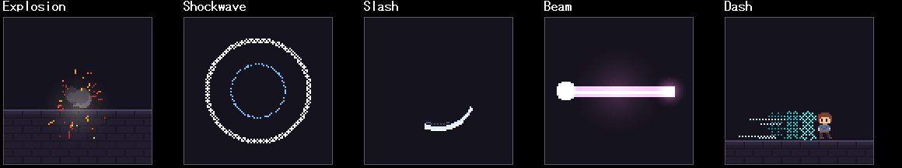
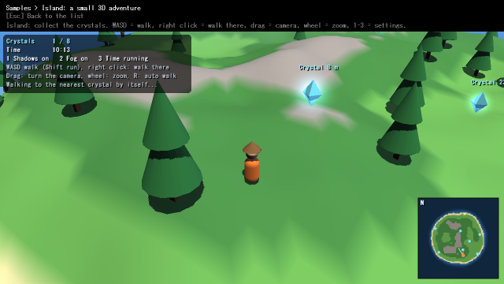

# 開発手順

## 構成と依存

実装前には、ローカルの開発文書と、対象機能および参考にするUnreal Engineの公式オンライン文書を必ず確認します。既存の仕組み、所有と寿命、実行順序、失敗条件を照合し、参照先と判断を関連文書へ残します。

`Library/Core`は値・コンテナ・インターフェース、`Library/Framework`はエンジンと資源の管理、`Library/Platform`はDxLibやSDLの実装、`Library/DebugUI`は編集画面、`Source`はアプリを持ちます（自己確認は`Source/SelfTest`へ置く別のリポジトリで、このリポジトリには含めません）。ジョブの共有状態とhandleは`Library/Core/Thread`、描画の共通契約値は`Library/Core/Render`、各実行側は`Library/Framework`や`Library/Platform`に置きます。

FrameworkからDxLibやImGuiの実装へ依存を追加せず、`IDrawExecutor`・`IAssetBackend`・入力など既存の窓口を使います。既存の型・所有・更新・終了処理を優先し、局所状態や単純な計算のためのsubsystemは作りません。

利用側と検査コードでは、コンテナ・文字列・スレッド・数値限界・型判定などに既存の`TArray`・`TMap`・`TSet`・`FString`・`FThread`・`TNumericLimits`・型特性を優先して使います。必要な機能がなければ、利用箇所ごとに標準ライブラリへ戻るのではなく、既存のCore/Framework構成に沿って必要最小限の共通実装を追加します。標準ライブラリやOS APIとの橋渡しは、既存の低層実装へ集約します。

物理の空間クエリ（レイ・重なり・形状の掃引）は、`Library/Core/Interfaces/Physics/IPhysicsQuery.h`の`IPhysicsQuery`から呼びます。形状・絞り込み・結果の型は`PhysicsQueryTypes.h`にあり、どちらも物理エンジンのヘッダーを含みません。実装は`CPhysicsSystem`（シーンでは`CPhysicsSubsystem`）で、`GetSubsystem<IPhysicsQuery>()`でも取れます。NaN・無限大・零ベクトル・0以下の距離や大きさは、何にも当たらなかった扱いで結果を空にします。メッシュの裏面は、レイと掃引では無視し、重なりでは数えます。

物理の衝突レイヤーは、`Library/Core/Interfaces/Physics/ICollisionLayers.h`の`ICollisionLayers`で決めます。剛体は`FRigidBodySettings::CollisionLayer`（または`FRigidBody::SetCollisionLayer`）で0〜31のレイヤーに入り、`SetLayerCollision( A, B, false )`のようにレイヤー同士がぶつかるかを表で決めます（初めはすべてぶつかり、表は対称です）。ぶつからない組は衝突判定も接触の通知も起きません。表やレイヤーを変えると、関係する眠っている剛体を起こします。空間クエリは`FPhysicsQueryFilter::LayerMask`（`NCollisionLayer::ToMask`を足し合わせる）でレイヤーを絞れ、衝突の表には左右されません。レイヤーの定数は`PhysicsLayerTypes.h`にあり、`IPhysicsQuery`と同じく物理エンジンのヘッダーを含みません。

物理の関節（拘束）は、`Library/Core/Interfaces/Physics/IPhysicsConstraints.h`の`IPhysicsConstraints`で作ります。`CreateConstraint( BodyA, BodyB, FConstraintSettings::Hinge( 位置, 軸, 最小, 最大 ) )`のように、固定（Fixed）・点（Point）・距離（Distance）・蝶番（Hinge）・スライダー（Slider）・円錐（Cone）をワールド座標で指定します（作った瞬間の姿勢が「ずれ 0」。`BodyB`が`nullptr`なら世界に固定）。作った`FPhysicsConstraint`（`Library/Physics/Constraint/PhysicsConstraint.h`）で、範囲・ばね・摩擦・モーター（速さ・位置）・有効／無効・現在の角度や位置を操作します。どちらのヘッダーも物理エンジンのヘッダーを含みません。実装は`CPhysicsSystem`（シーンでは`CPhysicsSubsystem`）で、`GetSubsystem<IPhysicsConstraints>()`でも取れます。既定ではつないだ剛体どうしは衝突しません（`bCollideConnected`）。剛体を破棄すると、その関節は外れて`IsAttached()`が`false`になり（入れ物は`DestroyConstraint`まで残る）、設定が不正な関節は作れず`nullptr`を返します。関節は壊れるようにもできます。`FConstraintSettings::BreakForce`（N）と`BreakTorque`（N·m）を設定すると、物理のステップの終わりに、関節が点や向きを保つためにかけている力かトルクがそれを超えたとき、関節は壊れて外れます（`IsBroken()`が`true`、`IsAttached()`が`false`。つないでいた剛体は起こされ、衝突に戻ります）。既定は壊れません。力は点をつなぐ力（Distanceは棒の力）、トルクは向きを保つ力（Fixed・Hinge・Slider・Cone）で、モーター・範囲の端・摩擦の力は含みません。作った直後の数ステップは、実際の荷重より大きな力が出ることがあるので、限界には余裕を持たせてください。壊れたことは`IPhysicsConstraints::AddConstraintListener`で登録した`IPhysicsConstraintListener::OnConstraintBroken( 関節, BodyA, BodyB, FConstraintBreakInfo )`で受け取れ（通知の中で剛体・関節を壊す、受け取り側を登録・解除してもかまいません）、いまかかっている力は`FPhysicsConstraint::GetAppliedForce()` / `GetAppliedTorque()`、限界は`SetBreakLimits`で後から変えられます。眠っている剛体の関節は荷重を測らないので壊れません。

操作するキャラクター（プレイヤーや敵）は、`Library/Core/Interfaces/Physics/ICharacterControllers.h`の`ICharacterControllers`で作ります。`CreateCharacter( 足元の位置, FCharacterSettings )`で縦向きのカプセルを作り（半径・高さ・登れる坂の角度・段差の高さ・床に吸いつく距離・体重・押す力・重力の倍率・衝突レイヤー）、作った`FPhysicsCharacter`（`Library/Physics/Character/PhysicsCharacter.h`）に、毎フレーム`SetMoveVelocity`で歩きたい水平の速さを渡し、`Jump`で跳びます。動かすのは物理の`Update`で、固定ステップごとに、重力・ジャンプ・坂（登れない角度）・段差・床への吸いつき・動く床に乗る・動く剛体を押す・他のキャラクターとぶつかる、までを行います。足元の状態（`GetGroundState`。`OnGround`・`OnSteepGround`・`NotSupported`・`InAir`）、足元の剛体、`SetHeight`（かがむ）、`SetPosition`（瞬間移動）なども使えます。キャラクターは、物理のワールドにキャラクターの形の運動学の剛体（`GetBody`）を持つので、空間クエリや接触の通知（トリガーなど）にも現れます。この剛体は`DestroyBody`では壊せず、`DestroyCharacter`で一緒に壊します。実装は`CPhysicsSystem`（シーンでは`CPhysicsSubsystem`）で、`GetSubsystem<ICharacterControllers>()`でも取れます。どちらのヘッダーも物理エンジンのヘッダーを含みません。

物理のデバッグ描画は、`Library/Core/Interfaces/Physics/IPhysicsDebug.h`の`IPhysicsDebug::DrawDebug( IPhysicsDebugDrawer&, FPhysicsDebugDrawSettings )`で、剛体の形・外接の箱・関節・キャラクターの足元の法線を線にして渡します（読むだけで、描いた線の本数を返します）。渡す先の`IPhysicsDebugDrawer`は線分1本の描画だけを持つ窓口で、画面に描くには`Library/Physics/DebugDraw/PhysicsDebugDrawContext.h`の`FPhysicsDebugDrawContext`が`FDrawContext::Line3D`へ橋渡しします。剛体の色は種類（動かない・キネマティック・動いている動的・眠っている動的・センサー・キャラクター）で変わり、`FPhysicsDebugDrawSettings`で種類ごとに描く・描かないを選べ、範囲（中心と半径）を絞れ、円の細かさや三角形の上限、色を変えられます。箱・球・カプセルは輪郭、凸包・三角形メッシュなどは三角形の辺で描きます。実装は`CPhysicsSystem`（シーンでは`CPhysicsSubsystem`）で、`GetSubsystem<IPhysicsDebug>()`でも取れます。

物理の接触の通知（ぶつかった・離れた・センサーに入った）は、`Library/Core/Interfaces/Physics/IPhysicsContacts.h`の`IPhysicsContacts::AddContactListener( IPhysicsContactListener*, FPhysicsContactFilter )`で登録します。受け取る側は`IPhysicsContactListener`を継承し、必要な関数だけ上書きします。たいていは、剛体の組ごとに1回届く`OnBodyContactBegin`（その組の接触が無い状態から有る状態になった）と`OnBodyContactEnd`（すべての接触が無くなった）で足ります。複合形状やメッシュは、1組の剛体でも接触する部位が複数ありますが、組としては1回ずつです。センサー（トリガー）の出入りも同じです。剛体が眠っても（物理エンジンは接触の終わりを知らせますが）End にはせず、触れたまま扱います。接触点ごとの通知（`OnContactAdded` / `OnContactPersisted` / `OnContactRemoved`）も届きます。接触の情報`FContactInfo`には、接触点・法線（AからBへ）・めり込み量に加えて、ぶつかる直前の法線方向の近づく速さ`ClosingSpeed`（衝撃音の大きさやダメージに使えます）があります。`FPhysicsContactFilter`で、特定の剛体が絡む通知だけ（`Body`）、どちらかの剛体のレイヤーが含まれる通知だけ（`LayerMask`）、毎ステップ届く継続の通知は要らない（`bPersisted`）を選べます。通知は物理の`Update`の中で固定ステップごとにメインスレッドから呼ばれるので、中で剛体を壊したり、受け取り側を登録・解除したりしてかまいません（壊した剛体は以降の通知に出ず、解除したものには以降届きません）。受け取り側は、破棄する前に`RemoveContactListener`で外してください。実装は`CPhysicsSystem`（シーンでは`CPhysicsSubsystem`）で、`GetSubsystem<IPhysicsContacts>()`でも取れます。どちらのヘッダーも物理エンジンのヘッダーを含みません。（以前の`CContactListener`は`IPhysicsContactListener`に置き換わりました。関数の形は同じです。）

帯と雷のUVディストーションは、既存の`Material.Distortion`を共有します。`FDrawDistortedMaterialRibbonData`を`FDrawContext::DistortedMaterialRibbon3D`で記録し、`IDrawExecutor::SupportsEffectRibbonUVDistortion()`で対応を問い合わせます。未対応実装の既定はfalseです。可変長命令の実行側は、固定部・点数・全長を検査してから点列を読みます。画像の取得と準備状態の固定は再生開始時に行い、描画の記録中には読み込みません。

メッシュ粒子は`FEffectMeshDefinition`と、再生開始時に作る`FEffectMeshGeometry`を使います。`FDrawContext::MaterialMesh3D`が96バイトの設定、ワールド座標の`FMeshVertex`、32bitの三角形indexを命令へ複写します。上限は1024頂点・3072 indexで、全長と全要素を検査してから追記します。描画時に呼出側のWorld行列を重ねません。`IDrawExecutor::SupportsEffectMaterialMesh()`の既定はfalseです。材質無効時も同じメッシュ形状を自己発光1・消失なし・UV移動なしで描きます。現在は照明を使わず、半透明・加算合成に対応します。GPU資源は既存の材質描画実装が所有します。

編集メッシュの材質効果は`FEditMeshMaterial::Effect`の`FMeshMaterialEffectDefinition`を使い、既存の`FMeshRenderer`が材質ごとの再生時計を所有します。画像と準備状態、分割済みの形状は生成時に固定して共有し、時計はコピーごとに独立します。`Update`で時間を進め、`Record`は状態を更新せず用意した資源だけを読みます。必要な画像がない効果はその材質全体を省略します。既定の効果は従来のJSONとハッシュに含めず、停止・無効時は通常のMesh3D命令へ戻します。

`MaterialMesh3D`の末尾引数`bUseRegularCulling`は既定falseで、従来の呼出元の描画状態を保ちます。編集メッシュの材質効果だけtrueを指定し、`UseRegularCulling` flagで通常メッシュの裏面除去設定を使います。命令番号・96バイトの設定形式は維持し、両面指定はどちらの方法でも裏面を描きます。GPUの状態は描画後に復帰します。

静的モデルの面データは、`IAssetBackend::GetStaticModelSurface`から位置・法線・UV0・頂点色・三角形・連続した材質範囲を取得します。位置はフレーム階層の変換を含み、モデル個体の配置変換を含みません。材質は拡散色とモデルが所有する借用画像ハンドルです。非対応・失敗時はfalseを返し、出力を変更しません。DxLib実装はアニメーション・形状変形・スキニングのない通常の静的モデルを対象にし（法線画像付きの頂点形式も現段階では対象外）、一時的なモデルの複製から抽出します。

`CModel::CreateStaticSurfaceSnapshot()`はメインスレッドで呼び、不変の`FStaticModelSurface`を返します。取得した値と元の`CModel`を共有所有するため、呼び出し側がモデルの参照を手放しても借用画像を使えます。画像を個別に削除したり、所有する`CTexture`に包んだりしません。利用中は元モデルとbackendの寿命を保ちます。頂点色は参照APIが返す値で、モデル形式によって材質色を含みます。保存した材質の拡散色を再び掛けません。現在の取得範囲は拡散材質までで、元の照明・透過判定・画像座標の変換・変形アニメーションの描画再現は含みません。モデル個体への材質効果は、以下の実行APIで準備します。

静的モデルの選択材質には、`FModelAnimator::PrepareMaterialEffect`で材質番号、既存の`FMeshMaterialEffectDefinition`、画像の読み込み関数、`IDrawExecutor`を渡します。一つのAnimatorに一つの材質を指定でき、`GetMaterialEffect()`から再生・一時停止・停止・再開を制御します。材質の時計はアニメーションの一時停止から独立し、既存のAnimator更新で一度進みます。個体ごとに`CModel::CreateInstance()`を呼んでください。rendererのコピーは不変資源を共有し、時計を値としてコピーします。Animatorをコピーした場合のモデル個体の共有は従来どおりです。

形状は準備時に`IAssetBackend::CreateModelMaterialGeometry`で分割保存し、`ModelMaterial3D`命令へ個体の配置行列12要素、形状handle、材質値、不透明度だけを固定長で記録します。設定部分は160バイト、命令全体は164バイトです。既存の命令番号と形式は維持します。`IDrawExecutor::SupportsModelMaterialEffects()`の既定はfalseです。準備失敗・非対応・停止・元モデルの不一致・アニメーションを付けた個体は従来のモデル描画を使います。効果再生中の非有限行列は記録を抑止します。記録中には画像の読み込みや準備状態の問い合わせを行いません。形状の解放は既存のAsset serviceを使い、別スレッドからの解放はメインスレッドまで延期します。

ワールドのModelには、任意の`FWorldModelMaterialEffect`を`FWorldModel::MaterialEffect`へ保存できます。材質番号、既存の`FMeshMaterialEffectDefinition`、両面指定を持ち、JSONでは`Model.MaterialEffect`の`MaterialIndex`・`Effect`・`TwoSided`になります。未設定なら従来のModel JSONを変えず、設定済みで効果を無効にした場合も編集値を保持します。型違いや整数の範囲外は不正状態として保存・再読み込み後も残し、`ValidateWorld`が対象オブジェクトと項目を報告します。モデルの実際の材質数や静的形状の対応は、配置時の準備で確認します。

`NWorld::Spawn`は有効な設定だけを既存の同期アセット読み込みと`FModelAnimator`へ渡します。`CScene::GetDrawExecutor()`はシーンの差し替え先を優先し、未設定ならアプリの描画先を借用します。非対応の描画先、アニメーションを結び付けた個体、画像・形状の準備失敗では、材質番号と原因を警告して通常のモデル描画を残します。停止時も通常描画へ戻り、別個体の時計や表示へ影響しません。保存したワールドをゲームで使う経路に対応し、編集画面では以下の個体別プレビューを使います。モデル用Inspectorでの設定と再生操作は後述します。

ワールドのモデルプレビューは`FWorldEditorState::ModelPreviews`が所有します。`FWorldEditorModelPreviewKey::ObjectIds`は、最上位のPrefab配置から入れ子の配置を経てモデルへ至るIDの全列です。通常のモデルは自分のIDだけを持ちます。キーは列の長さと全要素で比較し、同じPrefab内の同じIDでも配置元が違えば別の個体と時計になります。共有する`FAssetEditorInfo`のモデル個体は変更せず、元モデルから作った専用の`CModelInstance`と`FModelAnimator`を各配置が保持します。

`UpdateModelMaterialPreviews`はメインスレッドで配置を巡回し、画像・形状の準備と再生時間の更新を記録前に済ませます。設定、元モデル、読み込み完了状態、描画先と対応状態が変わったときだけ再構築し、失敗も同じ入力で繰り返し準備しません。設定の比較はハッシュだけで判断せず、不正な値も安定して比較します。`FAssetEditorInfo::GetModelSource`は既存キャッシュの元モデルを読み込み途中でも返し、失敗時は空を返します。元モデルが準備できたら専用個体の準備を再開できます。

`RecordModelObject`は準備済みの個体だけを読み、読み込みや再準備を行いません。停止・効果の無効化・非対応・効果の準備失敗では同じ個体の通常描画を使い、二重には記録しません。アニメーション集の補正、クリップと速度もゲーム配置と同じ順序で設定します。アニメーションが結び付いた個体の材質効果は未対応で、通常のアニメーション描画へ戻ります。非表示・削除された配置は更新時に解放し、ワールドの切り替え・新規作成・アセットの再読込・終了でもキャッシュより先に専用個体を解放します。

World EditorのModel Inspectorでは、任意の材質効果の追加・削除、材質番号、両面指定と、Meshと共通の材質パラメータ・曲線を編集します。追加直後の効果は無効です。無効中も編集値を保ち、`Reset binding`は型不正の印も含めて設定全体を初期化します。保存値の変更は既存のWorld文書とUndo／Redoへ渡し、連続入力は配置ごとの編集キーでまとめます。

材質一覧は枠番号、拡散色、元画像の有無、使うsection数を表示します。範囲外の番号は保存値を保持して問題を示します。`FAssetEditorInfo::PrepareModelSurface(Path)`はInspectorより前にメインスレッドで呼び、読み込み完了後の静的面取得を成功・失敗とも一度だけ試します。`FindPreparedModelSurface(Path)`は用意済みの値だけを読み、読み込みや準備状態の問い合わせをしません。`Clear()`で取得状態を破棄します。snapshotは元モデルを保持し、借用画像の寿命を支えます。

`Placement preview transport`は選択した配置の専用Animatorだけを操作します。Play／Pause／Stop／Restartは保存値や編集履歴を変えません。最新のModel設定と準備済みの値が異なる間は古い個体の操作を受け付けず、次の記録前更新を待ちます。準備待ち・非対応・失敗理由は同じ欄に表示します。

DxLibでは個体の選択meshだけを一時非表示にし、残りを通常のモデルとして描きます。まとめ描画を確定してから可視状態を戻し、元のローカル形状へ配置行列を一度掛けて選択材質を描きます。元の拡散色を頂点色へ二重適用せず、不透明度は頂点alphaへ一度掛けます。効果は照明を使わないLDRのAlpha/Addで、消失・自己発光・UV移動・ゆがみを使えます。元の材質の照明・画像変換・透過判定の完全再現は含みません。通常部分の描画順を保ちますが、効果面はその後に描くため、通常の半透明面との完全な相対順序は保証しません。変形するモデル、HDRとブルームは後続の範囲です。

準備・非対応・事前検査の失敗は通常モデルへ戻します。GPU描画の途中に失敗した場合は、描けなかった分割形状を省略して警告を一度記録します。成功した形状へ重ね描きする全体の再描画は行いません。backendの終了は、利用中のモデル・画像・効果資源を片付けてから行ってください。確認用の`CAssetSubsystem::SetBackendOverride`は、既存のモデル・画像・効果資源と遅延解放を全て片付けてから切り替えます。

オブジェクトの描画は、DX12のコマンドリストと同じ方式です。`CGameObject::Draw( FDrawContext& CommandList )`は、シーンが用意したコマンドリストに、`CommandList.Box(...)`などで「何を描くか」を記録するだけで、DxLibも実行先（`IDrawExecutor`）も知りません。シーンはオブジェクトごとにコマンドリストを空にして渡し（Reset）、記録されたものを描画順（`DrawOrder`）に実行する（ExecuteCommandLists）ので、ブレンドモードなどの状態は次のオブジェクトに漏れません。何も記録しなかったオブジェクトは、実行先を呼びません。

シーンの`OnDraw`、ゲームインスタンスの`OnDraw`など、オブジェクトの外から描くときは、DxLibを直接呼ばず`Library/Framework/Render/Draw/ImmediateDraw.h`の`FImmediateDraw`を使います。`FImmediateDraw Draw( GetDrawExecutor() );`と書くと、`FDrawContext`と同じ関数（`Box / Circle / Line / Text / Sprite`など）で描け、`Flush()`かスコープを抜けるときに、記録した順に`IDrawExecutor`で実行します。実行はメインスレッドで、描いたものがなければ実行先を呼びません。実行先が`nullptr`なら、描いたものは捨てます。

2Dの図形は、DxLibの関数と同じ形で書けます。整数の座標の`Pixel / Triangle / Quad / Oval / RoundBox`（と`Box / Circle / Line`）は`DrawPixel / DrawTriangle / DrawQuadrangle / DrawOval / DrawRoundRect`などに対応し、画素ちょうどで描きます。ゆっくり動くものや傾いた図形には、アンチエイリアス付きで`float32`の座標を取る`LineAA / BoxAA / CircleAA / OvalAA / TriangleAA / QuadAA / RoundBoxAA`を使います（`DrawLineAA`などに対応。DxLibの仕様で縁が半径の外へ約0.5ピクセルにじむので、円と楕円は整数版と同じ大きさに見えます）。円・楕円・角の丸みの`NumSegments`は何角形で近似するかで、0（既定）なら半径（楕円と角の丸みは大きいほうの半径）から、誤差が1/4ピクセル以下になる4の倍数（12〜256）を決めます。NaN・無限大・絶対値が1e7を超える座標・負の半径・0以下の太さは記録しません。見本は`Samples`の`Shapes`です（`Samples.exe --sample=Shapes`）。

2Dの画像は、`CommandList.Image( X, Y, Texture )`のように、画像（`TSharedPtr<CTexture>`・ポインター・参照のどれでもよい）を渡して描きます。画像は`Library/Core/Interfaces/Render/IImage.h`の`IImage`（`CTexture`が実装）か、型付きのハンドル`FImageHandle`で渡し、DxLibのハンドル（`int`）は公開しません。`nullptr`や無効な画像は、何も記録しません。引数の順番はDxLibに合わせてあります。`Image`（`DrawGraphF`。`bFlipX / bFlipY`で反転）、`ImageStretch`（`DrawExtendGraphF`。`X0 > X1`で反転）、`ImageQuad`（`DrawModiGraphF`。画像の左上・右上・右下・左下の行き先）、`ImagePart / ImagePartStretch / ImagePartQuad`（`DrawRectGraphF`などの、画像の一部分版）、`SpritePivot`（`DrawRotaGraph3F`。基準点・縦横別の拡大・回転・反転。反転しても基準点は動かない）、`Tile`（`DrawTile`。画像の左上を矩形の左上に合わせ、`OffsetX / OffsetY`だけ右下へずらす。DxLibの`DrawTile`は拡大した画像の中心を矩形の中心に置くので、実行のときに補正しています）、`CircleGauge`（`DrawCircleGaugeF`。真上から時計回りに`Fraction`（0〜1）だけ描く。描き始めの位置は`StartFraction`で、1を超えると先頭へ回り込む。DxLibのゲージは、画像の中心を中心とする円を描きます）。NaN・無限大・絶対値が1e7を超える座標・切り出す矩形の大きさが0以下・拡大率が0以下などは記録しません。見本は`Samples`の`Images`です（`Samples.exe --sample=Images`）。

描画の状態は、`CommandList.Blend( EDrawBlend::Add )`のように、記録して変えます。状態は、そのオブジェクトの`Draw`（1回の実行）が終わると、実行の前の値に戻るので、次のオブジェクトに引き継がれません。同じ`Draw`の中では続くので、使い終わったらその場で戻します。
- `Blend( Mode, Param )`（`SetDrawBlendMode`）: `Opaque / Alpha / Add / Subtract / Multiply`に、`Invert / MultiplyAlpha / PmaAlpha / PmaAdd / PmaSubtract / PmaInvert`を足しました（`Pma`は乗算済みアルファ用）。`Param`（0〜255。範囲の外は収める）は`Alpha`などの強さです。`GetBlendMode()`は、最後に記録した種類を返します。
- `CustomBlend( FCustomBlend )`（`SetDrawCustomBlendMode`）: 描く色（Src）と下の色（Dest）に掛ける係数（`EDrawBlendFactor`の11通り）と、組み合わせ方（`EDrawBlendOp`の足し算・引き算・小さいほう・大きいほう）を、色とアルファで別々に決めます。例: スクリーン合成は`SrcColor = One`、`DestColor = InvSrcColor`、`ColorOp = Add`。範囲の外の値は記録しません。
- `AddColor( R, G, B )`（`SetDrawAddColor`）: 描く色（図形も画像も）に足す色です。各成分は-255〜255（負なら引く）。`Tint`で掛けたあとに足されます。
- `AlphaTest( Compare, Reference )` / `AlphaTestOff()`（`SetDrawAlphaTest`）: 描く色のアルファ（画像の画素ごとの透明度と`Blend`の`Param`）を`Reference`と比べ、成り立つ画素だけを描きます。切り抜きの縁を半透明にしたくないときなどに使います。DxLibの`DX_CMP_NEVER`は何も止めないので、`Never`は「アルファ < 0」で代用しています。
- `Filter( EDrawFilter )`（`SetDrawMode`）: 画像を拡大・縮小・回転して描くときの色の決め方です。`Nearest`（既定。ドット絵向き）、`Bilinear`（なめらか）、`Anisotropic`（2Dの平らな描画では`Bilinear`と同じ）。
- `PushClip( X0, Y0, X1, Y1 )` / `PopClip()` / `FClipScope`（`SetDrawArea`）: 描ける範囲を絞ります。右と下の端は含みません。入れ子にすると、いまの範囲との共通部分になり、`PopClip`で1つ前に戻ります。`FClipScope`はスコープを抜けるときに`PopClip`します。共通部分が空（幅か高さが0以下）のあいだは、図形・画像・文字などの描く命令は飛ばし、状態を変える命令だけを実行します。クリップは画面の座標で決まり、`Transform2D`には影響されません。
- `Transform2D( Matrix )` / `ResetTransform2D()`（`SetTransformTo2D`）: 2Dの描画（図形・画像・文字）に掛ける変換です。行ベクトル（左から順に掛かる）で、アフィン変換だけ（最後の列は無視）。続けて呼ぶと置き換わります（掛け合わさりません）。拡大・回転・移動する2Dのカメラを、行列1つで作れます。DxLibには現在の2Dの変換を取る関数がないので、実行の終わりには、実行の前の値ではなく、変換なしに戻します。

NaN・無限大・絶対値が1e7を超える値、範囲の外の列挙型の値は記録しません。実行の終わりに戻す値は、DxLibに取得関数があるもの（加算する色・アルファテスト・描画モード・クリップ範囲・ブレンド・明るさ・3Dの図形の変換）は実行の前の値、ないもの（2Dの変換）は既定の値です。見本は`Samples`の`DrawState`です（`Samples.exe --sample=DrawState`）。

描画先（レンダーターゲット）は、描き込める画像です。`Assets->CreateRenderTarget( "Minimap", Desc )`で作ります（`FRenderTargetDesc`: 幅・高さは1〜16384、`bAlpha`でアルファチャンネル（描いていない所を透明のまま残す）、`bDepth`でZバッファ、`MultiSamples`でマルチサンプル、`Format`で1チャンネルの形式（`Color8`（既定）・`Float16`・`Float32`）、`Channels`でチャンネルの数（4。浮動小数点なら1・2も）。作れない値は`nullptr`）。同じ名前・同じ設定なら共有し、最後の参照が消えると自動で解放します。`CRenderTarget`は`CTexture`でもあるので、描いたあとは`IImage`として、ふつうの画像と同じく`CommandList.Image( X, Y, Minimap )`などで画面や別の描画先へ貼れます。
- 描く: `FTargetScope Scope( CommandList, Minimap );`のスコープの中だけ、描く先が替わります（`PushTarget` / `PopTarget`でも同じ。入れ子にできます）。替えた先は、クリップ範囲なし・2Dの変換なしから始まり、戻ると、替える前の範囲・変換に戻ります。ブレンドなどの状態と3Dのカメラは、替えても変わりません。そのオブジェクトの分が終わると、`PopTarget`が足りなくても、始める前の描画先に戻ります。描画先にできない画像（ふつうの画像）を渡すと、対の`PopTarget`まで、描く命令を飛ばします（元の描画先へ描いてしまいません）。
- `Clear( 色 )`: いまの描画先の全体を、色とアルファのまま塗りつぶします（既定は透明な黒）。DxLibの`ClearDrawScreen`と同じく、クリップ範囲やブレンドには関係なく、全体を塗ります。
- `CopyScreen( X0, Y0, X1, Y1, 画像 )`（`GetDrawScreenGraph`）: いまの描画先の矩形を、同じ大きさの描画先へ写します（大きさが違う・矩形が描画先の外へはみ出す場合は、何もしません）。画面全体の一部を写すときは、画面（バックバッファ）が描画先のときに使います。
- 読む・保存する: `ReadPixels( X, Y, 幅, 高さ, 出力 )` / `ReadPixel( X, Y, 色 )`は画素（`FColor32`。アルファを持たない描画先は255）を、`Save( パス, FImageSaveOptions )` / `SaveRegion( ... )`はファイル（Png・Bmp・Jpeg。Pngだけ透明度も残る。途中のフォルダーは作ります）を作ります。矩形が描画先の外へはみ出す場合は`false`です。描画は「記録 → 実行」なので、読む・保存するのは、描いたもの（オブジェクトの`Draw`）が実行されたあと（次の`Tick`など）にします。どちらも、メインスレッドだけです。
見本は`Samples`の`RenderTarget`です（`Samples.exe --sample=RenderTarget`。ミニマップへ描き、貼り、画面の一部を写し、色を読み、Sキーで保存します）。

CPU側の画像（`FPixelImage`）は、画素の並びを持つ値です（DxLibに依存しません）。`FPixelImage Canvas( 64, 64, FColor32( 0, 0, 0, 255 ) );`で作り、`Get / Set`（範囲の外を読むと透明な黒、書くと何もしません）、`Fill / FillRect`、`Blit`（別の画像の矩形を重ねます。`EPixelBlend::Copy`は置き換え、`Alpha`は乗算されていないアルファの`over`で半透明を混ぜます。はみ出す分は切り、自分自身から重ねてもかまいません）、`Crop`、`FlipHorizontal / FlipVertical`が使えます。大きさは1〜16384（画素の総数は64Mまで）で、範囲の外の大きさは空の画像（`IsValid()`が`false`）になります。
- 画像にする: `Assets->CreateDynamicTexture( "Canvas", Canvas )`で`CDynamicTexture`（`CTexture`でもあるので、そのまま貼れます）を作り、`Update( Canvas )`で中身を替えます（同じ大きさだけ。ハンドルは変わらないので、貼ってある場所は全部、新しい絵になります）。毎フレームの更新は、数百ピクセル四方までの画像に向きます。透明な画素の色も、そのまま入ります。
- ファイルとの行き来: `LoadPixelImage( パス )` / `DecodePixelImage( バイト列, 大きさ )`（PNG・BMP・JPEGなど。透明度を持たない形式は不透明。読めなければ空の画像）と、`SavePixelImage( 画像, パス, FImageSaveOptions )`があります。DxLibは、途中で切れたPNG・BMP・JPEGを渡すと範囲外を読んで落ちるので、渡す前に、構造が最後まであるかを確かめ、壊れたものは空の画像にします。
- 描画先から: `CRenderTarget::ReadPixelImage()`で、描画先の全体をCPU側の画像にできます。
- 分ける（`LoadDivGraph`相当）: `Assets->SplitTexture( 画像, Grid )` / `LoadTextureGrid( パス, Grid )`は、格子（`FSpriteSheetGrid`。余白・隙間・コマの大きさ・並べ方）で分けた、1コマずつの画像の並びを返します。元の画像を共有する派生画像なのでメモリは増えず、元の画像は、派生画像が残るあいだ保たれます。画像の外へはみ出すコマは`nullptr`です。
見本は`Samples`の`Pixels`です（`Samples.exe --sample=Pixels`。画素を毎フレーム書いて画像を更新し、半透明の光を重ね、シートを分け、Sキーで保存して読み直します）。

画像の処理（フィルター・混ぜる）とマスクは、描画の命令として記録します。記録した順に実行されるので、描いたあとの描画先に掛けることも、掛けた画像をそのあと描くこともできます。描画先・クリップ・ブレンド・明るさ・2Dの変換には影響されず、変えもしません（空のクリップ範囲の中や、描画先にできない画像へ替えたあいだも、実行されます）。
- フィルター（`GraphFilter`）: `CommandList.ApplyFilter( Source, Dest, FGraphFilter::Gauss( 16, 300 ) )`は、Sourceにフィルターを掛けた結果をDestへ出します（Sourceは変わりません。Destは描画先`CRenderTarget`でも、ふつうの画像`CDynamicTexture`でもかまいません。大きさが違うと、拡大・縮小はせず、左上から重なる分だけが出ます）。`ApplyFilter( Target, Filter )`はその場で掛けます。`ApplyFilterRect( Source, 矩形, Dest, 位置, Filter )`は矩形つきです。`bAlphaBlend`を`true`にすると、結果をDestの中身にアルファブレンドで重ねます（既定は置き換え）。切り出した画像（`SplitTexture`）にも使えます（元の画像のその範囲だけが変わります）。
- 種類（`FGraphFilter::`）: `Mono`（単色化）、`Gauss`（ぼかし）、`DownScale`（縮小。Destは元の1/Divisorの大きさ）、`BrightClip`、`BrightScale`、`HsbRelative` / `HsbAbsolute`（色相・彩度・明るさ）、`Invert`、`Level`（レベル補正）、`TwoColor`（2階調化）、`GradientMap`、`Replacement`（色の置換）、`PremultiplyAlpha` / `UnpremultiplyAlpha`、`BicubicScale` / `Lanczos3Scale`（指定の大きさへ）、`FloatColorScale`。DxLibは範囲の外の引数でも失敗を返さず、おかしな結果にする（例: レベル補正のガンマが0以下だと真っ暗）ので、引数は作るときに範囲へ収めます。乗算済みアルファの画像には、`bPremultiplied`を`true`にします（`BrightClip`・`BrightScale`・`Hsb`・`Invert`・`Level`・`TwoColor`・`GradientMap`・`Replacement`だけ）。
- 画面そのもの（`DX_SCREEN_BACK`）には`GraphFilter`が効きません。画面全体に掛けたいときは、描画先へ描いて（`FTargetScope`）、その描画先にフィルターを掛けて、画面へ貼ります。
- 混ぜる（`GraphBlend`）: `CommandList.BlendImages( Base, Overlay, Dest, FGraphBlend::Make( EDrawGraphBlend::Multiply, 255 ) )`は、2枚の画像を混ぜてDestへ出します（Destが Base と同じなら、その場で）。`Normal`・`Multiply`・`Add`・`Screen`・`Difference`（引き算）・`Overlay`・`NormalAlphaCh`（アルファつきの通常合成）・`Mask`など。出力の成分を選ぶ`FGraphBlend::SelectMix`もあります。
- マスク（`SetMaskScreenGraph`）: `FMaskScope Scope( CommandList, MaskImage )`の中の描画は、マスクの画像の値で薄まります。マスクの画像は、アルファを持つ描画先（`CRenderTarget`の`bAlpha`が`true`。ふつうの画像は使えず、実行のときはマスクなしで描かれます）で、図形・画像・文字は、ふつうの描画（`FTargetScope`）で作ります。値が大きいところほど濃く描かれ（0で描かれず、255でそのまま）、段階的に効きます。`EDrawMaskChannel`でアルファ・赤・緑・青のどれをマスクの値にするかを、`bInvert`で向きを選べます。マスクの画像は、描画先の左上を合わせて使い、その外は値が255として扱われます。入れ子にすると、内側のマスクが外側に替わります（重なりません）。替えた先の描画先（`PushTarget`）はマスクなしから始まり、戻すと元のマスクに戻ります。そのオブジェクトの分が終わると、マスクは解除されます。
見本は`Samples`の`Filters`です（`Samples.exe --sample=Filters`。1枚の画像にフィルターと混ぜ方を並べ、動くスポットライトの形のマスクで絵を見せます）。

文字とフォントは、`Assets->GetDefaultFont( 24, Style )`（`LoadSystemFont`・`LoadFontFile`も同じ）で作る`CFont`で扱います。`FFontStyle`では、太さ（`Thickness`）・縁取り（`EdgeSize`。縁の色は描くときの`EdgeColor`）・斜体（`bItalic`）に加えて、アンチエイリアスの段階（`Antialias`: `None / Standard / High4x4 / High8x8 / High16x16`）、字間（`LetterSpacing`。全部の文字の幅に足す。負の値で詰める）、行の送り幅（`LineHeight`。-1は1行の文字の高さ）を選べます。指定が1つでも違えば別のフォントとして作り、同じ指定は共有します。
- 測る: `GetMetrics()`は、フォントを作るときに測った寸法（`Size`・`GlyphHeight`（1行の文字の高さ）・`LineHeight`・`Ascent`・`MaxWidth`・`EdgeSize`・`LetterSpacing`）を返します。作ったあとは変わらないので、描画システムの中（オブジェクトの`Draw`）から読んでかまいません。`MeasureWidth`は幅、`MeasureSize`は幅・高さ・行数です（複数行の高さは「(行数 - 1) x 行の送り幅 + 1行の文字の高さ」。空の文字列は0行で、末尾の改行のあとも1行と数えます）。`GetGlyphs`は、文字ごとのバイト位置・幅・位置を返します。`MeasureWidth / MeasureSize / GetGlyphs / Layout`はDxLibを呼ぶので、メインスレッドで呼びます。
- 折り返す: `Layout( 文字列, FTextLayoutOptions )`は、箱の幅（`MaxWidth`。0以下なら折り返さない）に収まるように行へ分けた`FTextLayout`を返します（`MaxLines`で行数を切ると`bTruncated`が`true`）。改行（LF）で段落を分け、英単語は空白で、漢字・かななどは1文字ごとに折り、箱より長い単語は途中で折ります。行末の空白は幅に数えず、折り返した次の行の頭の空白は読み飛ばします。`bAvoidPunctuationAtLineEdges`（既定は`true`）では、句読点・閉じ括弧・小さいかななどを行頭に、開き括弧を行末に置きません（折る位置が無いときは、行の端にはみ出して、ぶら下げます）。文字を測るので、`Tick`などで`Layout`を作っておき、`Draw`の中では`RecordLayout( CommandList, Layout, X, Y, 箱の幅, 色, 位置揃え )`で記録します（こちらは測りません）。`RecordWrapped / DrawWrapped`は、折り返しと記録を1度に行います。折り返しの計算は`Library/Framework/Text/TextLayout.h`の`NTextLayout::Build`にあり、DxLibに依存せず（`ITextMeasurer`が文字の幅を渡す）、単体で確かめられます。
- 飾る: `RecordStyled( CommandList, X, Y, 文字列, 色, FTextStyle )`（DxLibの`DrawRotaStringFToHandle`）は、小数の位置に、拡大（`ScaleX / ScaleY`）・回転（`AngleRadians`。時計回り）・縦書き（`bVertical`）・影（`bShadow`・`ShadowColor`・`ShadowOffsetX / Y`）を付けて描きます。`AnchorX / AnchorY`は、文字列の大きさに対する割合（0〜1）で、(X, Y)に置く点を選びます。拡大と回転も、その点が中心です。縦書きは、上から下へ並べ、改行で左の列へ進み、(0, 0)は列の右上です。拡大が0以下の値、NaN・無限大は記録せず、`false`を返します。
- 文字の代わりの画像: `Font->AddCharImage( "@", Icon, 幅 )`で、その1文字を画像に置き換えます（そのフォントだけに効きます）。`TSharedPtr<CTexture>`で渡すと、フォントが画像を持ち、`RemoveCharImage`かフォントの破棄まで手放しません。`IImage`で渡す版は、持ち主が手放さないでください。
- 環境のフォント: `Assets->IsFontAvailable( "Arial" )`と`GetSystemFontNames()`で、使えるフォントを調べられます。
- 包んでいないもの: `DrawFormatString`系（書式付きは`TextF`）、`AddSubstitutionFontToHandle`（Windowsのフォントリンクが先に効くため、実測で変化がありません）、字の組み合わせごとの詰め（カーニング）、`FontCacheStringDraw`（文字を画像にする）、フォントデータ（.dft）の読み込み。必要になったら足します。
見本は`Samples`の`Text`です（`Samples.exe --sample=Text`。フォントの指定を1つずつ変えた行、幅の動く箱への折り返し、拡大・回転・影・縦書き・文字の代わりのアイコン）。

3Dのカメラは、`Library/Framework/Render/Camera/Camera.h`の`FCamera`（見る位置`Position`・見る点`Target`・上の向き`Up`・射影`Projection`（`Perspective` / `Orthographic`）・縦の視野角`FovY`・正射影の縦の長さ`OrthoHeight`・`Near` / `Far`・横の拡大率`HorizontalStretch`・光軸が通る画面の点のずれ`ScreenOffset`）で表します。DxLibに依存しない値と計算で、`FCamera::MakePerspective( 位置, 見る点, 視野角 )` / `MakeOrthographic( 位置, 見る点, 縦の長さ )`で作ります。左手系・Y上で、`IsValid()`が`false`になる値（NaN・無限大、`0 < Near < Far`でない、視野角が0以下かπ付近、位置と見る点が同じ、上の向きが見る向きと平行）は、描画に渡しません。
- 使う: `FCameraScope Scope( CommandList, Camera );`（`PushCamera` / `PopCamera`でも同じ。入れ子にできます）の中の3Dの描画（`Sphere3D`・`Cube3D`・`Line3D`・モデルなど）が、そのカメラで見えます。カメラを替えるのはDxLibのカメラ（大域の状態）なので、`Draw`が終わると、`PopCamera`が足りなくても、始める前のカメラに戻ります。光軸が通る画面の点は、実行のときの描画先の大きさで決まり（描画先を替えたら、その描画先の中心。戻すと、元の画面の中心）、`ScreenOffset`の分だけずらせます。使えない値のカメラは、何も記録せず`false`を返します。
- 計算（DxLibを呼ばない）: `GetViewMatrix()` / `GetProjectionMatrix( FCameraViewport )`（DxLibの`GetCameraViewMatrix` / `GetCameraProjectionMatrix`と同じ。奥行きは`Near`で0、`Far`で1）、`WorldToScreen( Viewport, 世界の点, 画面の座標, &奥行き )`（`ConvWorldPosToScreenPos`と同じ。カメラの後ろ・`Near`より近い・`Far`より遠い点は`false`）、`ScreenToWorld( Viewport, 画面の座標, 奥行き, 世界の点 )`、`ScreenToRay`（画面の点を通る光線。始まりは`Near`の面の上。マウスで物を選ぶのに使えます）。画面の座標は、描画先の左上が(0, 0)、単位はピクセルで、描画先の大きさを`FCameraViewport`で渡します。
- 視錐台: `GetFrustum( Viewport )`の`FFrustum`が、点・球・軸に平行な箱との交差（`ContainsPoint` / `IntersectsSphere` / `IntersectsBox`）を答えます。見えない物を描かない（カリング）のに使えます。点の判定は、DxLibの`CheckCameraViewClip`と同じ答えで、箱は、見えるものを外とは言いません（保守的）。
見本は`Samples`の`Camera`です（`Samples.exe --sample=Camera`。マウスの左ボタンを押したまま動かすと回り、ホイールで近づき、Pで透視射影と正射影を切り替え、Q / Eで視野角を変えます。上から見下ろす2つ目のカメラを別の描画先へ描き、右下に貼ります）。

3Dの描画状態（深度バッファ・カリング・画像の貼り方・フォグ・異方性）は、`FDrawContext`に記録します。値は`Library/Framework/Render/State/RenderState3D.h`の`FDepthState` / `FFogSettings` / `FTextureTransform`で、DxLibに依存しません。どれも、そのオブジェクトの分（1回の`Draw`）が終わると、始める前の状態に戻ります。使えない値（範囲の外の種類、NaN・無限大など）は、何も記録しません。
- 深度バッファ: `Depth( FDepthState )`（`SetUseZBuffer3D` / `SetWriteZBuffer3D` / `SetZBufferCmpType3D` / `SetZBias3D`）。比べるか`bTestDepth`・書くか`bWriteDepth`・比べ方`Compare`（`EDrawCompare`。既定は`LessEqual`）・偏り`Bias`（負の値は手前に寄る。±`MaxBias`に収める）。`FDepthState::ReadOnly()`は半透明の物に（手前の物には隠れるが、あとの物を隠さない）、`Disabled()`は空や画面の飾りに使います。`ClearDepth()`（`ClearDrawScreenZBuffer`）は、いまの描画先の深度バッファを全体消します。ここまでに記録した3Dは、消す前の深度で描き終えてから消し（DxLibは3Dを溜めて描くので、先に描き出します）、クリップ範囲や描画範囲に関係なく全体を消します。手前に描く物（一人称の武器など）を、奥の物に隠されないよう、あとから描くときに使います。
- カリング: `Culling( EDrawCulling )`（`SetUseBackCulling`）。表は、画面で頂点が時計回りに見える面です。`BackFaces`は裏（反時計回り）を描かず、`FrontFaces`は表を描かず、`None`は両面を描きます。
- 画像の貼り方: `TextureAddress( U, V )`（`SetTextureAddressModeUV`。`Wrap`は繰り返す・`Mirror`は折り返す・`Clamp`は端を伸ばす・`Border`は外を描かない）。`TextureTransform( FTextureTransform )`（`SetTextureAddressTransform`）は、面の画像の位置・拡大・回転を動かします（水面や雲を流すときに）。UVは、回転（`RotationCenter`のまわり。正なら画面で反時計回り）→ ずらす（`Translation`）→ 拡大（`Scale`。原点から）の順に動きます（`Apply( UV )`が同じ計算）。何も変えない変換と`ResetTextureTransform()`は、変換をやめます。画像を拡大・縮小するときの色の決め方は、これまでの`Filter`（`Nearest` / `Bilinear` / `Anisotropic`）が、3Dの面にも効きます。`Anisotropy( 1〜16 )`（`SetMaxAnisotropy`）は、`Anisotropic`のときだけ効き、斜めから見た面の画像が、遠くでぼやけにくくなります。
- フォグ: `Fog( FFogSettings )`は距離（視点からの奥行き）、`HeightFog( FFogSettings )`は高さのフォグです。`FFogSettings::MakeLinear( 色, 始まり, 終わり )` / `MakeExponential( 色, 密度, 始まりの高さ )` / `MakeExponentialSquared`、`Off()`で作ります。距離のフォグは、直線なら奥行き`Start`で0・`End`で1、指数は`1 / exp( 距離 x 密度 )`（指数の2乗は`1 / exp( ( 距離 x 密度 )^2 )`）です。高さのフォグは、直線なら高さ`Start`で0・`End`で1（`End`のほうが低くてもよい）、指数は、高さ`Start`より下で、低いほど濃くなります。球・箱・カプセル・画像を貼った四角形・メッシュ・モデルに掛かり、**三角形（`Triangle3D`）・線（`Line3D`）・ビルボード（`Billboard3D`）には、DxLibの仕様で掛かりません**。
- 3D図形の変換の積み重ね: `PushWorldMatrix( 自分の変換 )` / `PopWorldMatrix()`（`FWorldMatrixScope`）は、`WorldMatrix`で置いた変換（または、積んだ変換）に、自分の座標 -> 親の座標の順に掛けます（腕・肩・肘・手のような入れ子に）。積んだ数より多く戻しても、何も起きません。`Draw`が終わると、戻さなくても変換なしに戻ります。

見本は`Samples`の`RenderState`です（`Samples.exe --sample=RenderState`。数字キーの1〜8で、ガラスの深度・部屋のカリング・距離のフォグ・足元の霧・地面のフィルターと異方性・水面の流れ・光線の深度の消去を切り替えます。マウスの左ボタンを押したまま動かすと回り、ホイールで近づきます）。

3Dのライティング（光）も、`FDrawContext`に記録します。値は`Library/Framework/Render/State/Lighting.h`の`FLight` / `FSurfaceMaterial` / `FLightingOptions`で、DxLibに依存しません。どれも、そのオブジェクトの分（1回の`Draw`）が終わると、始める前の状態に戻ります。使えない値（NaN・無限大、向きの長さ0、`Range`が0以下など）は、何も記録しません。何も記録しなければ、DxLibの既定の見た目（最初からある白い方向ライト1つ）のままです。光を受ける図形は、球（`Sphere3D`）・箱（`Cube3D`）・カプセル（`Capsule3D`）・画像を貼った四角形（`Quad3D`。見ている人の側が表）で、**三角形（`Triangle3D`）と線（`Line3D`）は、光を受けません**。
- ライト: `FLightScope Lamp( CommandList, FLight::MakePoint( 位置, Range, 色 ) );`（`PushLight` / `PopLight`でも同じ。入れ子にできます）の中の図形が、そのライトでも照らされます。種類は、方向ライト（`MakeDirectional( 光が進む向き, 色 )`。太陽・月。距離で暗くならない）、点光源（`MakePoint`。距離とともに暗くなり、`Range`より遠くには届かない）、スポットライト（`MakeSpot( 位置, 向き, 外側の角度, 内側の角度, Range, 色 )`）です。スポットライトの角度は全角（ラジアン）で、外側より外は照らさず、内側より中は全力、そのあいだは直線的に弱まります。色は、拡散光`Diffuse`・鏡面反射`Specular`・ライトの環境光`Ambient`の3つで、1を超えてもよく、負の色は光を吸います。距離の減衰は`1 / ( ConstantAttenuation + LinearAttenuation x 距離 + QuadraticAttenuation x 距離^2 )`で、`MakePoint`は`Range`で約5%になる値にします。向きの長さは問いません。足したライトは、`Draw`が終わると、外し忘れても全部外れます。
- ライトの数: **同時に効くライトは6つまで**です（DxLibの仕様）。DxLibに最初からある1つのライト（白い方向ライト。向き`(1, -1, 1)`）が有効なら、それも1つに数えます。自分のライトだけで照らすときは、`DefaultLight( false )`で切ります。6つを超えて足した分（先に足した6つが効きます）は、何も起きません。外すときの数は合わせます（`PopLight`は、効かなかったライトの分も、1つずつ戻します）。
- CPUで計算する: `FLight`の`GetAttenuation( 距離 )`・`GetSpotFactor( 光源から点への向き )`・`GetIntensityAt( 世界の点 )`は、DxLibと同じ計算で答えます（「この点は明るい場所か」を、ゲームの処理で調べるのに使えます）。
- 面の材質: `SurfaceMaterial( FSurfaceMaterial )`で、以降に描く図形の光の受け方を決めます。拡散色`Diffuse`・環境色`Ambient`・鏡面色`Specular`・自己発光`Emissive`・鋭さ`Shininess`（大きいほどハイライトが小さく鋭い）です。既定は、DxLibの既定の材質（拡散0.8・環境0・鏡面0.8・自己発光0・鋭さ20）と同じです。拡散光と鏡面反射の色は、既定では、図形に付けた色（`Sphere3D`の`Diffuse` / `Specular`など）を使い、`bUseVertexDiffuse` / `bUseVertexSpecular`を`false`にすると、材質の色だけを使います。**環境光は、材質の`Ambient`が0（既定）だと効きません**。環境光を受けるときは`FSurfaceMaterial::MakeMatte()`、自分で光る物には`MakeGlowing( 色 )`が使えます。
- 全体の環境光と光の入り切り: `AmbientLight( 色 )`（`SetGlobalAmbientLight`）は、すべての面を、向きに関係なく底上げします（材質の`Ambient`が掛かります）。`UseLighting( false )`（`SetUseLighting`）は、光の計算（ライト・環境光・自己発光）をやめて、拡散色と鏡面色を足した色をそのまま出します（図形の鏡面色が黒の既定なら、図形の色のままです）。空や画面の飾りに使います。
- 光の当たらない側: 既定のライト1つだけだと、光が当たらない裏側は**真っ黒**になります（環境光は、図形の色ではなく、材質の`Ambient`に掛かるので、既定の材質では効かず、効かせても、どの図形にも同じ色を足してしまい、色がにごります）。図形の色に応じた、やわらかい陰にするには、**反対側から弱い方向ライト（補助光）を足し**、`bWrapLighting`で境目をなだらかにします。`Samples`の`Source/Common/SoftLighting.h`の`FSoftLightingScope`が、この2つを1行で入れます（`Camera`と`RenderState`が使います。真っ黒な画素は、Cameraで4.1万 → 2,700、RenderStateで1.5万 → 750に減ります）。
- 光の計算の仕方: `LightingOptions( FLightingOptions )`。`bUseSpecular`（ハイライトを出すか。既定は`true`）、`bPixelLighting`（画素ごとに光を計算するか。**大きな面では、頂点ごと（既定）だと点光源・スポットライトの光の輪が出ません**。重い）、`bWrapLighting`（光の当たらない側もやわらかく照らす。いわゆるハーフランバート）、`bIgnoreSurfaceAngle`（面の向きと光の角度に関係なく、光が届く面を全力で照らす）の4つです。

見本は`Samples`の`Lighting`です（`Samples.exe --sample=Lighting`。夜の中庭を、月明かり（方向ライト）・床の上を回る電球（点光源）・床を舐めるスポットライト・周りの街灯（同時に6つまで）で照らします。数字キーの1〜9で、各ライト・全体の環境光・画素ごとの光・ハイライト・やわらかい光・街灯の数・光の計算そのものの入り切りを切り替えます。マウスの左ボタンを押したまま動かすと回り、ホイールで近づきます）。

3Dの図形も、点・円錐・カメラへ向ける画像・頂点の並びを、`FDrawContext`に記録して描けます。使えない値（NaN・無限大、無効な画像など）は、何も記録しません。どれも、`WorldMatrix` / `PushWorldMatrix`の変換を受け、深度（`Depth`）・ブレンド（`Blend`）・描画の色（`Tint`）がそのまま効きます。
- 点と円錐: `Pixel3D( 位置, 色 )`（`DrawPixel3D`）は1画素の点で、**光もフォグも受けません**。`Cone3D( 先, 底の中心, 半径, 分割数, 拡散色, 鏡面色, bFill )`（`DrawCone3D`）は、底にも面があり、光を受けます（先と底が同じ、半径0なら、何も描かれません）。`Culling`に従い、`FrontFaces`では外側が描かれず、内側だけが見えます（内側の法線は外を向くので、光を受けると真っ暗です）。
- カメラへ向ける画像（5種類）: `BillboardPivot3D`（`DrawBillboard3D`。大きさは画像の横の長さ。基準点は、画像の左上が0, 0の0〜1）・`BillboardQuad3D`（`DrawModiBillboard3D`。画像の4つの角を、位置からのずれで自由に動かす）・`Sprite3D`（`DrawRotaGraph3D`）・`SpriteStretch3D`（`DrawExtendGraph3D`）・`SpritePivot3D`（`DrawRota2Graph3D`。基準点はピクセル）。`Sprite3D`の仲間は、画像の1ピクセルが、ワールドの`Scale`の長さです（`Scale`0.1で、32x16の画像は3.2x1.6）。どれも、カメラの方を向き（カメラを回すと、画像も回ります）、`Culling`に関係なく見え、**光を受けません**。回転の正は反時計回りで、反転しても、画像の中だけが反転します（位置は同じです）。
- 頂点の並び: `Primitive3D( 頂点, 数, つなぎ方 )`（`DrawPrimitive3D`）と`PrimitiveIndexed3D( 頂点, 数, インデックス, インデックスの数, つなぎ方 )`（`DrawPrimitiveIndexed3D`）。頂点は`FVertex3D`（位置・法線・拡散色・鏡面色・画像の座標）、つなぎ方は`EDrawPrimitive`（`Points`・`Lines`・`LineStrip`・`Triangles`・`TriangleStrip`・`TriangleFan`）で、画像は最後の引数で渡します。頂点（インデックスがあれば、インデックス）の数は、つなぎ方に合う数にします（`Lines`は偶数、`Triangles`は3の倍数、帯と扇は3以上、折れ線は2以上。DxLibは余りを黙って捨てますが、ここでは記録しません）。インデックスは、すべて頂点の数より小さい値にします。**点・線・三角形のどれも、法線で光を受け、フォグも受けます**（`Pixel3D`・`Line3D`と違います）。三角形の表は、画面で時計回りに見える面で、帯は、1つおきに向きが入れ替わりますが、全体では同じ向きに見えます。頂点のアルファは、`Blend`が`Opaque`でも、頂点ごとの不透明度として効きます（`Blend`のアルファとは、掛け合わさります）。光の計算を切ると、鏡面色が拡散色に足されます。1つの命令に入る大きさには上限があり（65,535ワード。頂点1つが12ワードなので、頂点だけなら5,460個まで）、超える形は、分けて記録してください。
- 頂点バッファ・インデックスバッファ: 頂点の並びを`Primitive3D`で描くと、描くたびに頂点が命令の中へ全部書き込まれます。同じ形を何度も描くなら、`CVertexBuffer`（`FVertex3D`の並びを、一度だけ DxLib に置く）と`CIndexBuffer`（インデックス。`uint16`の並びなら16ビット、`uint32`なら32ビット）に置いて、`PrimitiveBuffer3D( バッファ, つなぎ方, 範囲 )`と`PrimitiveIndexedBuffer3D( 頂点バッファ, インデックスバッファ, つなぎ方, 範囲 )`で描きます。命令にはバッファの指定だけが入るので小さく、`PushWorldMatrix`で位置を変えて、何度でも描けます。バッファは`CVertexBuffer::Create( 頂点の数 )`・`Create( 頂点の並び )`、`CIndexBuffer::Create( インデックスの数, EIndexType )`・`Create( インデックスの並び )`で、**メインスレッドだけ**で作ります（頂点は16,777,216個、インデックスは67,108,864個まで。作れなければ`nullptr`）。大きさは変わらず、`SetData( 位置, 並び )`で、一部を書き換えられます（範囲の外・NaN・無限大の頂点・16ビットのバッファへの`uint32`などは、何も書かず`false`。これもメインスレッドだけ）。作ったばかりのバッファは0で埋まっていて、何も描かれません。描く範囲は`FBufferRange( Start, Num, BaseVertex )`で、`Num`が負なら最後までです。`BaseVertex`は各インデックスに足す数で、1つの頂点バッファに並べた形ごとに、0から数えたインデックスを使い回せます（16ビットのインデックスでも、65,536番目より先の頂点を指せます）。画像は、頂点の画像の座標で貼ります。バッファは、`TSharedPtr`・参照・ポインター・ハンドル（`FVertexBufferHandle` / `FIndexBufferHandle`）のどれでも渡せます。使えない値（作れなかったバッファ・無効な画像・範囲やつなぎ方に合わない数・インデックスなしの`BaseVertex`）は、何も記録せず`false`です。**記録してから描かれるまで、バッファを手放さないでください**（手放すと、何も描かれません。逆に、記録のあと、描かれる前に書き換えると、書き換えたあとの中身で描かれます）。**`Blend`と`Tint`は、頂点バッファの描画には効きません**（DxLibの仕様。頂点の色とアルファで表します）。光・フォグ・`Culling`・変換・`Depth`・頂点のアルファは、`Primitive3D`と同じに効きます。インデックスが頂点バッファの外を指すと、DxLibは失敗を返し、先に処理した三角形だけを描くことがあります（描かれるものは決まりませんが、落ちません。収めるのは呼ぶ側です）。

見本は`Samples`の`Shapes3D`です（`Samples.exe --sample=Shapes3D`。夜の広場に、松（円錐）・星（点）・蛍（点の並び）・座標軸と、らせん（線）・波（帯）・傘（扇）・宝石（インデックスつきの三角形）・草・旗・回る星・脈打つ心臓・揺れるランタンに加えて、奥の森（木1本の頂点バッファとインデックスバッファを、位置・向き・大きさを変えて、最大128回描く）と、池の水面（頂点を毎フレーム書き換える格子）を並べます。数字キーの1〜7で、円錐の線描き・フォグ・多角形のカリング・ビルボードの基準点・画像の半透明・光の入り切り・森の木の数を切り替えます。マウスの左ボタンを押したまま動かすと回り、ホイールで近づきます）。

影（シャドウマップ）も、`FDrawContext`に記録します。シャドウマップは、光の向きから見た「いちばん手前の深度」を覚えておく画像で、これを使って描くと、光が遮られる場所に影ができます（DxLibのシャドウマップ）。値は`Library/Framework/Render/State/ShadowMapView.h`の`FShadowMapView`、シャドウマップは`Library/Framework/Asset/Gpu/ShadowMap.h`の`CShadowMap`で、`FShadowMapView`はDxLibに依存しません。影は2段で作ります。
- 作る: `CShadowMap::Create( 幅, 高さ )`。**メインスレッドだけ**で作ります（それぞれ1〜16384。作れなければ`nullptr`）。大きいほど輪郭が細かく、メモリを使います。大きさは変わりません。持っている間は有効で、手放すと解放されます。
- 影を落とすものを描く（影の絵）: `FShadowMapPassScope Pass( CommandList, ShadowMap, FShadowMapView::MakeForArea( 光が進む向き, 範囲の最小, 範囲の最大 ) );`（`BeginShadowMap` / `EndShadowMap`でも同じ）の中に、影を落とす3Dの図形・モデル・頂点バッファを記録します。画面ではなく、シャドウマップに描かれます。始めるたびに、中身は消えて描き直されます（動くものは、毎フレーム描き直します）。
- 影を受ける: `FShadowMapUseScope Shadow( CommandList, 0, ShadowMap );`（`UseShadowMap( スロット, シャドウマップ )`）のあとに描く、光を受ける図形に、影ができます。スロットは0〜2の3つで、別のスロットに別のシャドウマップを同時に使えます（向きの違う2つの影など）。同じスロットに別のシャドウマップを指定すると、入れ替わります。`UseLighting( false )`だと、光の計算をしないので、影も出ません。
- `FShadowMapView`: `LightDirection`（光が進む向き。長さは問わない。真下や真上も使える）、影を計算する範囲、`AdjustDepth`（影の判定に足す深さの補正。0以上1未満、既定0.005。0や小さすぎる値だと、面が自分の影で縞になり、大きすぎると影が出ません）です。範囲は、`MakeForArea( 向き, 最小, 最大 )`の箱で、**範囲の外には影ができません**（影を受ける床も、この箱に入れます）。範囲が狭いほど、同じ大きさのシャドウマップで輪郭が細かくなります。`MakeFitToCamera( 向き )`は、始めるときのカメラの見える範囲に自動で合わせますが、カメラの`Far`が遠いと広くなって粗くなります。`MakeForCameraView( 向き, カメラ, 画面の大きさ, 距離, 高さの下, 高さの上, 広げる量 )`は、カメラの見える範囲のうち手前から`距離`までを囲む箱にします（見えている近くだけに影を出し、カメラの後ろや遠くには出しません）。カメラが動くたびに作り直します。箱はワールドの軸に沿うので、斜めに見下ろすカメラでは横に広がります（`Island`では、距離60で島全体と同じくらいになったので、霧が始まる手前の35にしています）。使えない値のときは`MakeFitToCamera`と同じです。使えない値（向きの長さ0・NaN・無限大、範囲の最小と最大が逆か同じ、補正が範囲の外）は、`IsValid()`が`false`です。
- ライトごとに、影を受けるか決める: 既定では、すべてのライトが、使っているスロットの影を受けます。太陽の影だけが欲しいときは、ほかのライト（空の明かり・補助光・ランタンなど）の`FLight::ShadowMapSlots`を0にします（受けるスロットのビットの和。`NDrawShadowMap::SlotBit( スロット )`。DxLibに最初からあるライトは`DefaultLight( 有効か, スロットのビットの和 )`）。影の中も、影を受けないライトの分だけ明るくなります。**影が消すのは、ライトの拡散光と鏡面反射だけ**で、環境光と自己発光は残ります。`Samples`の`FSoftLightingScope`の補助光は、影を受けません。
- 影を落とすもの: ふつうの3Dの図形・モデル・頂点バッファが落としますが、**ほぼ不透明に描いたものだけ**です。不透明度（ブレンド`Alpha`の値・頂点のアルファ・画像のアルファ）が、三角形（`Primitive3D`）は149以上、箱（`Cube3D`）は189以上、球（`Sphere3D`）は195以上のものが落とし（255が不透明）、加算ブレンドは落としません。画像のアルファが低い画素も落とさないので、柵や葉の切り抜きの形の影ができます。カリングは、画面と同じ設定が効きます（裏面を描かない設定のときは、裏面は影を落としません）。
- 影の絵を描いている間: 効くのは、3Dの図形・モデルと、その描き方の状態（ワールド変換・カリング・ブレンド・アルファテスト・画像の貼り方）です。描画先・カメラ・クリップ・マスク・`Clear` / `ClearDepth` / `CopyScreen`・画像の加工・`UseShadowMap` / `PreviewShadowMap`の命令は、影の絵を壊すので、実行のときに無視します。入れ子にはできません（内側の`BeginShadowMap`と、その対の`EndShadowMap`は無視します）。シャドウマップか`FShadowMapView`が使えないときは、`BeginShadowMap`は`false`を返し、影の絵は描き直されませんが、命令は記録して、対の`EndShadowMap`まで間の図形を飛ばします（影を落とすはずの図形が、画面にそのまま描かれないように）。`EndShadowMap`は、必ず呼びます。
- 終わるとき: `Draw`が終わると、終わらせ忘れた影の絵は終わり、使っているスロットは外れ、`DefaultLight`のスロットの指定も戻ります。シャドウマップの中身は、実行をまたいで残ります（1回の実行で描いて、別の実行で使えます）。
- 浮動小数点の描画先（`Format = ERenderTargetFormat::Float16`など）: 1を超える明るさや負の値も、そのまま残ります（HDR。加算で重ねると1を超えて溜まります）。値をそのまま使えるのは、シェーダーで読むとき（`ShaderTexture`）です。ふつうの画像として貼る・`ReadPixels`で読む・保存するときは、0〜1（0〜255）に収められます。シェーダーで読むと、ないチャンネル（`Channels`が1・2のとき）は0、アルファは1です。ふつうの図形・`Clear`・マルチサンプルも、8ビットの描画先と同じく使えます。
- 確かめる: `PreviewShadowMap( シャドウマップ, X0, Y0, X1, Y1 )`が、中身（光から見た深度。近いほど暗い赤）を画面の矩形に描きます。`CShadowMap::GetViewProjection( 行列 )`は、最後に影を描いたときの、光から見た行列（ビュー行列 x 射影行列）を読みます（メインスレッドだけ。まだ一度も描いていなければ`false`）。

見本は`Samples`の`Shadows`です（`Samples.exe --sample=Shadows`。昼の中庭に、家・木・木箱・すき間のある柵・歩き回る旅人を置き、動く太陽の影を落とします。数字キーの1〜7で、影の入り切り・シャドウマップの大きさ・影を計算する範囲・太陽の動き・補正の深さ・影の絵の表示・ランタン（影を受けない点光源）を切り替えます。マウスの左ボタンを押したまま動かすと回り、ホイールで近づきます）。

シェーダー（自分で書いた、頂点と画素の計算）も、`FDrawContext`に記録します。HLSL（DirectXのシェーダー言語）で書き、DxLibのDirect3D 11で動かします（シェーダーモデル4.0 / 4.1 / 5.0）。シェーダーは`Library/Framework/Asset/Gpu/Shader.h`の`CShader`、頂点は`Library/Framework/Render/Types/ShaderVertex.h`の`FShaderVertex3D`です。
- 作る: `CShader::Compile( EShaderStage::Vertex, ソース, "main", &メッセージ )`が、HLSLのソースを実行のときにコンパイルして作ります（Windowsに入っている`d3dcompiler_47.dll`を使います。メインスレッドだけ）。失敗したら`nullptr`で、メッセージに理由（行番号つき）が入ります。ファイルからは`CompileFile`（`#include`は、そのファイルのフォルダーから探します）。コンパイル済みのバイト列は`Create`、ファイルは`LoadFile`で読みます（fxcの出力。コンパイラーが無くても使えます）。持っている間は有効で、手放すと解放されます。
- 使わせる: `UseVertexShader( シェーダー )` / `UsePixelShader( シェーダー )`（`FShaderScope Shaders( Draw, 頂点, ピクセル )`が、抜けると外します）。頂点シェーダーとピクセルシェーダーの**両方**が決まっていないと、シェーダーで描く命令は何も描きません。ふつうの図形・モデル（`Box`・`Cube3D`など）は、シェーダーを決めたままでも、いつもどおり描けます。
- 描く: `PrimitiveShader3D( 頂点, 数, つなぎ方 )` / `PrimitiveIndexedShader3D( 頂点, 数, インデックス, インデックスの数, つなぎ方 )`。頂点は`FShaderVertex3D`（位置・補助の位置・法線・接線・従法線・色2つ・画像の座標2組）です。位置は、頂点シェーダーが自分の行列でクリップ座標にします（DxLibのカメラや`WorldMatrix`は掛かりません）。数の規則は`Primitive3D`と同じで、頂点は1つの命令に2,978個までです。
- 頂点シェーダーの入力: **`FShaderVertex3D`の並びのとおりに、先頭から飛ばさずに宣言します**（DxLibが、宣言した順に詰めて読むためです。途中で止めるのは構いません。`uv`だけが欲しくても、その前の項目を全部宣言します）。
```hlsl
struct VertexInput
{
	float3 Position : POSITION;    float4 SubPosition : POSITION1;
	float3 Normal : NORMAL;        float3 Tangent : TANGENT;      float3 Binormal : BINORMAL;
	float4 Diffuse : COLOR0;       float4 Specular : COLOR1;
	float2 Uv : TEXCOORD0;         float2 SubUv : TEXCOORD1;
};
```
- 定数を渡す: `ShaderConstants( EShaderStage::Pixel, スロット, 構造体 )`。HLSLでは`cbuffer 名前 : register( b4 )`で受けます。スロットは**4〜13**（0〜3はDxLib自身が使い、上書きすると普通の3D描画が壊れます）、大きさは16の倍数で4096バイトまでです。4x4の行列は`row_major float4x4`で受けます（`FMatrix4x4`のメモリの並びがそのまま入ります）。同じオブジェクトの中で、描く順に替えられます（1つずつ別の色で描けます）。頂点側とピクセル側で、同じ番号のスロットは別物なので、両方が読むなら、両方に渡します。
- 画像を渡す: `ShaderTexture( 段, 画像 )`（段は0〜15）。HLSLの`Texture2D`は`t0`から**連続して**宣言します（`t1`だけを宣言すると、DxLibが落ちます）。宣言した段には、すべて画像を置きます。描画先（`CRenderTarget`）も、そのまま画像として渡せます。貼り方は、`Filter`とテクスチャのアドレスの設定に従います。`StopUsingShaderTexture( 段 )`で外すと、その段は0（透明な黒）が読めます。
- 矩形（ポストエフェクト）: `ShaderRect( X, Y, 幅, 高さ )`が、画素の座標の矩形を、組み込みの頂点シェーダーで描きます。**ピクセルシェーダーだけを書けば**使えます（頂点シェーダーは決めなくてよく、決めていても使われません）。ピクセルシェーダーの入力は、`float4 位置 : SV_POSITION`・`float4 色 : COLOR0`（`ShaderRect`に渡した色）・`float2 画像の座標 : TEXCOORD0`（左上が(0, 0)、右下が(1, 1)。部分を決める版もあります）です。描画先に場面を描き、その描画先を画像として`ShaderRect`で貼る、という使い方で、白黒・モザイクなどの効果が作れます。奥行きは0（いちばん手前）で描くので、画面全体にかける効果は、`Depth`の比較を切っておきます。ぼかし・ゆがみのように画像の外（0〜1の外の座標）を読む効果は、`TextureAddress( EDrawTextureAddress::Clamp )`にします（既定は繰り返しなので、反対側の端の絵が回り込んで、画面の端ににじみます）。
- 複数の出力（MRT）: `ShaderOutputTarget( 出力, 描画先 )`（出力は1〜7）で、ピクセルシェーダーの`SV_Target1`〜`SV_Target7`を、別の描画先へ同時に書けます（`SV_Target0`は、いまの描画先）。色と深度を1回の描画で書き分ける、といった使い方をします。描画先は、いまの描画先と同じ大きさにします（形式は違ってよく、8ビットと浮動小数点を混ぜられます）。`PushTarget` / `PopTarget`をまたいでも残り、`StopUsingShaderOutputTarget( 出力 )`か、そのオブジェクトの分が終わると外れます。書くのはシェーダーで描く命令だけで、ふつうの図形は書きません。書いた描画先を画像として読む前に、外しておきます。
- 描き方の設定: ブレンドは、ピクセルシェーダーが出したアルファで混ざります（`Blend`の濃さの指定は効きません）。`Culling`（画面で時計回りが表）・`Depth`・クリップ・描画先は、ふつうの3D図形と同じように効きます。ピクセルシェーダーの`SV_Position.z`は、頂点シェーダーが出したクリップ座標の`z`のままです（0〜1。奥行きを色にして、描画先へ書き出すのに使えます）。光・フォグ・`Tint`は掛かりません。
- 終わるとき: `Draw`が終わると、使わせたシェーダー・置いた画像・定数バッファは片付きます（次のオブジェクトに漏れません）。影の絵（`BeginShadowMap`）を描いている間は、シェーダーで描く命令は実行しません。
- ないもの: 2Dの頂点（`DrawPrimitive2DToShader`）・頂点バッファ・モデル（`MV1`）へのシェーダーは、用意していません（DxLibは、2Dの描画で、頂点シェーダーの中身を使いません）。

見本は`Samples`の`Shaders`です（`Samples.exe --sample=Shaders`。庭に球と柱を置き、自分で書いたシェーダーで描画先へ描いて、ポストエフェクトをかけて画面に貼ります。数字キーの1〜4で、物の見え方（トゥーン・法線の色・奥行き・うねり）・地面（波紋・市松模様）・ポストエフェクト（なし・白黒・周りを暗く・モザイク・ゆがみ）・時間の停止を切り替えます。マウスの左ボタンを押したまま動かすと回り、ホイールで近づきます）。

浮動小数点の描画先と複数の出力の見本は`Samples`の`PostEffects`です（`Samples.exe --sample=PostEffects`。夜の広場の光る玉とネオンの溝を16ビットの浮動小数点の描画先に描き、同じピクセルシェーダーで深度を32ビットの描画先へ同時に書きます。そのあと、明るい所を抜き出してぼかし（ブルーム）、深度で霧をかけ、トーンマップ（ACES・Reinhard）で画面に貼ります。1キーで見せるもの（仕上がり・8ビット相当・ブルームだけ・深度）、2キーでトーンマップ、3・4キーでブルームと霧、5キーで時間の停止、Q / Eキーで露出を切り替えます）。

3Dの機能をまとめて使った、ゲームの画面らしい見本は`Samples`の`Island`です（`Samples.exe --sample=Island`。探検家が島を歩き、光る結晶を集めます。地形は決まったシードから作った高さの格子を頂点バッファ + インデックスバッファで描き、木と灯台は3D図形、太陽は一日の時刻で空を動いて影（シャドウマップ）を落とし、影を受けない空の明かりで影の中も真っ黒にしません。灯台の回る光（スポットライト）・霧・半透明の海・加算の光のにじみ・地図・`WorldToScreen`の名札・右クリックの目的地（`ScreenToRay`で地形に当てる）を、1つの画面にまとめています。WASD / 矢印キーで歩き（Shiftで走る）、右クリックでその場所へ歩き、マウスの左ボタンを押したまま動かすとカメラが回り、ホイールで近づきます。数字キーの1〜3で、影・霧・時刻の停止を切り替えます）。影の絵を描き終えると、DxLibはクリップを画面全体に戻してしまうので、実行側で元のクリップに戻しています（影の絵のあとの3Dも、見せる範囲に収まります）。

2Dの機能を1つの画面にまとめた見本が、`Samples`の`Village`です（`Samples.exe --sample=Village`。WASDか矢印キーで歩き、Shiftで走り、Enterで村人に話しかけ、Nキーで昼と夜を切り替えます。キーを押すまでは、ひとりで歩きます）。クラスとファイルは、1つの仕事ごとに分けてあります。`CTileMap`（タイルの地図。見えている範囲だけを`ImagePart`で描く）、`CPlayer`（入力・衝突・カメラの追従）、`CCoin`、`CVillager`、`CDialogue`（`CFont::Layout`で折り返し、1文字ずつ表示）、`CDarkness`（夜）、`CStatusPanel`（金貨の数・体力の円グラフ・ミニマップ）で、オブジェクトどうしは`FVillageState`で状態を分け合います。絵はすべて`FPixelImage`で作る（`NVillageArt`）ので、画像のファイルは要りません。
- カメラ: 世界の座標で描くオブジェクトは、`Draw`の最初に`FWorldScope`（見せる範囲へのクリップと、`Transform2D`でカメラの移動を掛ける）を置きます。クリップと変換は、`Draw`が終わると戻るので、情報の表示や会話のウィンドウのような、画面の座標のオブジェクトには影響しません。カメラの位置は、整数にそろえます（タイルの継ぎ目がずれないように）。
- 夜の明かり: 「夜の層」（アルファを持つ描画先）を、暗い青で塗り（アルファが夜の濃さ）、光の画像を、カスタムブレンド（`SrcAlpha = Zero`・`DestAlpha = InvSrcAlpha`。画像のアルファの分だけ、いまのアルファを減らす）で置いてから、その層を、ふつうのアルファブレンドで画面へ重ねます。光が重なると、さらに明るくなります。
- マスク（`FMaskScope`）で、画面（アルファを持つ描画先）へ直接描くのは、うまくいきません。DxLibは、アルファを持つ描画先へ、マスクつきで描くと、色を置き換えてしまい（下の絵に混ざらない）、描いたところのアルファが下がります。マスクで描く先は、アルファのない描画先にします（`Filters`の見本）。マスクで描くときの濃さは、マスクの値そのもので決まり、`Blend`の強さの指定は効きません。

組み込みのデバッグ表示は、`Library/DebugUI/DebugOverlay.h`の`CDebugOverlay`です。ゲームインスタンスが持ち、`Init() / Tick() / Draw( *this ) / Term()`を呼ぶと、F1のウィンドウ（FPS・入力・シーン・ログ）、F2のプロファイラー、F3のコンソール（Debugだけ）、F11のフルスクリーンが使えます。F1の「Window」パネルは、上から、FPSと画面の大きさ・ウィンドウの種類・マウスカーソル・プロファイラー（F2）とコンソール（F3）の切り替え、折りたたみの**Debug views**（物理の形の線など。登録されたビューだけ。F4）・**Tools**（`OnDrawPanelItems`で足した項目。ゲームでは、アセットとエディタのウィンドウの切り替えが、2列の表で並ぶ）・**Log categories**（カテゴリごとのログの重要度）・**Keys**（キーの一覧）、最後にExitです。`OnDrawPanelItems`（パネルの「Tools」に出る）と`OnDrawWindows`に関数を渡すと、ゲーム側の項目やウィンドウを同じ画面に並べられます。キーの処理は`HandleKeys`に切り出してあり、偽の入力・プロファイラー・プラットフォームで確かめられます。

## ピクセルアートのエフェクト

`Library/Framework/PixelEffect`は、ドット絵のエフェクトをCPUで1画素ずつ描く仕組みです（DxLibに依存しません）。描いた絵は`FPixelImage`にして、`CDynamicTexture`で毎フレーム貼ります。

- 描き先`IPixelSurface`: 大きさと、1画素の読み書き（`SetPixel` / `BlendPixel` / `AddLight` / `GetPixel`）だけの窓口です。`FPixelEffectFrame`は色と光の2枚に溜めて`CompositeToImage( 背景 )`で1枚にし、`FPixelImageSurface`は`FPixelImage`へ直接書きます。この6つを書けば、自前の描き先にもできます。
- エフェクト`IPixelEffect`: `Start( FPixelPlacement )`（置く場所・左右反転・シード・色の段）→ `Update( 秒 )` → `Draw( 描き先, EPixelLayer::Back / Front )`、`IsFinished()`です。後ろの層と前の層の間にキャラクターを描くと、煙やオーラが後ろに、火花が前に出ます。同じシードなら毎回同じ絵になり、時間は1/120秒の決まった刻みで進むので、フレームの長さが違っても同じ絵です。
- 自分のエフェクトを作るときは`CPixelTimedEffect`を継承し、`OnStart`（粒子を撒く）・`OnStep`（刻みごと）・`OnDraw( Painter, 層 )`だけを書きます。`CPixelPainter`は点・線・円・輪・円弧・楕円・多角形・四角・光・ドット文字・シルエット・立ち絵を描き、描き方は`FPixelStroke`（濃さ・太さ・光）で決めます。濃さ1未満は色を混ぜず、4x4のディザで画素を間引きます。粒子は`CPixelParticleSystem`です。
- 用意してあるエフェクト（`PixelEffect/Effects`）: 爆発・衝撃波・斬撃・光線・突進の残像・炎・落雷・凍結・水しぶき・風・砂ぼこり・回復・毒・オーラ・きらめき・魔法陣・転送・お金・ダメージ数値・レベルアップの20種です。

- ゲームで使うときは`CPixelEffectView`が便利です。後ろの層と前の層を別々の画像（`CDynamicTexture`）にして、基準点を画面の好きな位置へ、好きな倍率で描きます。**エフェクトはキャラクターを描きません**。キャラクターは、`DrawBack`と`DrawFront`の間にふつうに描きます（キャラクターと重ならない爆発などは、どちらか片方の層しか使いません）。画像を作らずに層ごとの絵だけが欲しいときは`CPixelEffectPlayer`（CPUだけ）を使います。

```cpp
// 作るとき（Assets は CAssetSubsystem）
CPixelEffectView Heal( *Assets, MakeUnique<CPixelHealEffect>() );
Heal.Play( Seed );                         // 左右反転・色の段も渡せる

// Tick で
Heal.Update( DeltaTime );                  // Heal.IsFinished() で終わりがわかる

// Draw( FDrawContext& CommandList ) で。Feet はキャラクターの足元の画面の座標
Heal.DrawBack( CommandList, Feet, 2.0f );  // 2 倍に拡大
CommandList.Image( Feet.x - 12.0f, Feet.y - 38.0f, HeroTexture );
Heal.DrawFront( CommandList, Feet, 2.0f );
```



見本は`Samples`の`PixelEffects`です（`Samples.exe --sample=PixelEffects`。20種を2ページに並べて繰り返し再生します。← →キーでページ、Fキーで左右反転、Rキーでシードを変えて最初から）。

## モデルの構造・見た目・当たり判定

- 構造: `CModel::GetStructure()`は、フレームのツリー（親・子・持っているメッシュ）、メッシュ（材質・頂点と三角形の数・範囲）、材質（読み込んだときの色・使うテクスチャ）、テクスチャ（ファイルのパス・大きさ）、形状（モーフ）の名前を返します。名前から番号は`FindFrame` / `FindMaterial` / `FindShape`。DxLibの`.x`は、`Mesh`ごとに子のフレームを作り、材質の一覧の1つずつにメッシュを作ります（使われない材質は三角形0のメッシュ）。
- 見た目: `CModelInstance::GetAppearance()`の`FModelAppearance`で、その1体だけの材質の色（`SetMaterialColors` / `SetMaterialDiffuse`、`ResetMaterialColors`で読み込んだときの色へ）、メッシュとフレームの表示、全体の不透明度、形状の効き具合（`SetShapeRate`）を変えます。同じモデルから作ったほかのインスタンスは変わりません。
- フレームの行列: `CModelInstance::GetFrameMatrix( 番号, EModelFrameSpace::World / Local, 行列 )`（最後に描いたときのアニメーションと置き場所で決まる）。
- 骨の親基準pose: `SetFrameLocalMatrixOverride( 番号, 行列 )`はアニメーション姿勢を位置・向き・大きさを含む完全な行列で置き換え、成功後は解除まで優先されます。`GetFrameLocalMatrixOverride( 番号, bOutOverridden, 行列 )`はbackend窓口で設定した上書きだけを調べ、有効なframeに上書きが無ければtrueとfalse flagを返して行列を保ちます。失敗時は両出力を保ちます。有限な拡大縮小・せん断・反転・0 scaleを許し、右端の列は厳密に(0, 0, 0, 1)である必要があります。`ClearFrameLocalMatrixOverride( 番号 )`で現在のアニメーション評価へ戻ります。3つともゲームスレッド専用で、読み込み中・範囲外・不正入力・未対応backendでは失敗し、既存のoverrideを保ちます。Null backendは未対応です。`CModelInstance`経由で追跡したposeはモデル複製にも引き継がれます。DxLibの生model handleへ直接行う`MV1SetFrameUserLocalMatrix` / `MV1ResetFrameUserLocalMatrix`はbackendの追跡値には反映されず、getterの結果や複製への継承は保証されません。`FDrawContext::ModelWithFrameOverrides`は1命令の通常native model描画中だけposeを一時適用し、適用前の追跡状態へ戻します。1命令の上限は256 frame poseです。queryやapplyが失敗したときは描かず、途中までapplyした状態は逆順に戻します。`Restore()`は復元失敗frameだけを再試行し、scope破棄時にも残りを一度試します。最後の復元も失敗するとnative状態が残る可能性があり、警告とfalseで知らせます。生native操作のposeは追跡されないため、この一時描画の保存・復元対象外です。ModelMaterial描画への適用と`FModelAnimator::Record`からの自動接続は未対応です。
- Animatorの骨pose付き記録: `RecordWithFrameOverrides` / `RecordAtWithFrameOverrides`は既存と同じ層時間・全体blend・部分blend・ModelOffsetを使い、poseが0件でも`ModelFramePose3D`命令を記録します。入力pose・world・合成world・累積word数を追記前に検証し、失敗時はDrawContextのwordsを保ちます。pose値は呼出時にcopyするため記録後に入力配列を変更できます。記録時にbackend/nativeは呼び出さず、Animatorの読み取り専用状態を使います。同じAnimatorを並行Updateせず、command実行までmodelを生存させてください。材質効果が準備済みで停止以外（再生中・一時停止・終了保持）の場合はfalseを返し、停止中または未準備なら記録できます。
- メッシュの中身: `CModelInstance::GetMeshData( メッシュの番号 または -1, いまの姿勢か, FModelMeshData& )`は、頂点（位置・法線・テクスチャ座標・色・いちばん強く影響する骨）と三角形（頂点の番号・メッシュ・材質・フレーム）を返します（モデルのローカル座標。メインスレッドだけ）。`false`を渡すと読み込んだままの形、`true`なら、アニメーションと骨の上書きを含む、いまの姿勢です（形状=モーフの変形は、描画には効きますが、ここには出ません。DxLibの参照用メッシュの仕様です）。メッシュの番号を渡すと、そのメッシュの三角形だけ（頂点は使うものだけに詰めて）返します。描画のまとまりである三角形リスト（材質・頂点の数・骨の数の種類・法線マップの有無）は、`GetStructure().TriangleLists`にあります。
- 当たり判定: `CModelInstance::GetCollision()`の`FModelCollision`で、線を飛ばして最初に当たる所（`Raycast`）と、球と重なる三角形（`OverlapSphere`）を求めます。置き場所は、問い合わせのたびに描くときと同じ行列で渡します（移動・回転・拡大で写し直さなくてよい）。形は最初の問い合わせのときに写すので、アニメーションや形状で変わった形で調べるときは`Refresh()`を呼びます。

```cpp
FModelHit Hit;
if ( Ground->GetCollision().Raycast( GroundWorld, Eye, Eye + Down * 50.0f, Hit ) )
{
	FeetY = Hit.Position.y;          // Hit.Normal・Hit.Distance・Hit.Frame・Hit.Material も分かる
}
```

モデルの再生と混合計算はFrameworkが担当し、描画実装には共通の描画命令を渡します。バックエンドを交換・追加する際も、FrameworkへDxLibやDirect3Dの型を持ち込まず、アセットと描画のインターフェースを介して接続します。

### アニメーションの時間の単位

クリップの長さと再生位置は、`FModelAnimator`の外では秒で扱います。モデルの中の時間（`GetModelAnimLength`やモデルへ渡す再生時間）は、バックエンドが決める単位です。この単位は、`IAssetBackend::GetModelAnimUnitsPerSecond`が答える1秒あたりの値で、`FModelClipInfo::UnitsPerSecond`から読めます（DxLibは30。答えない実装は0で、30として扱います）。`FModelAnimator::UnitsPerSecond`は、その値を上書きしたいときだけ使い、既定の0はモデルが答える値を使います。バックエンドへの問い合わせはゲームスレッドだけなので、単位は再生を始めるときに読んで覚えます。1つのアニメーターの中では、クリップの単位がそろっている前提です。

### 体の一部だけ別のアニメーションを再生する

`FModelAnimator::Play`で全身を再生し、`PlayPart( "Wave", "UpperBody" )`で指定した骨と子孫だけを別のクリップへ切り替えます。クリップと骨はモデルに登録された名前を使い、見つからない場合は現在の再生を保持して`false`を返します。部分再生は一組で、別の骨やクリップを指定すると前の部分再生からフェードで切り替わります。

`StopPart`は部分再生を終了して全身の動きへ戻し、`Stop`は両方を停止します。フェード時間と速度は`FModelPlayParams`で指定できます。全身と部分で同じクリップを使っても、部分の終了は全身の終了通知へ影響しません。描画は既存の命令リストを通し、骨ごとの率も描画実装へ命令として渡します。ルートモーションはこの機能には含みません。

### アニメーションの任意時刻の骨姿勢を読む

`CModelAnimationSampler::Create( TargetModel, AnimationSource, AnimIndex )`で、姿勢を読む専用インスタンスを用意できます。表示用モデルと動きのファイルを別々に指定でき、成功後は両方の参照を保持します。`SampleFrameLocalMatrix`は骨番号と時刻を受け取り、親の骨を基準にした行列を返します。時刻は既存のモデルAPIと同じ時間単位で、0からクリップの長さまでを指定します。

作成と読み取りはゲームスレッドから行います。未対応・読み込み中・不正な骨番号や時刻では失敗し、読み取り先の行列を保持します。表示中のモデルやほかのサンプラーの再生状態を変更せず、繰り返しの読み取りでモデルを複製し直しません。これはルートモーション用の姿勢取得の土台であり、移動量の抽出・ループ境界の処理・オブジェクトの自動移動はまだ行いません。

### 再生区間の姿勢差分を取り出す

`NRootMotion::ExtractDelta`は、開始・終了の再生位置、クリップの長さ、再生方式、姿勢を読むコールバックから行列の差分を返します。時刻と長さは同じ単位を使います。返す差分は行ベクトル規約で`Delta * ExtendedFrom = ExtendedTo`を満たします。区間を分割した場合は、後の差分を前の差分の左へ掛けて合成します。

`Once`はクリップの端で止まり、`Loop`は1周の動きを蓄積し、`PingPong`は往復で元へ戻ります。負の時刻・逆区間・複数周に対応し、姿勢を読む回数は周回数に比例して増えません。共通の周回を先に相殺することで、長時間後の短い移動の桁落ちを避けます。位相分解が必要なのに周回数を安全に判定できない範囲（2の52乗周を超える場合など）、非有限・遠近変形・逆行列を求められない姿勢、読み取り失敗は`false`となり、出力を保持します。

`Extended`は再生方式に従って連続化した姿勢です。Loopでは、姿勢を`P(t)`、先頭を`P0`、1周の差分を`C = P(Length) * Inverse(P0)`とすると、`t = n * Length + r`の連続姿勢は`P(r) * Inverse(P0) * C^n`です。共通の周回を相殺した同値な式で区間差分を求めます。

この計算はバックエンドを参照せず、拡大率も含む完全な姿勢差分を返します。コールバックは呼び出し元のスレッドで実行するため、姿勢サンプラーを渡す場合はゲームスレッドから呼びます。Animatorからの明示的な取得APIは次節のとおりです。表示上のルートの移動の除去、自動移動、物理へ適用する方針は含みません。

`TryExtractRigidMotion`はproper rigid（軸長1、軸同士が直交し、右手系）の差分だけを移動と回転へ分けます。軸長二乗・軸同士の内積は`1.0e-4`以内、行列式は1から`4.0e-4`以内を許容します。scale、shear、反転を黙って落とさず、条件を満たさない場合は`false`を返して両出力を保持します。`m03/m13/m23`は厳密に0である必要があり、積の丸めによる`m33`だけは1との差が`1.0e-4`以内なら1へ戻します。

`TryConvertToActorMotion( SourceDelta, ReferenceToActorBasis, ... )`は、`SourceDelta * ReferenceToActorBasis = ReferenceToActorBasis * Converted`を満たすactor空間の移動・回転を返します。`SourceDelta`は有限affineなら受け付けますが、変換後がproper rigidでなければ失敗します。基準行列は有限・可逆・正向きaffineであればshearを含められます。3x3基底を共通倍率で正規化して逆行列を求めるため、一様scale`0.001`も扱えます。正規化後も既存の逆行列判定の行列式下限を下回る、相対的につぶれた基準や非有限な中間結果では失敗し、両出力を保持します。この下限は一般的な条件数判定ではありません。

基準行列は差分の座標に合わせて呼び出し側で構成します。骨差分の場合は固定基準姿勢、固定parent-to-model行列、`ModelLocal`を掛け合わせます。動くparentの補正は対象外です。Animatorから得る全 affine差分とつなぐ計算は純粋関数で、actor移動や描画poseの変更は行いません。

### Animatorからroot-motion差分を一度だけ受け取る

`FModelAnimator::ConfigureRootMotionBone( "Root" )`で読む骨を設定し、ECSの並列`Update`が完了した後、ゲームスレッド側のオブジェクト`Tick`などから`ConsumeRootMotion( Delta )`を呼びます。設定・解除・取得はゲームスレッド専用です。`Scene::OnTick`は組み込みの`PreUpdate`より先に動くため、そのフレームの更新差分が必要なら、`PreUpdate`のjoin後に実行されるオブジェクト`Tick`で受け取ります。`Update`は区間の時刻だけを蓄積し、`Record`は描画命令だけを記録します。native姿勢の読み取りは`ConsumeRootMotion`時に行います。

```cpp
FMatrix4x4 RootDelta;
if ( Animator.ConsumeRootMotion( RootDelta ) )
{
	// 呼び出し側の移動・物理方針に合わせてRootDeltaを適用する。
}
```

移動と回転だけを受け取る場合は、`ConsumeRootMotion( ReferenceToActorBasis, Translation, Rotation )`を使います。基準行列は差分の座標に合わせて呼び出し側で構成し、root骨では`Pbase * ParentToModel * ModelLocal`を渡します。`ModelLocal`はAnimatorと同じ`TRS( ModelOffset, ModelRotation, ModelScale )`です。任意boneの差分にModelLocalだけを渡すと回転pivotがずれるため、固定基準poseと固定parent-to-model行列も含めます。parentが動く場合の補正は対象外です。

```cpp
const FMatrix4x4 ModelLocal = FMatrix4x4::TRS( Animator.ModelOffset, Animator.ModelRotation, Animator.ModelScale );
const FMatrix4x4 ReferenceToActorBasis = FixedRootPose * FixedParentToModel * ModelLocal;
FVector3 RootTranslation;
FQuaternion RootRotation;
if ( Animator.ConsumeRootMotion( ReferenceToActorBasis, RootTranslation, RootRotation ) )
{
	// 呼び出し側の移動・物理方針に合わせてTranslationとRotationを適用する。
}
```

このoverloadもゲームスレッド専用です。native sampleまたはbasis補正に失敗した場合は両出力と未消費区間を保持し、basisを直して同じ区間を再試行できます。成功した区間はどちらのoverloadからも二度取得できません。非剛体の差分を移動・回転だけへ丸めず失敗します。full affineのoverloadは従来どおりscale等を含む行列を返します。単位・再生instance・添付clipの置換など構成の不連続を検出した場合は、既存契約により区間を破棄または再開まで拒否するため、sample/basis失敗の再試行とは異なります。

差分は全身の主クリップだけを対象にし、クロスフェード中の前クリップと部分再生は含めません。複数の連続した`Update`は一つの区間にまとめます。同じクリップへの通常の`Play`は再生を再開せず、保留区間も維持します。停止・シーク・新しい再生・骨の選び直しは保留差分を捨てます。Animatorのコピーは保留区間を独立して持ち、ゲームスレッドの`ConsumeRootMotion`で共有samplerを順に使います。native sample失敗では出力と保留区間を残し、同じ差分を再試行できます。`UnitsPerSecond`変更を観測した後は、元の値へ戻しても成功した新しいPlay/restartまで拒否します。再生中のクリップを`AddClip`で置き換えた場合は`ClearClips`後にクリップを登録し直して再生してください。公開`Instance`の交換後は旧添付先と混同しないよう、新しい`FModelAnimator`を作成してください。取得した行列は親基準の完全な差分です。表示モデルからルートの動きを除く処理やゲームオブジェクトの自動移動は行いません。

## 資産ファイルの拡張子

フレームワークの資産ファイル（中身はJSON）は、`.json`を付けず、種類ごとの拡張子で終わります。

|種類|拡張子|
|---|---|
|スプライトシート|`.gxsprite`|
|エフェクト|`.gxeffect`|
|モデルのアニメーション|`.gxmodelanim`|
|ワールド|`.gxworld`|
|AIのブラックボード|`.gxblackboard`|
|AIのステートマシン|`.gxstate`|
|AIのビヘイビアツリー|`.gxbt`|

古い名前（`.sheet.json` / `.effect.json` / `.modelanim.json` / `.world`）の資産は、一覧にも出ず、読み込まれません。手元の資産は、`Tools\MigrateAssetExtensions.ps1 -Root <資産のフォルダ>`で移せます。ファイルの名前を替え、ワールドや別の資産の中の古い名前の参照も、まとめて書き換えます（中身の形式、文字コード、改行は変わりません）。`-DryRun`を付けると、何が起きるかだけを表示して、何も変えません。同じ名前の新しいファイルがすでにあるときは、そのファイルを触らずに知らせます。

## AI（ステートマシン・ブラックボード）

状態遷移を`enum`と`switch`で書かず、データ（JSON）で定義して動かします。定義は`CAssetSubsystem`で読み込みます。ゲームの型（アニメーターなど）は、窓口を挟んでゲーム側が実装します。

|やりたいこと|使うもの|
|---|---|
|AIが見る値の置き場を定義する|`.gxblackboard`（`FBlackboardDefinition`）。キーの型は`Bool` `Int` `Float` `Vector3` `Name` `Object`（`GetId()`の値）`Enum`。`"Trigger": true`のBoolは1フレームだけ真になる|
|状態遷移を定義する|`.gxstate`（`FStateMachineDefinition`）。階層（`Machine`）・遷移（`From` `To` `When` `Priority` `MinTime`）・Any State遷移・`OnEnter` `OnTick` `OnExit`・`Clip`・`OnClipEvent`。書式は`StateMachineDefinition.h`の先頭|
|オブジェクトで動かす|`CStateMachineComponent`を付ける（`AddComponent<CStateMachineComponent>( "AI/Player.gxstate" )`）。所有者の更新の前（`PreUpdate`）に動き、最初の`Tick`で読み込んで始まります|
|値を渡す・読む|`Component->GetBlackboard()`（`FindKey`で名前を1回引いて番号を使い、`SetBool` `GetFloat`など）。値が実際に変わったときだけリビジョンが進みます|
|イベントを送る|`Component->SendEvent( "Damaged" )`。遷移の`"On": "Damaged"`か`{ "Event": "Damaged" }`の条件で使われ、使った遷移が消費します|
|処理や判定をC++で書く|`FAIStateAction`（`OnEnter` `OnTick` `OnExit` `OnEvent`）・`FAICondition`（`Evaluate`）を継承し、起動時に`NAI::RegisterStateAction<T>( "名前", FParamSchema()..., "カテゴリ" )`・`NAI::RegisterCondition<T>`で登録します。`AddAlias( "古い名前", "名前" )`で古い名前のJSONも読めます|
|パラメータの型・範囲・既定値|`FParamSchema`（`Bool` `Int` `Float` `String` `Enum` `BlackboardKey` `Clip` `AssetPath`、続けて`Range` `Hint` `Required`）。JSONの読み込み・検証・（将来の）エディタの入力欄が、これ1つから決まります。部品は`Initialize( const FParamSet& )`で1回だけ読みます|
|アニメーションと繋ぐ|ゲーム側が`IAIAnimationControl`（`PlayClip` `IsClipFinished` `ConsumeClipEvent` `HasClip`）を実装し、`Component->SetAnimationControl( &Animator )`で渡します|
|実行中の状態を見る|コンソールの`ai.dump [オブジェクトID]`（ステートの経路・経過時間・ブラックボードの値・遷移の履歴）、`ai.event <オブジェクトID> <名前>`。コードからは`Component->Describe()`|

1回の`Tick`の動きは、(1)経過時間を進める、(2)遷移を探す（最上位のAny State遷移→今のステートの遷移を葉から親へ。同じ一覧の中では`Priority`の大きい順、同じなら書いた順）、(3)あれば離れるステートの`OnExit`（葉から）→入るステートの`OnEnter`（親から）、(4)いるステートの`OnTick`とアニメーションの出来事への反応、です。同じ`Tick`で続けて遷移できるのは8回までで、同じ遷移は1回の`Tick`で2度起きません（上限に当たると警告して残りは次の`Tick`へ）。Any State遷移は、どのステートからでも（終点の`Dead`などからも）起きるので、終わりのステートが入れない条件（`bDead == false`など）を付けます。

壊れた定義でもゲームは落ちません。未登録の部品・無いブラックボードのキー・型に合わない比較・無い遷移先は、問題の一覧（`GetIssues()`とログ）に出て、その部分だけが無効（条件は常に偽）になります。ステートが1つも無い・入口が無い・マシンの子が無いときは、動きません。### ビヘイビアツリー

判断をツリーで定義します（`.gxbt`、`FBehaviorTreeDefinition`。書式は`BehaviorTreeDefinition.h`の先頭）。ステートマシンと同じブラックボード・同じレジストリを使います。

|やりたいこと|使うもの|
|---|---|
|オブジェクトで動かす|`CBehaviorTreeComponent`を付けます（`AddComponent<CBehaviorTreeComponent>( "AI/Enemy.gxbt" )`）。所有者の更新の前（`PreUpdate`）に動き、最初の`Tick`で読み込んで始まります。外す・壊れるときは、動いているノードを中断します（`Task`の`OnAbort`）|
|行動（葉）をC++で書く|`FAITask`を継承し、`OnEnter`・`OnTick`（`EBTStatus::Success` / `Failure` / `Running`を返す）・`OnAbort`を書いて、`NAI::RegisterTask<T>( "名前", FParamSchema()... )`で登録します。終わった（`Success` / `Failure`を返した）ときは`OnAbort`は呼ばれないので、後始末は`OnTick`の中で済ませます|
|一定間隔で動く処理（センサー）|`FAIService`（`OnActivate` `Tick` `OnDeactivate`）を継承し、`NAI::RegisterService<T>`で登録します。ノードの`"Services": [ { "Do": "名前", "Interval": 0.1 } ]`に付けると、そのノードが動いている間、`Interval`秒ごとに動きます（最初の1回は動き始めてすぐ）|
|標準のTask|`Wait`（`Seconds`）・`SetBlackboard`（`Key` `Value`。Valueはキーの型に合わせて読み、Boolはtrue/false、Enumは選択肢の名前）・`Log`・`Succeed`・`Fail`。アプリのレジストリには最初から入っています|
|ノードの種類|`Selector`（子を順に。成功したら成功）・`Sequence`（子を順に。失敗したら失敗）・`Parallel`（`"Mode"`: `AllSuccess` `AnySuccess` `Primary`）・葉（`"Do"`）。子の順が優先順位です|
|デコレーター（`"Decorators"`）|`BlackboardCondition`（`Key` `Op` `Value`）・`Condition`（登録した`FAICondition`）・`Cooldown`・`Inverter`・`Succeeder`・`Failer`・`Repeat`（`Count` `UntilSuccess`）・`TimeLimit`。条件の2つは`"Not": true`で反転できます|
|条件が変わったときの中断（`"Abort"`）|`Self`（実行中に条件が偽になったら、配下を中断して失敗）・`LowerPriority`（`Selector`の子が持つ。条件が偽から真に変わり、入れる状態なら、後ろの兄弟の実行を中断して、その子から実行）・`Both`。ブラックボードのキーはリビジョンで変化を見るので、変わっていないキーの条件は評価し直しません（登録した`Condition`は毎`Tick`評価し直します）|
|ステートマシンと同じ値を見る|同じオブジェクトに両方を付け、定義の`Blackboard`が同じパスなら、あとから読み込んだほうが先のブラックボードを共有します。Trigger（1フレームだけ真になるキー）を戻すのも、あとから読み込んだほうだけです（コンポーネントは付けた順に`Tick`される前提。`SetShareBlackboard( false )`で共有をやめ、`SetClearsTriggers`で手動に決められます）|
|実行中の状態を見る|コンソールの`ai.dump`（動いているノード・ルートの結果・ブラックボードの値）。コードからは`Component->Describe()`と、`CBehaviorTree`の`GetActiveNodes`・`GetNodeResult`・`WasNodeAborted`・`GetDecoratorResult`|

実行は、毎フレームルートから評価しますが、`Running`のノードの経路を覚えていて、`Selector`と`Sequence`は実行中の子から続けます。ルートが終わると、次の`Tick`で最初からやり直します。`Repeat`は終わったノードを入り直しますが、1`Tick`に1回までで、`Running`を返して続きます。1回の`Tick`で動かすノードの数には上限（1024）があり、超えると警告して残りを次の`Tick`に回します。壊れた定義でも落ちず、未登録の`Task`は常に失敗、無いキーの条件は常に偽になります（問題は`GetIssues()`とログに出ます）。`LowerPriority`は`Selector`の直接の子だけで効きます。

### AIデバッガ（ステートマシン・ビヘイビアツリー）

|やりたいこと|使うもの|
|---|---|
|AIの状態を画面で見る|デバッグオーバーレイのアセットツールの「AI Debugger」。`--tool=ai`で最初から開き、`--ai-object=名前`で見るオブジェクトを選べます（Samplesの`AI`サンプルでは、`--hero-x=`でHeroの位置も決められます）|
|ステートマシンをグラフで見る|ステートが箱、遷移が矢印です。今のステートは緑の枠、遷移した矢印は緑で太く光って時間とともに消え、条件が満たされた矢印は黄色、起こりうる矢印は明るい灰色です。入れ子のマシンは外枠になり、Any Stateは左の「ANY」の箱から出ます。入口は「点 + start」の矢印です|
|ビヘイビアツリーをグラフで見る|ノードが箱で、動いている経路は緑で太く、`Running`のTaskは黄色の枠です。箱の上の帯が最後の結果（成功・失敗・中断）の色で、時間とともに暗くなります。デコレーターの条件は`T` / `F`で出ます。子は優先順位の順（`#1`から）に並びます|
|グラフの操作|ドラッグで動かし、ホイールで拡大・縮小します。「Fit」で全体に合わせます。箱・矢印・中継ノードにマウスを置くと説明が出ます|
|1ステップずつ進める|「Pause」で止め、「Step」で1回だけ進めます（`Step( 秒 )`はコードからも呼べます）。「Send event」でステートマシンへイベントを送れます|
|ブラックボードを見る・書き換える|値の一覧から直接書き換えられます（`Rev`は変更の回数）。変わった値は強調されます|

グラフの矢印は、直角に折れる線で描きます（角は丸め、終点に矢じり）。分かれ目・合わさる所や、箱の上下を回る長い矢印の途中には、中継ノード（丸い点）を置きます。他の矢印と並んで重なる矢印は、真ん中の線や経路全体をずらして避け、関係のない矢印と重なる中継ノードは、自分の矢印の上でずらします。配置と経路の計算は描画に依存しない`NAIGraph::BuildStateMachineLayout` / `BuildBehaviorTreeLayout`（`Library/DebugUI/AI/AIGraphLayout.h`）が行い、描く部品は`FNodeGraphCanvas`（`NodeGraph.h`。パン・ズーム・箱・矢印・中継ノード）です。どちらも、これから足すエディタで使い回します。

### AIの編集関数（エディタの土台）

|やりたいこと|使うもの|
|---|---|
|定義を、画面なしで編集する|`TBlackboardDocument` / `TStateMachineDocument` / `TBehaviorTreeDocument`（`TDefinitionDocument`。元に戻す・やり直す・未保存の印）に対して、`NBlackboardEdit` / `NStateMachineEdit` / `NBehaviorTreeEdit`（`Library/Framework/AI/Edit/`）の関数を呼びます。範囲外の番号・できない操作・変わらない操作は何もせず、履歴にも積みません。連続した変更（ドラッグなど）は`CoalesceKey`に同じ文字列を渡すと1回の編集にまとまります|
|ブラックボードのキー|`AddKey`（型の初期値で作る。同じ名前は`Name 2`）・`RemoveKey`・`RenameKey`・`MoveKey`・`SetKeyType`（型を変えると既定値・Enumの選択肢・Triggerを後始末）・`SetKeyDefault`・Enumの選択肢（`AddEnumValue`など）|
|ステートマシンのステート|`AddState`（葉の下に足すと、その葉がMachineになる。名前の`/`は`_`）・`RemoveState`（子孫と、それを指す遷移を消し、Entryを直す）・`RenameState`（Entry・遷移の`From` / `To`（`A/B`の経路を含む）を新しい名前に直す）・`SetStateIsMachine`・`SetStateClip`・`SetStatePosition`（エディタの座標。ドラッグは1回の元に戻す）|
|遷移・処理|`AddTransition` / `RemoveTransition` / `MoveTransition` / `SetTransition`（`bAny`でAny Stateの一覧）、`AddAction`など（`EStateActionList`）、`AddClipEvent`など|
|ビヘイビアツリーのノード|`AddNode`（位置`At`を指せる。兄弟の順が優先順位）・`RemoveNode`（子孫ごと）・`MoveNode`（別の親・並べ替え。自分の子孫の下・葉の下・ルートは不可）・`DuplicateNode`・`WrapNode`・`ChangeNodeType`・デコレーター / サービスの`Add` / `Remove` / `Move` / `Set`|
|部分木のコピー・貼り付け|`CopySubtree`（`.gxbt`と同じ書式のJSON）・`PasteSubtree`|
|キーの改名に合わせて参照を直す|`NStateMachineEdit::RenameBlackboardKey` / `NBehaviorTreeEdit::RenameBlackboardKey`（条件・デコレーターの`Key`を直す。部品のパラメータの中は直さない）。使用数は`CountBlackboardKeyUsage`|

### AIエディタ

デバッグウィンドウの「AI editor」で開きます（`--tool=aieditor`で最初から開き、`--ai-file=AI/Guard.gxbt`でファイルも開けます）。画面は`Library/DebugUI/AI/AIEditor*.cpp`で、編集の中身は上の編集関数です。タブは3つ（Behavior Tree / State Machine / Blackboard）で、タブごとに、開いているファイルと、元に戻す・やり直す（Ctrl+Z / Ctrl+Y）の履歴を持ちます。

|やりたいこと|操作|
|---|---|
|ファイルを開く・保存する|File > New / Open... / Save（Ctrl+S）/ Save as...。別のファイルを開く・新規のときは、未保存の変更を確認します。保存すると、動いているシーンのAIにも反映されます（ホットリロード）|
|ブラックボードを編集する|Blackboardタブの表で、名前・型・既定値・Trigger・Enumの選択肢を編集します。名前は入力が終わったときに改名され、開いているステートマシン・ツリーの参照も直ります。使われているキーを消すときは確認が出ます|
|ビヘイビアツリーを編集する|ノードをクリックで選び、右クリックのメニューで子の追加（Selector / Sequence / Parallel / 登録したTask）・デコレーター・サービスの追加・包む・種類の変更・コピー・貼り付け・複製・削除をします（Del / Ctrl+C / Ctrl+V / Ctrl+Dも使えます）。ノードを別のノードへドラッグすると動かせます（左1/4 = その前、右1/4 = その後ろ、真ん中 = その子の最後。兄弟の順が優先順位です）|
|ステートマシンを編集する|ステートをクリックで選び、ドラッグで動かします（座標は定義の`Editor`欄に保存。「Reset layout」で自動の配置に戻せます）。**遷移は、ステートの右端の丸（ポート）から、別のステートへドラッグして作ります**（ANYの箱のポートからドラッグすると、Any State遷移。同じマシンの中だけ。すでにつながっている相手へは、増やさず、既存の遷移を選びます）。矢印をクリックで遷移を選びます。同じ2つのステートの間の遷移が複数あるときは、1本の矢印にまとまって`xN`と出て、クリックのたびに組の中の次の遷移を選びます（Inspectorの「Duplicate」で、条件や優先度を変えた遷移を足せます）。右クリックで、子のステート・遷移・Any State遷移の追加、入口の指定、削除ができます。ステートの入れ子は`Machine`にチェックして子を足します|
|部品のパラメータを編集する|Task・Condition・Service・ステートの処理は、名前を一覧から選ぶと、パラメータの入力欄がスキーマから自動で出ます（範囲つきはスライダー、ブラックボードのキーは一覧、説明はマウスを置くと出ます）。登録されていない名前は赤で出ます|
|問題を調べる|下のIssuesに、部品の名前・ブラックボードのキー・構造の問題が出ます（保存する前に直せます）。**問題の行をクリックすると、該当のノード・ステート・遷移が選ばれて、グラフがそこへ寄ります**|

### AIのサンプルと負荷

|知りたいこと|内容|
|---|---|
|サンプル|Samplesの`AI`サンプル。Hero（`Hero.gxstate`。ステートマシン）、Guard（`Guard.gxbt`）、Scout（`Scout.gxbt`）、Villager（`Villager.gxbt`）が出ます。**Guard・Scout・Villagerは、同じC++のクラス（`CAIGuard`）に、別のツリー（JSON）を渡しているだけ**で、敵やNPCの種類を、コードを書かずに（JSONとエディタだけで）増やせます|
|多数のAIを出して負荷を見る|`--ai-count=300`で、見張りをさらに300体出します（F2のプロファイラーで、AIの更新の時間を見ます）|
|負荷の目安|1000個のビヘイビアツリーと1000個のステートマシンを、同じ定義から作って動かした、1フレーム分の更新（Releaseで約0.12 ms、Debugで約0.7 ms。検査の`ai-load`が、ログに出します）。定義は共有され、インスタンスが持つのは状態とブラックボードだけです|

ホットリロード: `NAI::ReloadAsset( Scene, パス )`が、そのアセット（`.gxstate` / `.gxbt` / `.gxblackboard`）を使っているコンポーネントを読み直します（`CStateMachineComponent::Reload` / `CBehaviorTreeComponent::Reload`。`Library/Framework/AI/AIHotReload.h`）。読めなければ元のまま動き続けます。ブラックボードは作り直して、キー名と型が同じ値を引き継ぎ（共有は保ちます）、動いていたステートマシン・ツリーは最初から動かし直します。エディタは、保存のたびに呼びます。

## ムービー

|やりたいこと|使うもの|
|---|---|
|ムービー（mp4など）を再生する|`CMovieSubsystem::Open( パス )`で`CMovie`を開き、`Play( bLoop )`で再生します。相対パスはアセットのルートフォルダから探します。開けた形式はバックエンドによります（DxLibはWindowsが読めるmp4・wmv・aviなど）|
|再生中のコマを描く|`CMovie`は`IImage`なので、`Draw.Image( X, Y, Movie )`のように画像として描けます|
|止める・続ける・位置を動かす|`Pause`（位置を覚えて止める）・`Play`（続きから）・`Stop`（頭に戻して止める）・`Seek( 秒 )`・`GetPosition`・`IsPlaying`（終わると`false`）|
|大きさ・長さ・コマ数|`CMovie::GetInfo()`（`FMovieInfo`。分からない項目は0）|
|音量・速さ|`SetVolume( 0〜1 )`・`SetSpeed( 倍率 )`（速さに対応しないバックエンドは`false`）。音量はムービー自身のもので、`CAudioSubsystem`のバスには入りません|

手放すと閉じます。`CMovieSubsystem`が終わるときに残っているムービーは使えなくなります（`IsValid()`が`false`）。DxLibには、ムービーを一度開くと`LoadGraph`が画像でないファイルを「ムービー」として開いて成功にしてしまう癖があるため、テクスチャの読み込み（`ITextureBackend::LoadTexture` / `CreateTextureFromMemory`）で弾いています（非同期の読み込みは判別できません）。

## 音の情報・生の音（PCM）・ループ区間

|やりたいこと|使うもの|
|---|---|
|音の長さ・サンプルレートなどを知る|`CSound::GetInfo( FSoundInfo& )`（分からない項目は0。DxLibはチャンネル数を答えられないので0）|
|計算で作った音を鳴らす|`FPcmBuffer`（チャンネルを交互に並べた-1〜1のfloat）を`CPcmSoundLoader::CreateFromPcm( 名前, Pcm )`に渡すと、`CAudioSubsystem`で鳴らせる`CSound`になります|
|音のファイルを生の音に読み出す|`CPcmSoundLoader::Decode( 絶対パス, Pcm )`。WAVは`NWavFile`が読み、それ以外はバックエンドが読める形式による|
|生の音をWAVに保存する|`CPcmSoundLoader::SaveWav( Pcm, 絶対パス )`（16ビットPCM）|
|実行時に作った波形を、流しながら鳴らす（シンセ・手続き的な音・独自のデコーダー）|`CAudioSubsystem::CreatePcmStream( サンプルレート, チャンネル数 )`で`CPcmStream`を作り、`Submit`で波形（チャンネルを交互に並べた-1〜1のfloat）を足して、`Start`で鳴らします。毎フレーム`GetQueuedSeconds`を見て、足りなくならないように足します（足りなくなると無音で待ち、足せば続きから鳴ります）。音量・パン・ピッチはなく、ミキサーのバスにも入りません（波形を作る側で決めます）。DxLibはチャンネル数が1か2だけで、それ以外は作れずログに出ます|
|イントロ付きBGM（頭は1度だけ、あとは繰り返す）|`CSound::SetLoopRegion( 始まり秒, 終わり秒 )`。`bLoop`で鳴らすと、終わりに届くたびに始まりへ戻ります。終わりが0以下なら音の最後まで。`ClearLoopRegion()`でやめます|

ループ区間をバックエンドが扱えないとき（`IAudioBackend::SetLoopRegion`が`false`を返すとき）は、`CAudioSubsystem`が毎フレーム再生位置を見て始まりへ戻して補います（フレーム単位の精度で、バックエンドが再生中に位置を動かせることが前提です）。DxLibは区間を直接扱えます。ただし、区間の始まりより後ろから再生を始めた場合は区間が効かないことがあります（頭から鳴らすBGMでは問題になりません）。

DxLibで使えない機能（3チャンネル以上のPCMなど）は、黙って無視せず、ログに警告を1回だけ出します（`NBackendSupport::ReportUnsupported`）。実装を書くときは、DxLibでできないことを関数の近くに簡潔なコメントで書きます。

```cpp
CPcmSoundLoader Loader( NAssetService::GetBackend() );
FPcmBuffer Beep;
Beep.SampleRate = 22050;
for ( int32 Index = 0; Index < 11025; ++Index )
{
	Beep.Samples.Add( 0.4f * NMath::Sin( 2.0f * NMath::Pi * 880.0f * Index / 22050.0f ) );
}
TSharedPtr<CSound> Sound = Loader.CreateFromPcm( "Beep", Beep );
Audio->Play( Sound );
```

## 保存先とセーブデータ

**`FProjectPaths`**（`Library/Platform/System`）は、ログ・スクリーンショット・セーブデータ・プロファイラーの書き出し・コンソールの履歴など、「保存する物」の置き場所を1か所で決めるクラスです。プロジェクトのルートの下の`Saved`から組み立てます（`GetLogsDirectory()`、`GetScreenshotsDirectory()`、`GetSaveGamesDirectory()` など）。ルートを渡せるので、検査では一時フォルダを基準にして、本物の`Saved`に触らずに確かめられます。返すのはパスの文字列だけで、フォルダは使う側が作ります。

**`CSaveGameStorage`**（`Library/Framework/SaveGame`）は、スロットごとのバイト列を壊れにくく保存・読み込みするクラスです。中身の形（JSONでもバイナリでも）と、何を保存するか（インベントリ・進行状況）はゲーム側が決めます。

```cpp
CSaveGameStorage Storage( FProjectPaths().GetSaveGamesDirectory() );
Storage.Write( "Slot1", Bytes );
TArray<uint8> Loaded;
switch ( Storage.Read( "Slot1", Loaded ) )
{
case ESaveLoadResult::Ok:                  break;   // 読めた
case ESaveLoadResult::RecoveredFromBackup: break;   // 本体が壊れていたので、1つ前のセーブから読んだ
case ESaveLoadResult::NotFound:            break;   // そのスロットは無い
case ESaveLoadResult::Corrupt:             break;   // 本体もバックアップも壊れている
default:                                   break;
}
for ( const FSaveSlotInfo& Info : Storage.List() ) { /* 名前・大きさ・更新日時・壊れていないか・バックアップの有無 */ }
```

書き込みは、一時ファイル（`.tmp`）に全部書いてから、`NFileSystem::OverwriteFile`（ディスクへ書き終えてから置き換える）で本体にします。途中で電源が切れても、前のセーブが残ります。置き換えるときに、壊れていない本体を1つ前のセーブ（`.bak`）にします（本体が壊れているときは、良いバックアップを守ります）。ファイルは「識別子 + バージョン + 大きさ + CRC-32（`NChecksum::Crc32`）+ 中身」の形で、途中で切れた・書き換わったファイルは壊れたものとして扱います。スロットの名前は、英数字・`_`・`-`の1〜64文字です。

## 乱数と日時

**`FRandomStream`**（`Library/Math`）は、シードで列が決まる乱数のクラスです。同じシードなら、環境に依らず同じ列になります（PCG32）。リプレイ・検査・手続き的な生成のように、毎回同じ結果にしたいときに使います。

```cpp
FRandomStream Random( 12345 );
const float32 Roll = Random.NextFloat();                // 0以上1未満
const int32 Damage = Random.NextInt( 8, 12 );           // 8以上12以下
const bool bCritical = Random.NextBool( 0.1f );
const FVector3 Direction = Random.NextUnitVector();     // 球面に一様
Random.Shuffle( Deck );
const FRandomStream::FState Saved = Random.GetState();  // セーブデータ・リプレイの途中から再開できる
```

暗号には使えません。並列で使うときは、スレッドごとに別のストリームを持ちます。パーティクル・ピクセルエフェクト・オーディオが自前で持っている乱数は、出力が既存の検査と一致している必要があるため、まだ置き換えていません。

**`FDateTime`**（`Library/Core/Time`）は、UTCのUnix時間（ミリ秒）で日時を持つクラスです。タイムゾーンに依らない値なので、保存・通信・比較に向きます。

```cpp
const FDateTime Now = FDateTime::Now();
const FDateParts Local = Now.ToLocalParts();           // 今の壁の時計の時刻（タイムゾーン・夏時間を反映）
const FString Text = Now.ToIso8601();                  // "2026-11-06T09:30:00.123Z"
FDateTime Parsed;
FDateTime::TryParseIso8601( "2024-02-29T21:34:56+09:00", Parsed );   // ずれを引いてUTCにする
const float64 Seconds = Now.AddDays( 1 ).SecondsSince( Now );        // 86400.0
```

日付の計算はグレゴリオ暦（1970年より前も、うるう年の規則どおり）で、うるう秒は扱いません。年は1〜9999年です。ローカル時刻への変換（`ToLocalParts` / `FromLocalParts`）はOSのタイムゾーンを使うため、1601年より前は変換せずUTCのまま返します。文字コードの変換は`FString`（`FromCodePage` / `ToCodePage`）にあります。

## ディスプレイとウィンドウ

|窓口|内容|
|---|---|
|`IDisplayInfo`|つながっているディスプレイの一覧（`GetDisplay`: 位置・大きさ・リフレッシュレート・表示の拡大率・名前・`bPrimary`）、OSで「メインのディスプレイ」に設定されているものの番号（`GetPrimaryDisplayIndex`）、切り替えられる解像度（`GetDisplayModes`）、ウィンドウのいるディスプレイ（`GetWindowDisplayIndex`）と拡大率（`GetWindowDpiScale`）|
|`IWindowControl`|ウィンドウの位置（`GetWindowPosition` / `SetWindowPosition`）、ディスプレイの中央へ移動（`MoveWindowToDisplay`）、ゲーム画面に対するウィンドウの倍率（`GetWindowScale` / `SetWindowScale`）、前面か（`IsWindowFocused`）|
|`IPlatform`|全画面・枠なし・通常のウィンドウの切り替え（`SetWindowMode`）、タイトル、マウスカーソルの表示|

座標はデスクトップ全体の座標です（OSのメインディスプレイの左上が原点。左や上にあるディスプレイは負になります）。位置と倍率を変えられるのは通常のウィンドウ（`EWindowMode::Windowed`）のときだけで、それ以外は`false`を返します。複数モニターの並びの計算（点がどのディスプレイか、中央の位置）は`FDisplayLayout`（`Library/Platform/System`）が受け持つので、別のバックエンドでもそのまま使えます。DxLibはディスプレイの名前を答えられないため、Windowsのデバイス名（`\\.\DISPLAY1`など）を使います。

```cpp
const IDisplayInfo* Displays = GetAppSubsystem<IDisplayInfo>();
IWindowControl* Window = GetAppSubsystem<IWindowControl>();
Window->MoveWindowToDisplay( Displays->GetPrimaryDisplayIndex() );   // OSのメインディスプレイの中央へ
```

## 文字入力・カーソル・タッチ

キーの状態（`IKeyboardInput`）とは別に、OSを通った文字入力、カーソルの操作、タッチを、バックエンドに依らない窓口で扱います。どれも`GetAppSubsystem<…>()`で取り、メインスレッドから使います。DxLibの文字コード・制御コード・IMEの構造体は`Library/Platform/DxLib/Input`の中に閉じ込めてあり、別のバックエンドでも同じ窓口と値の型をそのまま使えます。

|窓口|内容|
|---|---|
|`ITextInput`|欄に文字を打つときだけ`SetTextInputActive( true )`にします（`false`の間は文字も変換も受けず、WASDなどに変換が割り込みません）。`GetTextInputEvents()`は、このフレームに届いた確定文字（UTF-8）と編集の操作（Backspace・Delete・Enter・矢印・Home/Endなど。押しっぱなしの繰り返しを含む）を、届いた順に返します。`GetImeComposition()`は、かな漢字変換の途中の文字列・カーソル・候補です|
|`ICursorControl`|`SetCursorVisible`、`SetCursorPosition`（次の更新から`IMouseInput`に反映）|
|`ITouchInput`|`GetTouches()`（ID・位置・圧力・このフレームで触れ始めたか）と`GetReleasedTouchIds()`（離れた指）|

`FTextEditBuffer`（`Framework/Input/Text`）にイベントを渡すと、1行（または複数行）の入力欄になります。文字は全角を1文字として数え、カーソルは文字の境目にだけ置きます。Enterは確定の合図（`ConsumeSubmitted()`）、Escapeは取り消しの合図（`ConsumeCancelled()`）です。

```cpp
ITextInput* TextInput = GetAppSubsystem<ITextInput>();
TextInput->SetTextInputActive( true );     // 名前の欄を開いた
Field.ApplyAll( TextInput->GetTextInputEvents() );
if ( Field.ConsumeSubmitted() )
{
	TextInput->SetTextInputActive( false );
	// Field.GetText() が入力された名前
}
```

バックエンドを作るときは、`FUtf8ByteAssembler`（1バイトずつ届く文字のまとめ）と`FTouchTracker`（いまの指の一覧から触れ始め・離れたを求める）を使えます。`--backend=null`の`CNullInputSubsystem`は、`AddTypedText`・`AddTextCommand`・`SetImeComposition`・`SetTouches`で入力を決められます。IMEの変換中の状態は、本物のIMEでは未確認です（検査は決めた値の受け渡しだけ）。

## ゲームスレッドと AsyncTask

DX12は共通の`CThreadedRenderSurface`から専用の`CRenderCommandThread`へ描画を渡します。`Core/Thread/RenderThread.h`の`IsInRenderThread()`と`RENDER_THREAD_ONLY()`で実行側を識別できます。`IRenderCommandQueue`はゲーム側から値を所有する命令を渡す窓口です。GPU完了・窓側の排他的な貸出・終了順序は [スレッド設計](THREADING.md) に従います。

新しい並列・非同期処理は、実装前にローカルの規約と対象API／Unreal Engineの公式オンライン文書を必ず参照します。所有するスレッド、渡す値、順序、完了、終了を設計し、参照資料と実装範囲を関連文書へ記録します。共有ワーカーで直列化する`CJobPipe`、同じ専用スレッドで実行する`CCommandThread`、CPU完了を表す`FTaskFence`と選択基準は [スレッド設計](THREADING.md) を参照してください。

描画・アセット・音・ウィンドウなど、DxLibを触る仕事は**ゲームスレッド**（起動したスレッド。`NGameMain`と`CEngine::Run`が覚える）だけで行います。DxLibはスレッドセーフではないためです。

- `IsInGameThread()`: いまゲームスレッドか。
- `GAME_THREAD_ONLY();` / `GAME_THREAD_ONLY( 戻り値 );`: 関数の頭に書くと、ゲームスレッドの外から呼ばれたときに、エラーをログに出して何もせずに戻ります（DxLibを触って壊れる代わりに）。アセットの読み込み・作成（`CAssetSubsystem`の`Load…` / `Create…`など）、モデルの見た目、画面の撮影の関数に入っています。
- `AsyncTask( EThreadType::Worker, 仕事 )`: 重い仕事（計算・ファイルの読み込みなど。DxLibは触らない）をワーカーで実行します。ワーカーが0本なら、その場で実行します。
- `AsyncTask( EThreadType::Game, 仕事 )`: 仕事をゲームスレッドへ渡します。次のフレームのはじめ（更新の前）に、頼んだ順に実行されます。ワーカーで作った結果を、画面やアセットに反映するときに使います。

```cpp
AsyncTask( EThreadType::Worker, [ Path ]()
{
	FMapData Map = ParseMap( Path );                          // ワーカーで（DxLib は触らない）
	AsyncTask( EThreadType::Game, [ Map = MoveTemp( Map ) ]()
	{
		SpawnMap( Map );                                     // ゲームスレッドで（オブジェクト・アセット）
	} );
} );
```

仕事は、呼んだ側の変数を参照で使わず、値で持たせます（実行されるときには、呼んだ関数は終わっています）。

## 画面の撮影（スクリーンショット・GIF）

`CScreenCaptureSubsystem`（アプリのサブシステム）が、画面を撮って`Saved/Screenshots`へ保存します。名前を指定しなければ`Screenshot_00001.png`のような番号の名前になります（番号は、フォルダにあるものの次）。既定はゲームの絵だけで、デバッグ用のUI（ImGui）は写しません（`bIncludeDebugUI`で写せます）。形式はPNG・JPEG・BMP・GIFで、名前の拡張子か`Format`で選びます。

- **F9**でスクリーンショット、**Shift + F9**でGIFの記録を始める / 止める（フレームワークの決まり）。そのときの設定は`SetHotkeyScreenshotOptions` / `SetHotkeyRecordOptions`、キーを使わないゲームは`SetHotkeysEnabled( false )`。
- コードから: `TakeScreenshot( 名前, Options )`（矩形の切り出し・縮小・待つフレーム）、`StartRecording` / `StopRecording`（何フレームごとに1枚・枚数の上限・繰り返し）。
- 高解像度: `TakeHighResShot`は、画面とは別の大きな描画先へもう一度描いて撮ります（UnrealのHighResShotと同じ考え方）。`Multiplier = 2`で画面の2倍、`Width = 3840, Height = 2160`で4K。3Dは細かくなり、2D（UI・文字）は同じ配置のまま拡大されます。
- 被写体だけ: `SetSubject( 条件 )` / `SetSubjectByName( "Hero" )`で被写体を決め、`bSubjectOnly = true`で撮ると、被写体のオブジェクトだけを描き、ほかを透明にしたPNGになります（黒と白の背景で2回描いて透明度を求めるので、半透明の縁も正しく残ります）。被写体は、自分で描画を記録するオブジェクトの単位です（1つのオブジェクトが世界全体を描くつくりでは、その中の一部だけは選べません）。
- コンソール: `screenshot [名前] [待つ秒] [ui]`、`gif [名前] [step] [縮小] [ui]`、`highresshot [2 / 3840x2160] [被写体の名前] [名前]`。
- 起動引数（ドキュメントの画像を、決まったフレームで撮るため）: `--capture[=名前] --capture-frame=N --capture-region=X,Y,W,H --capture-downscale=K --capture-ui --capture-format=jpg --capture-scale=K --capture-resolution=WxH --capture-subject=名前 --capture-exit`、`--record[=名前] --record-start=N --record-frames=M --record-step=S --record-region=... --record-downscale=K --record-ui --record-exit`。

```powershell
# Island を 90 フレーム目に 1/2 で撮って終わる（下の画像）
.\x64\Debug\Samples.exe --sample=Island --capture=island.png --capture-frame=90 --capture-downscale=2 --capture-exit
# PixelEffects の上の段を、2 フレームごとに 60 枚の GIF に
.\x64\Debug\Samples.exe --sample=PixelEffects --record=pixel_effects --record-start=4 --record-frames=60 --record-region=36,96,1160,218 --record-exit
```



プラットフォームとの境目は`IFrameCaptureSink`（画面に出す直前の画素を受け取る窓口）と`IDrawExecutor::BeginOffscreenCapture`（大きな描画先へ描き直す窓口）だけで、GIFの組み立て（色の表・LZW・前の1枚との差分）と透明度の計算はCPUだけの自前のコードです。

## 粒子の力場

`FParticleEmitterDefinition::ForceFields`は、既存の粒子計算へ加えるWorld空間の力場を保持します。`FEffectForceFieldDefinition`は値の保存・検証・加速度の計算だけを持ち、描画やPhysicsへ依存しません。再生・停止・寿命は既存の`FParticleSimulation`と`IEffectPlayback`を使います。Effect Editorの`Force fields`から値を編集でき、`Force field wind`・`Gravity well`・`Whirlwind`・`Gust`を未保存のコピーとして開けます。

各要素は`Enabled`、`Kind`、`Acceleration`、`Position`、`Radius`、`Strength`を保存します。`Uniform`は`Acceleration`をそのままWorld加速度として加えます。`Radial`は`Position`を中心とし、`Strength`が正なら外へ、負なら中心へ加速します。中心から距離rの点で、加速度の強さは`Strength * (1 - r / Radius)`です。中心ちょうどと半径以上では作用しません。乱数を使わず、重力と合成して速度、抵抗、位置の順に更新します。生成停止後の残粒子にも作用し、即時停止は従来どおり粒子を取り除きます。

Local粒子は、現在のエフェクトの回転と移動からWorld位置を求めて評価し、加速度の向きだけをLocalへ戻します。生成時の拡大率を、場の半径や加速度へ再び掛けません。再生速度は従来どおり経過時間に掛かります。計算が粒子の速度や位置を有限範囲から押し出す場合、その刻みの力場の寄与を省き、従来の重力計算を使います。

1エミッターの上限は16場です。各ベクトル成分と強さの絶対値は1,000,000以下、半径は0より大きく1,000,000以下の有限値を使います。無効中や現在の種類が使わない値も検証します。型違い、未知の種類、非配列・非オブジェクトの入力は不正状態を保持し、保存して読み直しても検証エラーに残します。配列の上限を超えた値は捨てずに検証エラーとし、計算は先頭16件に限ります。空の配列はJSONとハッシュへ追加せず、従来の保存値、生成乱数、運動を保ちます。

`Vortex`は`Position`を中心に`Axis`（長さは使わず正規化）の周りを回る接線方向の加速度で、強さは`Strength * (1 - r / Radius)`（rは球状の距離）です。中心と回転軸上、半径以上では作用しません。`Turbulence`は`Frequency`（rad/m）と`ScrollSpeed`（rad/s）から、3軸が独立に変わる決定論的な波`(sin(py)+cos(pz), sin(pz)+cos(px), sin(px)+cos(py))`を求め、同じ線形減衰を掛けます。中心でも作用し、乱数は使いません。`FollowEmitter`が`true`の場は、エフェクトの移動と回転（拡大率は使わない）に中心・向きが追従し、`false`（既定）はWorld固定です。旧JSONで省略された項目は既定値で読みます。再生中の`Simulation.Time`が乱流の時間変化へ渡ります。

編集画面では追加・複製・削除・並べ替えと全体の`Reset`を使えます。無効中や種類で使わない値も編集・保持します。16件以上では追加と複製を止めますが、既存の超過分は残して削除できます。型違い・非有限値などがある場は数値入力を隠し、理由を表示します。`Reset`は不正の印を含めた場全体を既定値へ置き換えます。変更は既存の文書履歴へ入り、Undo／Redoできます。選択行と範囲線の表示切替は文書を変更しません。

`Show force field guides`は選択した場のWorld中心・半径・作用方向を表示します。開いた直後と`Reset camera`時には、全エミッターの形状・寿命中の移動・力場の範囲線を一度だけ視界へ合わせ、その後は手動視点を保持します。無効・過大な範囲を安全に収められない場合は元の視点を保ちます。`Move emitter preview`による円運動は自動範囲に含みません。力場付きの帯のPresetでは自動の発生元移動を使わず、旧来の力場なしの帯では従来の表示を保ちます。

`Kind`は`Uniform / Radial / Vortex / Turbulence`の4択で、`FollowEmitter`の有無、`Axis`（3成分の非ゼロベクトル）、`Frequency`（rad/m、下限0.001）、`ScrollSpeed`（rad/s、符号付き）を編集できます。使わない種類の値も編集・保持されます。`Show force field guides`では、`Vortex`は三円＋回転軸矢印＋周回矢印（Strengthの符号で反転）、`Turbulence`は三円＋3軸矢印を記録します。`FollowEmitter`が有効な場は、プレビューのエミッター姿勢（円運動）へ中心と向きが追従して描かれます。カメラの自動視点（`FocusCameraOnForceFields`）は、VortexとTurbulenceの球範囲と矢印長さ、およびTurbulenceの最大加速度（2*sqrt(3)*|Strength|）を正しく含めます。`Whirlwind`（Vortex）と`Gust`（Turbulence）の組み込みPresetをPresetメニューに追加し、原本保持・別名保存・World配置・通常再生まで繋げました。

範囲線は`FDrawContext`へ記録し、既存の`IDrawExecutor`で実行します。`FEffectPreviewSurface::Render`の5引数版は、合計65,535ワード以内の追加の`Line3D`／wire `Sphere3D`命令を呼出中だけ借りて格子・粒子の後へ重ねます。他の命令や壊れた並びは失敗として返し、従来の4引数版は追加命令なしの経路を使います。範囲線の記録は粒子の時計・保存値・アセット資源を変更しません。

Presetは原本を保ったまま編集し、`File > Save as...`で別名保存します。保存した`.gxeffect`はWorld Editorのアセット一覧から配置し、Worldへ保存して通常の再生に使えます。`FollowEmitter`を切った場はWorld固定、入れた場は配置の移動と回転に追従します。2D専用操作・HDRとブルームは後続の範囲です。

## 雷の動的終点接続

`FEffectPathDefinition::bUseTarget`（JSONでは`Path.UseTarget`）を有効にした`Lightning`と`TreeLightning`は、再生側から動的ワールド終点が指定されている間、固定オフセット`Path.End`の代わりにそのワールド座標を終点として主幹と枝を生成します。既定の`false`ではJSONキーとハッシュ混合を省略し、既存の全`.gxeffect`および既定ハッシュを維持します。`UseTarget`が真偽値でない場合は`null`として往復保持して検証エラーにし、記録も抑止します。`Path.End`は動的終点未指定時のフォールバックとして常に検証します。

`IEffectPlayback`には既定の空実装を持つ`SetTargetPosition(const FVector3&)`と`ClearTargetPosition()`を追加し、`FParticlePlayback`が`FParticleSimulation`へ反映します。動的終点はすでにワールド座標であるため、再生姿勢の回転や拡大率を二重に掛けません。非有限の終点座標が渡された場合は`Path.End`へ誤フォールバックせず、そのエミッターの雷記録を抑止します。同一エフェクト内で`bUseTarget`が有効なエミッターと無効なエミッターを混在させられます。

`CEffectComponent`は直接ワールド座標を指定する`SetTargetPosition`、別オブジェクトの`CTransformComponent`へローカル空間オフセット付きで追従する`SetTargetObject`（`TWeakPtr<CGameObject>`で保持し寿命を延ばさない）、指定を解除する`ClearTarget`、現在有効な終点を取得する`TryGetTargetPosition`を持ちます。`Play()`直後と毎フレームの`Tick()`更新前に再生へ同期し、追従先オブジェクトが破棄・未生存・変換なしになったフレームでは自動的に`ClearTargetPosition()`へ戻します。

## 雷の動的終点の制作UIとWorld接続

Effect Editorの`Path`欄（`Lightning` / `TreeLightning`）に`Use target`を追加しました。保存値`Path.UseTarget`としてUndo / Redoに対応し、型不正の値は表示してResetで復旧できます。試し再生の終点は文書へ保存しない編集用の状態で、有効化のチェック・ワールド座標の数値入力・プレビュー画面のクリック（水平面への配置）と移動ギズモ・発生位置から終点への接続線と三軸の目印（Target guides）・終点を含む範囲へのカメラ合わせ（Focus target）を持ちます。終点を使う雷の判定は選択中のエミッターに関係なく文書全体を見るので、板のエミッターを選んでいても雷は終点へ向かいます。動的終点つきの雷を持つ文書（組み込みPresetを含む）を開くと試し再生の終点が自動で有効になり、終点を含む範囲へカメラを一度だけ合わせます。

Worldの`Components.Effect`には、任意の`Target`（追従先オブジェクトのId）と`TargetOffset`（対象のローカル空間でのずれ）を追加しました。既定値ではどちらのJSONキーも書かず、既存の`.gxworld`と同じ形を保ちます。型が壊れた値は`Target = -1`・有限でない`TargetOffset`として保持して検証エラーにし、自己参照・存在しないId・有限でないずれを検証で報告します。複製・貼り付けでは、一緒に複製された対象を指すようにIdを付け替え、複製されていない対象は元のまま残します（Objectプロパティと同じ扱い）。配置（`NWorld::Spawn`）は全オブジェクトを置いてから`CEffectComponent::SetTargetObject`へ接続するため、並び順に依存しません。自分自身・置かれなかった対象・有限でないずれは接続せず、警告して定義側の`Path.End`のままにします。World Editorのプレビューは対象のワールド姿勢と`TargetOffset`から毎フレーム終点を渡し、Inspectorの`Effect`欄で対象オブジェクトとオフセットをUndo付きで編集できます。

組み込みPreset`Effects/target_lightning.gxeffect`（Presetメニューの`Target lightning`）は、動的終点を使う分岐雷です。複製して保存し、Worldの`Effect`部品の`Target`へ標的オブジェクトを指定すると、発射元から標的へ雷がつながります。

## コードとコメント

- フォルダは、領域（役割のジャンル）ごとに切ります。`Library/Framework/Asset`の下なら`Texture / Model / Font / Sound / Gpu / Data / Definition`、`Render`の下なら`Draw / Camera / State / Types / Mesh / MaterialEffect`のようにです。本質的なジャンルが同じ（同じ題材の定義と処理、値の型と読み書きなど）ファイルは同じフォルダに置いてよいですが、ジャンルの違うファイルを一つのフォルダに並べません。フォルダ直下には、その領域の入口になる少数のファイル（`Asset.h`や`AssetManager.*`など）だけを置き、新しいファイルは、いちばん近い領域のフォルダへ置きます（合う所が無ければ新しい領域のフォルダを作ります）。ファイルを移したら、`#include`と文書の参照も合わせて直し、プロジェクト生成（`Tools\GenerateProjectFiles.ps1`）をやり直します。
- インターフェース（`Library/Core/Interfaces`）と、その値の型は、ゲームとフレームワークが「何をしたいか」から決めます。DxLibの関数・単位・制約・ファイル形式・既定値に合わせません（DxLibを別のバックエンドに替えても、インターフェースは変わらないようにするため）。バックエンドごとの事情は、実装（`Library/Platform/<名前>`）の中で吸収し、できない機能は「未対応」（`false`）を返して、フレームワークの側で補えるものは補います。
- クラスの責務は一つにします。登録とキャッシュの管理（`CAssetSubsystem`）、作る・読み込む・書き出す（`CPcmSoundLoader` などのローダー）、鳴らす・描くなどの実行（`CAudioSubsystem` など）は別のクラスです。新しい処理を既存の管理クラスに足さず、役割ごとのクラスを作ります（バックエンドは作るときに渡し、検査で偽物に替えられるようにします）。責務を分けるときは、関数を別ファイルに分けたり名前空間を作ったりして済ませず、クラスにします。ただし、状態も依存も寿命も差し替えも持たない小さな関数群（`NMath`・`NFile`・`NWavFile` のような変換や計算）は、名前空間のままでかまいません。何をクラスにするかは、状態・依存・差し替えの要る責務かどうかで考えます。
- アセットのバックエンドの窓口（`IAssetBackend`）は、役割ごとの窓口（`ITextureBackend`・`IModelBackend`・`IRenderResourceBackend`・`IFontBackend`・`ISoundBackend`）をまとめたものです。使う側は、必要な窓口だけを知ります（`CTextureLoader`は`ITextureBackend`、`CSoundLoader`は`ISoundBackend`）。別のバックエンドで一部の窓口だけを実装するときも、この分け方に沿います。
- クラス名とファイル名は、「何をする人か」が分かる名前にします（`CAssetPathResolver`＝パスを解決する人、`CTextureLoader`＝画像を読み込む人、`CModelImporter`＝モデルを取り込む人）。`Manager`・`Helper`・`Utility`・`Subsystem` に分けたファイル名（`AssetSubsystemImages.cpp` など、クラスの一部を分けただけの名前）は付けません。分けたい処理は、その役割の名前のクラスにします。サブシステムの名前は、「役割 + `Subsystem`」の2つの要素だけ（`CAssetSubsystem`・`CAudioSubsystem`）にします。
- サブシステム（`CAppSubsystem` / `CGameInstanceSubsystem` / `CSceneSubsystem` を継承するクラス）の名前には`Subsystem`を付けます（`CAssetSubsystem`・`CDxLibInputSubsystem` など）。ファイル名もクラス名に合わせます。
- 公開する主要な型は原則一つのヘッダーに置き、実装は同名cppへ分けます。templateの実装は同名ヘッダーまたはinlに置きます。
- 型は構文上のclass／structではなく責務で分類します。`C`は作成・実行・変換・登録・外部資源管理などの機能を担う型、`F`はデータ・値・ハンドルやデータを効率的に保持する型です。F型が操作関数や内部メモリを持つこともできます。サービスをFへ一律分類しません。`T`はtemplate、`E`はenum、`I`はインターフェース、`N`は名前空間です。既存の型は無関係な変更で一括改名しません。
- ヘッダー冒頭は`// SPDX-License-Identifier: MIT`と`#pragma once`を置き、長い使い方は文書へ分けます。
- 型や関数の宣言直前に、日本語で役割・入力・失敗条件を記述します。複数の引数を説明するときは引数ごとに改行します。
- field、変数、定数、列挙値にも、その場所の役割が分かる短い日本語コメントを付けます。専門用語が必要な場合は短く補足します。
- 制御文（`if / else / for / while / switch / do / try / catch`）の本体は波括弧を省略せず、Allman形式（制御語や条件式の次行に開き波括弧）で書きます。同じ行に開き波括弧を置きません。関数・cast・macro・constructor・初期化子の括弧内部は一行に保ち、途中のコメントで式を分断しません。
- 自作のh・cpp・inl・ps1はUTF-8 BOM一つ、CRLF、NULなしとします。第三者のソースとライセンスは元の形式を保ちます。BOMは必須です。ビルドは`/execution-charset:utf-8`（`/utf-8`ではありません）なので、BOMのあるファイルだけがUTF-8として読まれ、BOMを落とすと、日本語の文字列リテラルが警告なしで化けます。
- 文字列は`FString`（UTF-8）です。文字列リテラルもUTF-8で、ImGui・SDL・JSON・DxLibにそのまま渡せます。Win32のAPIは`W`系を使い、パスは`ToWide()`で渡します。UTF-8でないファイルなどとの境目は`FromCodePage` / `ToCodePage`で変換します。詳しくは`WRAPPER_GUIDE.md`の第6節にあります。
- 標準ライブラリより先に、フレームワークの機能を使います。数値の比較・範囲・有限判定は`Library/Core/Types/Numeric.h`（`NMath::Abs / Min / Max / Clamp / IsFinite / IsNaN / IsInfinite`と`TNumericLimits<T>`）、右辺値の受け渡しは`Library/Core/Types/Utility.h`（`MoveTemp / Forward`）にあります。浮動小数点の`NMath::Abs`は`std::fabs`と同じく符号ビットを落とし、`Min / Max`は`std::min / std::max`と同じ向きで値を返します。同等の機能が無い場合は利用側に`std::`を残さず既存moduleに必要最小限の共通実装を加え、標準ライブラリやOSとの橋渡しは既存の低層実装へ集約します（第三者コードは対象外です）。
- 機能、公開API、ソースの配置を変えた場合は、関連する文書と参照も更新します。

## ソリューションの構成

`project.sln`は、四つのプロジェクトからなります。

|プロジェクト|種類|中身|
|---|---|---|
|`mazigatiDX`|静的ライブラリ|`Library`（フレームワーク本体）と`VendorModules`（第三者のライブラリ）|
|`project`|実行ファイル|`Source`（このリポジトリのゲーム。検査を置いたときはその分も）|
|`Samples`|実行ファイル|`Samples/Source`（機能別のサンプル集。下の「サンプル集」）|
|`Editor`|実行ファイル|`Editor/Source`（エディタ専用の実行ファイル`Editor.exe`。下の「エディタ専用の実行ファイル」）|

- フレームワークを使うプロジェクトは、`Build/mazigatiDX.props`を取り込み、`mazigatiDX`への参照を持ちます。propsが、インクルード検索先（`#include "Library/..."`）、C++17、文字列リテラルをUTF-8にする設定（`/execution-charset:utf-8`）、DxLibとSDL3のライブラリ検索先、`main`で始められる入口の設定、`SDL3.dll`のコピーを引き受けるので、ゲーム側の`.vcxproj`は短く済みます。
- 入口は`main`です。`Source/main.cpp`が`NGameMain::RunGame<CGameApplication>()`を呼ぶだけで、リーク報告、ログ（コンソールとファイル）、ウィンドウの設定（`Config/ScreenConfig.json`）、終了時の後片付けは、`Library/Framework/Engine/GameMain.h`が担当します。
- サブシステムの登録（`REGISTER_SUBSYSTEM`）とコンソールコマンドの登録は、静的な初期化で行います。静的ライブラリの`.obj`は参照されないとリンクされず登録が消えるので、実行ファイルはライブラリ全体を取り込んでリンクします（propsが`/WHOLEARCHIVE:mazigatiDX.lib`を設定）。
- 各`.vcxproj`の`<MazigatiSourceRoots>`に書いたフォルダーの下のファイルを、`GenerateProjectFiles.bat`が`ClCompile` / `ClInclude`と`.filters`へ書き出します。プロジェクトを足すときも、`<MazigatiSourceRoots>`を書けば再生成の対象になります。
- 中間ファイルは、プロジェクトごとのフォルダー（`project/`、`mazigatiDX/`）に出ます。出力は`x64/Debug`と`x64/Release`です。
- 静的ライブラリは、デバッグ情報を`.obj`の中に持ちます（`/Z7`）。`.pdb`を指す形（`/Zi`）だと、Releaseのリンクで`LNK4020`（型レコードが壊れている）が出るためです。実行ファイルのリンクが、全部を1つの`.pdb`にまとめます。

## エディタ専用の実行ファイル（Editor.exe）

ゲームの実行ファイルにエディタを含めないための、別のアプリです（`Editor/`。[ロードマップ](ROADMAP.md)のR9でDX12を含む統合を確認）。ゲームのシーンは持たず、メニューバーの「Tools」から、アセットの画面・オーディオ・スプライトシートエディタ・モデルのアニメーションエディタ・ワールドエディタ・エフェクトエディタ・AIエディタ・AIデバッガを開きます。

|やりたいこと|操作|
|---|---|
|起動する|`x64/Debug/Editor.exe`（または`Release`）。作業フォルダーに`Config/ScreenConfig.json`（ウィンドウの設定）を置きます|
|編集するゲームのアセットを指す|`--assets=フォルダー`（そのゲームのアセットのルートフォルダー。無ければ、作業フォルダーの`Assets`）|
|プロジェクトのブラウザー（Project）|アセットのルートの下のファイルを、種類別（スプライトシート・アニメーション・ワールド・エフェクト・AI・画像・モデル・音）に一覧します。名前で絞り込め、**ダブルクリック**（か、右クリック > Open in editor）で、その種類のエディタで開きます。エディタが無い種類（画像・音・モデル・`.gxparts`）は、灰色で、開けません。開く先のエディタに未保存の変更があるときは、失われないよう、開かずに、断ります。何も指定せずに起動すると、これが開きます（`--tool=project`でも開けます）。コードからは`NDebugUI::OpenAssetInEditor( Tools, パス )`|
|エディタ同士をつなぐ|ワールドエディタのパス欄（エフェクト・アニメーションセット・ワールドファイル）の右の**Open**ボタンで、そのファイルを、専用のエディタ（エフェクトエディタなど）で開きます。他のエディタからも、`NDebugUI::RequestOpenAssetInEditor( パス )`を呼べば、同じことができます（要求は`DrawAssetTools`が、次のフレームの頭で受け取ります）|
|アセットを、どのワールドが使っているか調べる|エフェクトエディタの「Used by (worlds)」と、モデルのアニメーションエディタの「Used by」タブの**Scan the worlds**で、アセットのルートの下のすべての`.gxworld`を読み、そのファイルを使っているワールドと、オブジェクト（`#Id 名前 (部品)`）を一覧します。ワールドごとのOpenで、ワールドエディタで開けます。ワールドを全部読むので、自動では走らせません。コードからは、1つのワールドの中なら`NWorld::FindAssetUses( 定義, パス )`（`WorldAssetUse.h`）、全ワールドなら`NAssetUsage::FindWorldsUsing( Assets, パス )`（`AssetUsageScanner.h`）|
|アセットを改名・削除する|Projectウィンドウで、専用のエディタがあるファイル（データアセット）を右クリックして**Rename...** / **Delete...**。確認のウィンドウに、そのファイルを指しているアセット（ファイルと箇所の数）が出ます。改名は、ファイルを新しいパスへ移し（フォルダも作り）、指している`.gx*`ファイルの中の、そのパスと同じ文字列（区切り・大文字小文字の違いも）を、新しいパスへ書き換えます。拡張子は変えられません。削除は、ファイルだけを消し、参照は直しません（警告だけ）。エディタで開いているファイルは、先に閉じるまで、どちらもできません。読み込み済みのアセットのキャッシュは更新しないので、書き換えたファイルを開いていたエディタは、開き直してください。コードからは`NAssetReferences::FindReferences / RenameAsset / DeleteAsset`（`Library/Framework/Asset/AssetReferences.h`）|
|音を波形で見て、切り出す・音量をそろえる|**サウンドエディター**（Toolsの「Sound editor」、`--tool=sound`、Projectで音のファイルをダブルクリック、`--open=snd/a.wav`）。波形は、ホイール＝横へ動かす、Ctrl＋ホイール＝カーソルを中心に拡大縮小、左ドラッグ＝範囲を選ぶ。割れた所（しきい値以上）は赤。加工は、選んだ範囲（選んでいなければ全体）に: **Trim to selection**（切り出し）・**Normalize**・**Apply gain**・**Fade in / out**（直線かなめらか）・**Snap to zero crossings**（切り口をゼロを横切る所へ。プチッという音を防ぐ）・**Select audible part**（無音を除く）。Undo / Redo（16回）。**Play**で試し聞き（押したときだけ。音量の既定は0.4）。保存は**Save as WAV**（16ビット。元のファイルは変えず、名前を付けて保存。既にあるファイルは、Overwriteを入れたときだけ）。未保存の加工があるうちは、別の音を開けません（同じ音を開き直すと、加工を捨てて読み直します）。部品は、鳴らさずに検査できる`NPcmEdit`（`Library/Framework/Asset/Sound/PcmEdit.h`）と`CWaveformPeaks`（`Waveform.h`。64フレームごとの最小・最大を、2つずつ束ねた階層にしたもの。全サンプルを数えた結果と一致）。**Delete selection**（選んだ範囲を削る。つなぎ目は、数msのクロスフェード）、**Gain ramp**（範囲の頭から終わりへ、音量を dB でなめらかに変える。dBの入力は0.01刻み）、**Find silences / Shorten silences**（しきい値dB・最小の長さ・残す長さを指定して、長い無音を詰める。Find silences で灰色に表示）。**開始位置**: 目盛りをクリックすると、黄色い線（再生の開始位置）が決まり、Play がそこから最後まで鳴らします（選択があれば、その範囲）。選択の始まり・終わり・開始位置は、秒の数値でも指せます。読める形式は、音声のバックエンドが答えます（DxLibは WAV・Ogg Vorbis・Opus・MP3。MP3は実機で確認済み。**FLAC は読めませんでした**。wma / aac / m4a は未確認なので、一覧には出しませんが、「Open path」でパスを指せば、試しに開けます）。**ループ区間**: 範囲を選んで**Set loop = selection**（波形に緑の帯と線。Clear loopで消す。Play loopedで、ループの聞こえ方を確かめる）。WAVの`smpl`チャンクとして保存され（他のツールとも共通。最初のループだけ）、開くと読み込まれます。ゲームでは、`CAssetSubsystem::LoadSound`が、WAVの`smpl`を見て、`CSound::SetLoopRegion`にします（`NWavFile::ReadLoopFrames`。ヘッダーだけをたどるので、大きなファイルでも速い。あとから`SetLoopRegion` / `ClearLoopRegion`で変えられます）。切り出し（Trim）はループが収まれば引き継ぎ、削除・置き換えは、手を入れた所の前後なら位置をずらして引き継ぎ、重なればループなしになります。mp3 / ogg にはループの印を入れられません（WAVだけ）|
|最初に開くツールを指す|`--tool=project,aieditor`（`project` `assets` `audio` `sprite` `model` `world` `effect` `ai` `aieditor`。カンマ区切り）、`--ai-file=AI/Guard.gxbt`、`--open=パス`（拡張子から、その種類のエディタで開く）、`--world=...`など（`AssetTools.h`の起動引数。何も指定しなければ、アセットの画面を開きます）|
|ゲーム固有のAIの部品を、エディタで使う|ゲームの部品（C++）は、エディタ専用の実行ファイルにはありません。ゲームが、部品の**カタログ**（`.gxparts`。名前・カテゴリ・説明・パラメータのスキーマ・別名）を書き出し、エディタがそれを読んで「名前とスキーマだけの部品」（何もしない）を登録します。これで、部品を一覧から選べ、パラメータの入力欄がスキーマから出て、「未登録」の警告も出ません（実行は、ゲームの実行ファイルが、本物の部品で行います）|
|カタログを書き出す|ゲームのコンソール（F3）の`ai.parts`（アセットのルートの`AI/AIParts.gxparts`へ。パスも指せます）。Samplesは、`--sample=AI --export-ai-parts`で書き出せます。コードからは`NAI::SavePartsCatalog( Assets )`（`Library/Framework/AI/Registry/AIPartsCatalog.h`）|
|カタログを読む|AIエディタが、起動時と「File > Reload parts catalog」で、`AI/AIParts.gxparts`を読みます（`NAI::LoadPartsCatalog`）。すでに登録されている部品（本物）は、上書きしません|

エディタの画面（`Library/DebugUI`）は、これまでどおり`mazigatiDX`の中にあり、ゲームの実行ファイルでも使えます（ゲームの実行ファイルから外す作業は、公開準備（M9）で行います）。

## デバッグビュー（物理の形の線など）

ゲームの画面に重ねて描く、デバッグ用の表示（物理の形の線など）を、**デバッグビュー**として、名前・オン/オフ・調整項目で扱います（`Library/Framework/DebugView/DebugViews.h`の`FDebugViewRegistry`）。デバッグ画面とコンソールは、持ち主を知らずに、どのビューも同じように扱えます（依存は、持ち主→Frameworkの一方向）。

**物理の形の線**（`Physics`ビュー。`Library/Physics/DebugDraw/PhysicsDebugView.h`）: 剛体の形・外接の箱・関節・キャラクターの足元の法線を、線で重ねます。物理を使うシーン（`IPhysicsScene`）で、オンにするだけで描かれます（ゲームのコードは何も要りません）。

|やりたいこと|操作|
|---|---|
|オン/オフ|**F4**（デバッグ画面があるとき）/ F1のパネルの「Physics view」/ コンソール`view Physics on`（`off`・`toggle`）/ 起動引数`--physics-debug`|
|描くものを選ぶ・範囲を絞る|F1のパネルの「Physics view」の`options`、またはコンソール`view.set Physics static off`・`view.set Physics radius 30`。項目: `static` `kinematic` `dynamic` `sensors`（種類ごと）・`bounds`（外接の箱）・`constraints`（関節）・`characters`・`region` + `radius` + `centerx` / `centery` / `centerz`（範囲を絞る）・`segments`（円の線の数）・`maxtriangles`（形が細かいものの上限）|
|項目の一覧・値を見る|`view`（ビューの一覧）、`view.set Physics`（項目の一覧）、`view.set Physics radius`（値）|
|コードから|`NPhysicsDebugView::SetEnabled( true )`、`NPhysicsDebugView::GetSettings().bDrawStatic = false`（色などの細かい設定も、ここ）|

色: 動かない=灰、キネマティック=青、動いている=緑、眠っている=暗い緑、センサー=黄、キャラクター=ピンク、関節=橙。

**2Dのゲームなど**（物理の座標が、画面にそのまま対応しないとき）: 既定の線は3Dの線（いまのカメラで見える）です。`NPhysicsDebugView::SetLineMapper( ... )`で、線1本を、ゲームの画面の座標に変えて描く関数を渡します。シーンの`OnEnter`で渡し、`OnExit`で空にします（`Source/Scene/GameScene.cpp`が例: 1メートル=100ピクセル、yは上向き）。

**自分のビューを足す**: `FDebugView`に、名前・オン/オフの実体へのポインター・（キー）・項目（スイッチ / 整数 / 実数。実体へのポインターと範囲）を入れて、`FDebugViewRegistry::Global().Register( View )`。描く側は、オンのときに描きます。シーン全体に重ねて描く場所は`CScene::AddSceneDraw( 名前, []( FDrawContext& Draw ) { ... } )`（オブジェクトの`Draw`が終わったあと、`OnDraw`の前。撮影の「被写体だけ」では呼ばれません）。

## ログのカテゴリ

ログは`LOG( カテゴリ, 重要度, 書式, ... )`で出します（`Library/Core/Log/Log.h`）。カテゴリは、**クラスごとではなく、機能・領域ごとに1つ**にします（ログの1行には、クラス名と関数名が入るので、細かく分けなくても、どこで出たかは分かります。細かく分けると、F1の「Log categories」と`--log=`の候補が増えて、探しにくくなります）。

|領域|カテゴリ|
|---|---|
|起動・エンジン|`LogMain` `LogEngine` `LogEngineCrash`（落ちたときの後始末）`LogGameInstance` `LogScene` `LogSubsystem` `LogGameObject`（コンポーネント・Transformを含む）`LogGameThread` `LogJob` `LogScreenConfig`|
|アセット|`LogAsset`（読み込み・保存・モデル・アニメーション・スプライトシート・音・テクスチャ・描画先を含む）`LogModelAnimator` `LogMovie` `LogAudio` `LogSaveGame` `LogJson` `LogFileSystem`|
|描画|`LogRender`（モデルの材質エフェクトなど。フレームワーク側）`LogDxLibDraw`（描画コマンドをDxLibの呼び出しにする所）`LogCapture`（撮影）|
|物理・AI・ワールド|`LogPhysics` `LogAI` `LogWorld`|
|入力・OS|`LogInput` `LogGamepad` `LogPlatform`（DxLibの実装。アセット・音・ムービーのバックエンドを含む）`LogNull`（Nullバックエンド）`LogDX12`（DX12バックエンド）`LogBackendSupport`|
|エディタ・デバッグ|`LogEditor`（Editor.exeのアプリ）`LogEditorUI`（各エディタの画面）`LogDebugOverlay` `LogProfiler`（記録・書き出し）`LogCrashReporter` `LogAssert`（CHECK / ENSURE）`LogImGuiAssert`|
|ゲーム・サンプル・検査|`LogGame` `LogGameScene` `LogTitleScene` `LogPhysicsObjects`（ゲームのコード）、`LogSamples` `LogPostEffectsSample` `LogShadersSample`、`LogAssetSelfTest` `LogEcsSelfTest` `LogWorldSelfTest`（セルフテスト）、`LogTemp`（とりあえず出したいとき）|

**足すとき**: その`.cpp`だけで使うなら`DEFINE_LOG_CATEGORY_STATIC( LogXxx, Log )`。複数のファイルで使うなら、ヘッダーに`DECLARE_LOG_CATEGORY_EXTERN( LogXxx, Log )`、1つの`.cpp`に`DEFINE_LOG_CATEGORY( LogXxx )`（例: `AssetLog.h` `ProfilerLog.h` `RenderLog.h` `EditorLog.h` `NullLog.h` `DxLibRenderLog.h`）。新しい機能のために、まず、**上の既存のカテゴリで足りないか**を考えてください。定義だけして、`LOG( ... )`で1度も使っていない（その`.cpp`だけで使うカテゴリ）ものは、`CheckSourceFormat.ps1`が検出します。

**実行中に切り替える**: F1のパネルの「Log categories」、コンソールの`log`、起動引数`--log-verbose`・`--log=LogScene:Verbose,LogAsset:Warning`。

## プロファイラー（計測の分類）

処理の時間は、`PROFILE_SCOPE`などのマクロで測り（`Library/Core/Profiler/ProfilerScope.h`）、F2で記録をオン/オフして、ウィンドウで見ます。記録は、コンソールの`profiler`・`profiler.capture`・`profiler.save`でも扱え、Chromeトレース形式（`chrome://tracing`で開ける）で`Saved/Profiler`に書けます。落ちたときは、直近の記録が、自動で`..._crash.json`に書かれます。

計測は、4つの軸で分けます: **分類**（何の処理か）・**持ち主**（どの持ち主の下か。シーン名など）・**名前**（処理や型の名前）・**個体**（オブジェクトのID）。このうち分類が、画面の並び・色・絞り込み（Group by Category）の単位です。

```cpp
PROFILE_SCOPE( "Enemy.Tick" );                                             // 名前だけ（分類はGeneral）
PROFILE_SCOPE_CAT( NProfileCategory::AI, "FindTarget" );                   // 分類 + 名前
PROFILE_SCOPE_OWNER( NProfileCategory::Platform, "DxLib", "ScreenFlip" );  // 分類 + 持ち主 + 名前
PROFILE_COUNTER_BYTES( "Asset.Memory.Texture", TextureBytes );             // 時間でない値（個数・バイト数など）
```

**分類は、`Library/Core/Profiler/ProfilerCategories.h`の定数で決めます**（綴りの違いで、別の分類に割れるのを防ぐため）。

|分類|何の処理か|
|---|---|
|`Engine`・`Platform`・`GameInstance`・`Scene`|フレームの流れ（エンジンの大きな区切り / OS・描画の実装の呼び出し / ゲームインスタンス / シーンのTickとDraw）|
|`Subsystem`・`Component`・`System`・`Job`|仕組みごとの処理（サブシステムのTick / コンポーネント / ECSのシステム / ジョブのワーカー）|
|`Physics`・`Audio`・`Asset`・`AI`|それぞれの機能|
|`Debug`|デバッグ表示そのもの（計測の邪魔をしていないかを見る）|
|`General`・`Function`|`PROFILE_SCOPE( Name )`・`PROFILE_FUNCTION()`の既定|
|`Memory`・`Handle`・`Pool`|カウンターだけの分組（`Memory.VRAM.Used`など）|

決まり: ライブラリの中（`Library`）では、`PROFILE_SCOPE_CAT`・`PROFILE_SCOPE_OWNER`・`FProfileScope`の分類に、**文字列リテラルを書かず、定数を使います**。カウンター名は`<分類>.<名前>`で、最初の`.`の前は、この一覧のどれかです。どちらも`CheckSourceFormat.ps1`が検査します。新しい分類が要るときは、`ProfilerCategories.h`に、何の処理かを書いて足します。ゲーム側（`Source`・`Samples`）は、自分の分類を文字列で決めてかまいません。持ち主と名前は、分類の下で自由に決めてかまいません。

## 一時ファイル・不要ファイルを消す（Clean.bat）

ルートの`Clean.bat`が、一時ファイルと、ビルドの出力を消します（実体は`Tools/Clean.ps1`）。消す前に、消すものと大きさを一覧にして、確認します。

|やりたいこと|コマンド|
|---|---|
|一時ファイルを消す（既定）|`Clean.bat`。ログ（`Saved/Logs`）・クラッシュ報告とダンプ（`Saved/Crashes`）・プロファイラーの記録（`Saved/Profiler`）・コンソールの履歴・`Temp`・`__pycache__`・セルフテストが`%TEMP%`に残した`AssetSelfTest_*`。`Samples`と`Editor`の`Saved`も同じ|
|消すものだけ見る|`Clean.bat --dry-run`（何も消さない）|
|ビルドの出力も消す|`Clean.bat build`（`x64`・`project`・`mazigatiDX`・`Samples/x64`・`Editor/x64`・`.vs`。Visual Studioを閉じてから）。`Clean.bat all`で、一時ファイルと両方|
|スクリーンショット・セーブデータも消す|`--screenshots`（`Saved/Screenshots`）、`--savegames`（`Saved/SaveGames`。**元に戻せません**）。付けたときだけ消します|
|確認なしで消す・キー待ちなし|`--yes`、`--no-pause`（スクリプトから呼ぶとき）|

**消さないもの**: ソース・`Assets`・`Config`・`imgui.ini`（ウィンドウの配置）・`Source/SelfTest`（別のリポジトリへのジャンクション）。ジャンクションは、リンクだけを外し、先のファイルは消しません。使用中のファイル（動いているexeなど）は消せないので、その場所を報告して、残りを続けます。フレームワークのフォルダー（`Library`と`project.sln`がある所）でなければ、何も消さずに断ります。

## クラッシュ報告・CHECK / ENSURE・落ちたときの後始末

落ちた（クラッシュした）ときに、原因をあとから調べられるように、フレームワークが報告を書きます（`Library/Platform/System/CrashReporter.h`。`NGameMain`が、起動の最初に有効にします。DebugでもReleaseでも）。

|知りたいこと|答え|
|---|---|
|報告はどこに出る？|`<プロジェクト>/Saved/Crashes/Crash_<日時>_<プロセス番号>.txt`（人が読む）と`.dmp`（Visual StudioやWinDbgで開くミニダンプ）。同じ秒に2つ目が出るときは`_2`が付きます|
|報告に何が書かれる？|理由・例外の種類と場所（`モジュール+位置`・アクセス違反なら読み書きしたアドレス）・呼び出し履歴・OSとメモリ・起動引数・読み込んでいるモジュール・直前のログ（ログファイルの末尾）|
|何で報告が出る？|処理されない例外（アクセス違反・0除算・スタックオーバーフローなど）・`abort()`（標準の`assert`・`std::terminate`・`CHECK`・Fatalのログも）・CRTの不正な引数|
|関数名・行番号は出る？|exeと同じフォルダーに`.pdb`があれば出ます（無ければ`モジュール+位置`だけ。位置は`.pdb`から引けます）|
|落とす練習をしたい|起動引数`--crash-test=access` / `divide` / `stackoverflow` / `abort` / `check` / `ensure`（`ensure`は落ちずに続きます）。`Docs/AI_WORKFLOW/tools/crash_run.ps1`が、使い捨てのフォルダーで落として、報告を表示します|

**CHECK / ENSURE**（`Library/Core/Log/Assert.h`。標準の`assert`は使いません）:

```cpp
CHECK( Index >= 0 );                                   // 偽ならFatal: 式・場所・呼び出し履歴をログに出して止める（Releaseでも有効）
CHECKF( Handle != 0, "no handle for '%s'", *Name );    // 理由（printf形式）つき
if ( !ENSURE( Target != nullptr ) ) { return; }        // 偽でも続けられる: Errorを（場所ごとに最初の1回だけ、呼び出し履歴つきで）出し、falseを返す
DEBUG_CHECK( ExpensiveTest() );                        // Debugだけ（Releaseでは式を評価しない）
```

使い分け: `CHECK`＝偽だと先へ進むと壊れる。`ENSURE`＝偽でも、その場を避ければ続けられる。読み込みの失敗のような、起こりうる失敗には使わず、ErrorやWarningのログと戻り値で扱います。

**落ちたときの流れ**（落ちたスレッドで、この順に動きます）:
1. 報告（`.txt`と`.dmp`）を書く（別のスレッドで書くので、スタックを使い切った落ち方でも書けます）
2. 入力の解放（マウスの拘束・カーソルの非表示を戻す。Platformが必ず行う）
3. ログを書き出す
4. **エンジンの後始末**（`NCrashReporter::AddEngineCrashHandler`で登録した順）。標準では`Stop all sounds`（音を全部止める。エラー報告のダイアログが出ている間、音が鳴り続けないように）と`Save the profiler trace`（プロファイラーに記録があれば、直近600フレームを`Saved/Profiler/..._crash.json`に書く）。`NGameMain`が登録します（`Library/Framework/Engine/EngineCrashHandlers.h`）
5. **ユーザーのコールバック**（`NCrashReporter::SetCrashCallback( []( const FCrashInfo& Info ) { ... } )`。フレームワークは何も設定しません。`FCrashInfo`は理由・報告と`.dmp`のパス・例外の種類）

後始末もコールバックも、中で落ちたら握りつぶして（ログに出して）次へ進みます。落ちた直後の壊れているかもしれない状態で動くので、短く終わらせ、ヒープの確保やロックは避けてください。

## 新しいゲームを始める

`Tools/NewProject.ps1`が、`Templates/Minimal`から新しいゲームのプロジェクトを作ります。

```powershell
powershell -NoProfile -ExecutionPolicy Bypass -File Tools\NewProject.ps1 -Name MyGame -Destination C:\dev
```

`C:\dev\MyGame`に、ソリューション・プロジェクト・`Source`（入口・ゲームインスタンス・タイトルとプレイのシーン・プレイヤー）・`Config/ScreenConfig.json`・`Assets`・`README.md`ができます。プロジェクトは、フレームワークのフォルダーを相対パスで指し（`.vcxproj`の`<MazigatiDXRoot>`と`.sln`）、`Build/mazigatiDX.props`と静的ライブラリ`mazigatiDX`を使います。DxLibは`C:\DxLib`を探します（別の場所なら、環境変数`MazigatiDxLibDir`と`MazigatiDxLibVcDir`）。ファイルを足したり消したりしたら、新しいプロジェクトの`GenerateProjectFiles.bat`で、ファイル一覧を作り直します。テンプレートの確認（作る・ビルド・起動・画面の確認）は、検査側の`RunTemplateTest.ps1`が行います。

## サンプル集

`Samples`は、機能を1つずつ動かして見られるサンプル集です。起動すると一覧が出て（サンプルが増えても収まるように2列。左の列を上から順に、続けて右の列）、上下キーで選び（左右キーで列を移り）、Enterで動かし、サンプルの中からEscで一覧へ戻ります。`--sample=Hello`のように名前を付けて起動すると、一覧を飛ばしてそのサンプルから始まります（`NCommandLine::GetValue( "sample" )`で読みます）。

- **1サンプル = 1フォルダー**（`Samples/Source/<名前>/`）。中身は、シーン1つ（`CSampleScene`を継承）と、そのシーンが置くオブジェクトのクラスで、**1ファイルに1クラス**です。シーンは何をどこに置くかだけを決め、描き方・動き方はオブジェクトが持ちます。
- サンプルは、自分の`.cpp`の中で`TSampleRegistrar<T>`を静的変数として置いて、自分を`CSampleCatalog`へ登録します（名前・一覧に出す題・説明・並び順）。サンプルを足しても、アプリケーション（`Application/`）と一覧の画面（`Browser/`）は書き換えません。
- 共通の部分は`Catalog/`にあります。`CSampleScene`は、Escで一覧へ戻る処理と見出しを持ち、サンプルは`OnTick / OnDraw`の代わりに`OnSampleTick / OnSampleDraw`を書きます。
- サンプルを足すときは、`Tools/NewSample.ps1 -Name Physics -Title "..." -Description "..."`を使います。`Templates/Sample`から`Samples/Source/Physics/`にシーンのクラスを作り、プロジェクトのファイル一覧を更新します（並び順は、指定しなければ最後）。
- 確認は、検査側の`RunSamplesTest.ps1`が行います（Debug / Releaseのビルドで警告0、一覧と各サンプルの起動と画面の画素、知らない名前、`--backend=null --max-frames=30`での一覧と全サンプルの実行と描画命令・未解放ハンドルの検査、`/p:MazigatiWithoutDxLib=true`でのビルドと起動、`NewSample.ps1`で足して消す）。

## DxLib を使わない実行（Null バックエンド）

`Library/Platform/Null`には、DxLibやDirect3Dのヘッダーを読まずに`IPlatform`・`IDrawExecutor`・`IAssetBackend`・`IAudioBackend`・`IInput`を実装した2つ目の実行側があります。起動の引数`--backend=null`を付けると、DxLibの代わりにこちらが選ばれます（`Library/Platform/BackendSelection.h`の`NBackendSelection::IsNullRequested()`）。

```powershell
.\x64\Debug\Samples.exe --backend=null --max-frames=30 --sample=Island
.\x64\Debug\project.exe --backend=null --max-frames=30
```

- `CNullPlatformSubsystem`: ウィンドウを出さず、待たずに1フレーム`1/60`秒ずつ進め、`--max-frames=N`に達するか`RequestExit()`が呼ばれたら終了します。ImGuiは描画の実装なしでフレームだけ進め、`imgui.ini`は読み書きしません。
- `CNullDrawExecutorSubsystem`: `FDrawSpan`の命令列を先頭から読み、命令ごとの最小ワード数と、`PushTarget / PopTarget`・`PushClip / PopClip`・`PushMask / PopMask`・`PushCamera / PopCamera`・`PushWorldMatrix / PopWorldMatrix`・`PushLight / PopLight`・`BeginShadowMap / EndShadowMap`の7組の深さの釣り合いを検査して終了時に統計をログへ出します。
- `CNullAssetBackendSubsystem`: 画像（PNG・BMP・JPEGのヘッダーから寸法を読み、未知の形式は64x64）・描画先・頂点バッファ・インデックスバッファ・シャドウマップ・シェーダー（`CompileShader`はダミーの`"DXBC"`4バイトを返す）・フォント（半角はサイズの半分、全角はサイズ幅で折り返しと文字位置を計算）・音（WAVのヘッダーから秒数を計算）のハンドルを発行し、終了時に未解放のハンドルが残っていれば警告します。
- `CNullInputSubsystem` / `CNullAudioBackendSubsystem`: キー・マウス・ボイスの状態をメモリ上で進め、テストから入力を差し込めます。
- `msbuild project.sln /p:Configuration=Release /p:Platform=x64 /p:MazigatiWithoutDxLib=true`で、`Library/Platform/DxLib`のソースとDxLibのライブラリを除いたままビルド・リンクできることを確かめられます。

## 依存の取得と、まっさらな環境での確認

- **DxLib**: リポジトリには入っていません（再配布できないため）。`FetchDxLib.bat`（本体は`Tools/FetchDxLib.ps1`）が、公式サイトから、固定バージョン（3.24f）・固定ハッシュで取得して、`C:\DxLib`へ置きます。`-Destination`で場所を変えたら、`Build/mazigatiDX.props`の`MazigatiDxLibDir`（または同じ名前の環境変数）を、同じ場所に合わせます。置き済みなら、何もしません。ほかの依存（Jolt・ImGui・SDL・nlohmann・ufbx）は、`VendorModules`に入っています（`FetchJolt.bat`・`FetchImGui.bat`・`FetchSDL.bat`は、入れ直すとき用）。
- **まっさらな環境での確認**: `Tools/VerifyCleanBuild.ps1`が、リポジトリを新しいフォルダーへ clone し（コミットしたものだけ）、プロジェクトのファイル一覧を作り、`project.sln`をビルドして（警告・エラーが無いこと、4 つの実行ファイルができること）、Null バックエンドで`project`と`Samples`のいくつかのサンプルを動かします。公開の前や、ファイルを足した・消したあとに使います（先に`FetchDxLib.bat`）。`-Source`にリポジトリのフォルダーを渡すと、push する前の確認になります。

```powershell
powershell -NoProfile -ExecutionPolicy Bypass -File Tools\VerifyCleanBuild.ps1 -Source C:\dev\mazigatiDX -Branch dev
```

- **Samples の作業フォルダー**: `Samples.exe`は、`Samples`フォルダーで起動します（`Config`と`Assets`を、作業フォルダーから探すため）。ルートから起動すると、サンプルの資産が見つかりません。

## エンジン組み込みの素材（EngineContent）

エンジンが最初から用意している素材（UI の基本画像・アイコン・Effect Editor の`Preset`のエフェクトなど）は、ルートの`EngineContent`にあります。ユーザーの`Assets`とは別で、読み取り専用です。`Assets->LoadTexture( "Engine:/UI/Window.png" )`のように、接頭辞`Engine:/`を付けたパスで読みます（`CAssetPathResolver::IsEnginePath`で判定し、`EngineContent`の下だけを探します。`..`で外へ出るパスは解決せず、保存先（`PrepareSavePath`）は作りません）。フォルダーの場所は、`Assets->SetEngineContentDirectory`で変えられます（既定は`EngineContent`。実行ファイル・作業フォルダー・その親から探します）。中身と作り方は[`EngineContent/README.md`](../EngineContent/README.md)にあります。

## プロジェクト生成と確認

cpp・header・inlを追加・削除・移動したら、次でプロジェクトを再生成します（本体は`Tools/GenerateProjectFiles.ps1`で、`-Root`にプロジェクトのフォルダーを渡します。ルートの`.bat`はそれを呼びます）。

```powershell
cmd /c "GenerateProjectFiles.bat < nul"
msbuild .\project.sln /p:Configuration=Debug /p:Platform=x64 /m
msbuild .\project.sln /p:Configuration=Release /p:Platform=x64 /m
```

自己確認（ecs・assets・world）はこのリポジトリに含めず、別のリポジトリ`framework-test`で管理します。ルートの`Source\SelfTest`へ置く（ジャンクション可）と、`GenerateProjectFiles.bat`がワイルドカードで取り込み、検査側が静的な登録で起動時の窓口（`Source/Application/StartupHook.h`）へ自分を差し込んで、`--selftest=ecs|assets|world`のシーンを登録します。`GameApplication`は有無を知らないので、置かないときは何も組み込まれず通常どおりビルドでき、足し引きしても再コンパイルの要否に影響しません。ソリューションエクスプローラーでは、`GenerateProjectFiles.bat`を実行したときに存在する検査ファイルが、`Source\SelfTest`のフォルダーにまとまります（Visual Studioは、ワイルドカード項目のフィルターを使わないため、`.filters`にはファイルを1つずつ書きます。後から足した検査は、再実行するまでプロジェクト直下に見えますが、ビルドには入ります）。

```powershell
.\Source\SelfTest\RunSelfTests.ps1 -Suite assets -Configuration Debug
.\Source\SelfTest\RunSelfTests.ps1 -Suite world -Configuration Debug
.\Source\SelfTest\RunSelfTests.ps1 -Suite ecs -Configuration Debug
```

両構成で実行し、ecsはワーカー0／1／4／15の結果を照合します。PowerShellから`-WorkerCounts`へ配列を渡す場合は、`-File`の文字列引数にせず、PowerShell内で呼び出します。項目数は検査を足すたびに増えるため、数値だけで合格とせず、失敗・スキップ・正常終了を確認します。Debugはリーク報告も調べます。描画の変更は実GPUの既知画素、状態復元、資源の解放を確認します。

### 検査を、まとめて動かす（取得と実行）

```powershell
powershell -NoProfile -ExecutionPolicy Bypass -File Tools\SetupSelfTests.ps1     # framework-test を取得して、Source\SelfTest へ取り付ける（1 回だけ）
cmd /c "GenerateProjectFiles.bat < nul"                                          # 検査のファイルを、プロジェクトへ取り込む
powershell -NoProfile -ExecutionPolicy Bypass -File Tools\RunAllChecks.ps1        # すべての検査を、順に実行して、結果をまとめる
```

`Tools/RunAllChecks.ps1`は、ビルド（Debug・Release。警告・エラーが 0）→ 書式の検査と、その検査自身・掃除（`Clean.bat`）の確認 → 自己確認（構成ごとに ecs・assets・world）→ サンプル集の確認・テンプレートの確認、の順に実行して、1 行ずつ結果を出し、最後に PASS / FAIL をまとめます（失敗があれば、終了コード 1。各ステップのログは、一時フォルダーに残ります）。`-Configurations Debug`（片方だけ）、`-SkipBuild`、`-Quick`（時間のかかるサンプル集・テンプレートの確認を飛ばす）が使えます。自己確認は、環境によっては、グラフィックスドライバーのクラッシュで、まれに失敗する（アプリの問題ではない）ので、`-Retries`（既定 3）まで、やり直します。実行中に、`x64`の下の実行ファイル（`Samples.exe`など）が動いていると、リンクできないので、先に閉じてください（動いていれば、止まります）。

## 変更の統合

バージョンの付け方・互換の約束・ブランチとタグは[バージョン方針](VERSIONING.md)に、変更の記録は[変更履歴](../CHANGELOG.md)にあります。

`main`は安定バージョン、`dev`は統合バージョンです。作業は`Effect`・`Asset`・`Core`など責務に応じたブランチへ分けます。機能ブランチで実装と関連する確認を揃えてから`dev`へ統合し、安定バージョンの確認を終えた区切りを`main`へ反映します。

コミットは変更のまとまりごとに分け、`feat`・`fix`・`refactor`・`other`と、原因や変化が分かる日本語の説明を使います。push前にはremoteとの差分と追跡ファイルを確認し、履歴の強制的な書き換えは行いません。公開前の範囲を`Tools/CheckCommitMessages.ps1 -Base <公開済みHEAD> -Head HEAD`で検査します。別のリポジトリには`-Repository <作業コピー>`を付けます。

追跡するものは本体・必要なアセット・設定・ビルド手順・プロジェクト文書です。実行結果、個人のIDE設定、ローカルの作業記録、認証情報、一時テスト資料は含めません。第三者ライブラリの使用に必要なファイルとライセンスは保持します。


## DX12バックエンド

v1.0.0までの開発順序と完了条件は[ロードマップ](ROADMAP.md)で定めます。 公開機能ごとの判定と検査計画は[互換表](BACKEND_COMPATIBILITY.md)、形式・サービスとGPU基盤の課題は[初期調査](BACKEND_AUDIT.md)へ記録します。この節は現在の実装と検査状況を記録し、予定機能を対応済みには数えません。

`--backend=dx12`でDirect3D 12を選びます。既定のDxLib、`--backend=null`は従来どおりです。未知の選択値も従来どおりDxLibになります。DX12を選んだときはDxLibの実装を一つも生成しません。初期化に失敗した場合は終了し、別の実装へ暗黙に切り替えません。

ソリューションから`project`をデバッグ起動する場合、x64のDebug／Releaseでは共有の`project.vcxproj`に指定した`--backend=dx12`を使います。個人の`project.vcxproj.user`では上書きできます。同ファイルの履歴や個人設定はGitへ含めません。実行ファイルを引数なしで直接起動した場合の既定は、従来どおりDxLibです。

Windows 10以降とWindows SDKのD3D12・DXGI・WICを使います。追加のGPU SDKやAgility SDKは不要です。ImGuiは既存の固定バージョンの公式DX12実装を使います（`FetchImGui.bat`の取得対象にも追加）。DX12を組み込まない場合は`/p:MazigatiWithoutDX12=true`でDX12の実装と公式DX12描画ファイルを除外できます。DxLibを組み込まない場合の`/p:MazigatiWithoutDxLib=true`とも独立です。

### 責務と依存

新しいインターフェースは全て`Library/Core/Interfaces`にあります。Direct3D・DXGI・WIC・ImGuiのヘッダーは含みません。

|窓口|役割|
|---|---|
|`IRenderCanvas2D`|論理画素座標の図形・文字・借用画像・クリップを描く|
|`IRenderGeometry3D`|同次クリップ座標の頂点色リストを描き、深度を消す|
|`IRenderSurface`|フレーム内だけ2D・3Dの実行先を貸す、順序を保った画面消去、終了時のGPU完了待ち|
|`IStaticModelSource`|準備済みの静的モデル形状・材質範囲と個体の不透明度を同期実行中だけ貸す|
|`IGeometryBufferSource`|登録済みのローカル頂点・32bitへ統一したindex列を同期処理中だけ貸す|
|`ITextureDrawSource`|登録番号から借用画像の寸法と描画実装内のbindingを得る|
|`IRenderTextureResources`|codecやUIに依存せずRGBA8画像資源を作成・更新・解放し、借用viewを得る|
|`INativeWindow`|OS接続用の窓と、フレームに固定したホイールを借りる|

`FTextureDrawView::Binding`は描画実装内だけで解釈する値です。ゲームへ返したり、異なる描画実装間で使い回したりしません。登録画像の読み込み・所有と、描画側の画像参照を分離するための窓口です。`INativeWindow`のハンドルはWindowsではHWNDで、OS接続だけが解釈します。

- `Library/Platform/Render/Canvas/CCanvasDrawExecutor`は、共通描画命令の長さと値を検査して`IRenderCanvas2D`へ渡します。GPUの型を参照しません。ブレンド・乗算色は呼び出しごとの局所値で、クリップは正常終了・不正命令・未対応命令のいずれでも戻します。
- `Library/Platform/ImGui/Render/CImGuiCanvas2D`は2D図形を三角形へ変換します。GPUのデバイスを持たないため、今後のVulkan／OpenGLのImGui描画実装にも使えます。異なる図形生成器を使う場合は、同じキャンバス窓口を実装できます。
- `Library/Platform/Windows/Input/CWindowsInputSubsystem`はキーボードとマウス、`Library/Platform/Windows/Image/FWicImageDecoder`はCPU画像の展開を担当します。どちらもDirect3Dへ依存しません。文字入力・IMEはゲームの入力窓口には未接続です（ImGuiの文字入力は公式Win32実装が扱います）。テンキーEnterの独立判定は未対応です。
- `Library/Platform/DX12/Window/CDX12PlatformSubsystem`は窓とフレーム、`Render/CDX12Device`はGPU資源と同期、`Asset/CDX12AssetBackendSubsystem`はデコードと共通の画像登録への接続、`Render/CDX12DrawExecutorSubsystem`は窓口の接続を担当します。Frameworkへ具体クラスの依存を追加しません。GPUとImGuiの所有・提出・終了の境界は [デバイスの分離](DX12_DEVICE.md)、2D・3D・文字・撮影の直接経路と--no-imguiは [ゲーム描画の分離](DX12_GAME_RENDER.md) を参照してください。

画像は同期で展開・アップロードします。`bAsync=true`でもその場で完了し、`IsLoading`はfalseです。解放を頼まれた登録番号は直ちに無効にし、実画像はそのフレームの描画が完了するまで保ちます。終了時もGPUを待ってから画像を解放し、その後にGPU・ImGui・窓を片付けます。

### 現在の対応範囲

2Dと頂点色の基本3Dに対応しています。DxLibの全機能との同等性はありません。

|対応|内容|
|---|---|
|フレームと窓|作成・終了、実時間、タイトル、論理解像度、通常の窓／枠なし全画面、VSync、FPS上限、カーソル、`--max-frames=N`|
|2D命令|Box／BoxAA、Line／LineAA、Circle／CircleAA、Pixel、Triangle、Quad、Text、Opaque／Alphaブレンド、Bright、PushClip／PopClip、Clear|
|静的モデル|FBX／OBJの同期取り込み、複製、Model3D、個体別の不透明度、外接箱、衝突用三角形、静的面・構造・材質色・親基準フレーム行列の取得|
|基本3D命令|Line3D、Triangle3D、Cube3D、Sphere3D、Capsule3D、Quad3D、Billboard3D／BillboardPivot3D／BillboardQuad3D、Sprite3D／SpriteStretch3D／SpritePivot3D、Primitive3D、Mesh3D、PrimitiveBuffer3D、TextureAddress、Nearest／BilinearのFilter、WorldMatrixとそのPush／Pop、PushCamera／PopCamera、Depth、Culling、ClearDepth、照明の無効化|
|画像命令|Image、ImageStretch、ImageQuad、ImagePart、ImagePartStretch、ImagePartQuad、対応する上下左右の反転|
|画像の資源|WICで展開できるPNG・JPEG・BMP等、メモリからの展開、RGBA画素からの生成・同寸法更新、登録数の取得（同時に保持する画像は遅延解放分を含め1024枚まで）|
|入力と編集画面|キーボード、5ボタンのマウス、縦横ホイール、SDLの既存ゲームパッド、ImGuiの主画面とマルチビューポート|

AA指定のない図形は端の補間を無効にしますが、DxLibと全ての境界画素が一致する保証はありません。TextはUIから独立したWindowsの既定13画素の文字画像を使い、切り取りと撮影倍率はゲーム描画側で適用します。字形・幅は従来と異なります。個別フォント・TextFont／TextStyledは未対応です。描画先の解像度は起動時に固定し、表示先の大きさへ拡大します。画面拡大時のScalingFilter::Nearest指定と排他Fullscreenは未対応です。ImGuiの別ウィンドウの設定・所有・座標・検査は [マルチビューポートの記録](DX12_IMGUI_VIEWPORTS.md) を参照してください。

MV1／スキン／モーフ・アニメーションモデル・円錐・帯等の未対応図形・材質・照明・影・独自シェーダー・描画先画像・画像保存・派生画像・画像処理のフィルター・異方性補間・マスク・2D変換・回転スプライト・加算等のブレンド・音声・動画・ゲーム側のIME／タッチ／クリップボード・窓位置とモニター情報の窓口は未対応です。アセットは無効ハンドル・false・空の値を返し、対応能力もfalseのままです。別の実装の仮ハンドルを返しません。

未対応の描画命令は警告を一度出し、そのSpanの残りを省略します。描画先や変換などの未対応状態を無視して誤った場所へ描くことを防ぐためです。次のSpanの状態には影響しません。モデルや照明を使う既存サンプル、Editorの全機能の動作は保証しません。

### 確認

Windowsの通常ビルド後、同じCanvas2Dサンプルを各実装で起動できます。

```powershell
.\x64\Debug\Samples.exe --backend=dx12 --sample=Canvas2D --max-frames=120
.\x64\Debug\Samples.exe --backend=dx12 --dx12-warp=true --sample=Canvas2D --max-frames=120
.\x64\Debug\Samples.exe --sample=Canvas2D
.\x64\Debug\Samples.exe --backend=null --sample=Canvas2D --max-frames=30
```

`--dx12-warp=true`はWindowsのソフトウェアGPUを選ぶ確認用です。矩形・円・線、緑の矩形のクリップ、半透明の赤い矩形、市松模様の画像、文字、通常の窓と枠なしの切り替え、拡大時のマウス座標、終了時のGPU資源解放を確認します。撮影サービスによるPNG・GIF・高解像度撮影は [DX12の撮影](DX12_CAPTURE.md) を参照してください。旧IPlatform::RequestScreenshotは未接続です。

追加時のLinux環境では、MinGWによるWindows向けの構文検査と、新規ソース・公式DX12描画実装のオブジェクト生成を行いました。既存CoreのMSVC固有の型特性組み込み2種類だけを検査用ヘッダーで置き換え、製品コードは変更していません。別置きの検査プログラムでバックエンド選択、状態の分離、クリップ復元、壊れた命令、文字範囲、非有限座標、画像の登録番号とUV範囲をWine上で確認しました。WICの不正入力時の出力保持とBMPからRGBAへの展開も確認しました。MSVCでの全体ビルド、Windows上のDX12表示・WARP・GPUデバッグ層による検証は別途必要です。


2026-11-09 の Windows 再開確認では、画面消去の定義漏れと警告を修正し、MSVC の x64 Debug／Release 全体ビルド、既定アダプター／WARP の初期 sample を確認しました。自己検査の対応版・結果と、画素比較・resize・デバッグ層などの未確認範囲は [Windows 検証記録](DX12_WINDOWS_VALIDATION.md) を参照してください。

### 頂点色の基本3D

`Library/Platform/Render/Geometry/CGeometryCommandExecutor`がカメラ・ワールド変換・深度と表裏を解釈します。2Dと同じSpan内の順番を保ち、状態はSpanごとに初期化します。ワールド変換は既存の行ベクトル規約を使い、Pushは「新しいローカル変換 * 現在のワールド変換」です。カメラの射影と画面中心のずらしは既存の`FCamera`と同じ規約です。既定のカメラは`FCamera`の既定値です。起動設定のCameraNear／CameraFarを使いたい場面はカメラを明示してPushしてください。

GPUへ渡す`FGeometryVertex`は透視除算前の同次座標です。近い面・遠い面や画面端のクリッピング、透視補間はGPUが行います。座標がカメラの後ろにあるだけではCPU側で三角形全体を捨てません。`FGeometryDrawState`は深度の読み書き・比較・整数bias、時計回りの表面を基準とするカリング、Opaque／Alphaの合成を表します。API固有の列挙値は公開しません。

`CDX12GeometryRenderer`が深度画像・頂点色シェーダー・パイプラインとフレーム内の頂点資源を所有します。描画と深度消去を2Dと同じGPU命令列へ直接記録し、2D・3D・UIの各利用者が必要なGPU状態を設定します。ImGuiのコールバックや描画リストは使いません。入力の頂点を呼び出し中に複写し、前フレームのGPU完了まで保持します。1命令の上限は65536頂点、1フレームで保持する頂点領域は64MiB、異なるパイプライン状態のキャッシュは128種類までです。上限超過や作成失敗はfalseとなり、そのSpanの残りを省略します。

Primitive3DとPrimitiveBuffer3Dは点・線・三角形のリストと、折れ線・TriangleStrip・TriangleFanに対応し、帯や扇は共通処理でリストへ展開します。可変長の全長と全indexを確認してから描画します。画像の登録番号はITextureDrawSourceで解決し、画像がない・無効な場合はその描画を拒否します。照明の有効化は未対応として拒否します。頂点色は非照明のDiffuse+Specular（飽和加算）にBrightとAlphaを適用します。図形は非照明の拡散色です。

```powershell
.\x64\Debug\Samples.exe --backend=dx12 --sample=Geometry3D --max-frames=120
.\x64\Debug\Samples.exe --backend=dx12 --dx12-warp=true --sample=Geometry3D --max-frames=120
```

`Geometry3D`は共通窓口だけで、回転する箱・輪郭・地面の線・手前と奥の三角形に加え、市松模様のメッシュと汎用頂点／indexバッファを描きます。照明・アニメーションモデル・編集画面全体への対応は別の作業です。


追加の検査では、Windows向けの3D共通命令検査をWineで実行し、射影・透視除算前の座標・ワールド変換の積み順・カメラと状態の復元・深度／表裏・色・線の輪郭・TriangleStrip展開・可変長データと非有限値の拒否・描画失敗の伝達を確認しました。

さらにWine 10／vkd3d／Mesa lavapipeで実際のDX12デバイスと64×64の描画先を作り、GPUの結果を読み戻しました。手前の赤い三角形の後に奥の青い三角形を記録しても中央が赤(255,0,0)、間にClearDepthを入れると青(0,0,255)、クリップ外は黒(0,0,0)、3Dの後に描く2Dの矩形は緑(0,255,0)となりました。呼び出し元の頂点を書き換えても描画が変わらず、フレーム間の遅延解放も検査しました。これは変換層上でのGPU検査で、Windows実機のDX12ドライバー・WARP・SDKデバッグ層・MSVCの全体ビルドの代わりにはなりません。


### 画像付き3Dと形状バッファ

`FGeometryVertex`のUVをGPUで透視補間し、画像と頂点色を乗算します。補間はNearest（既定）とBilinear、画像の外側はWrap／Mirror／Clamp／透明Borderに対応します。補間の設定は2D画像と3D画像に反映し、文字の描画とSpanの終わりでは外側のImGui用の補間へ戻します。異方性補間は未対応です。DX12のSRVとsamplerは実装内に閉じ、GPUへ提出する際に画像のbindingが同じheap内にあることを検査します。画像の作成・更新はFDX12TextureStoreが担当し、ImGuiのdevice objectsや画像アップロードを必要としません。

`FDrawVertex3D`は形式と既定値を変えず`Core/Render/DrawVertex3D.h`へ移しました。`CGeometryBufferStore`はCPU上でローカル頂点・indexを所有する共通実装です。作成・更新・解放は既存のIRenderResourceBackend、参照はCore/InterfacesのIGeometryBufferSourceを通します。描画APIのデバイスやGPUバッファの型を公開しません。indexの書き込みは元の16／32bit形式を尊重し、描画側へは32bitの参照列を貸します。バッファの追加・更新・解放より前に借用を消費してください。

Mesh3Dは独自の配置行列を1命令の間だけ使い、元のWorldとカリングを成功・失敗のいずれでも戻します。TwoSidedもこの1命令に限ります。既存のメッシュの契約に合わせ、Brightは重ねず、保存された頂点色を使います。PrimitiveBuffer3DはStart・Num・BaseVertexと、記録時の寸法を検査します。全indexを検査してから頂点を送るため、途中の三角形だけを描くことはありません。画像が無効なら、頂点色だけの代替描画には切り替えません。

CPU形状の合計上限は64MiB、登録数は頂点・indexを合わせて1024件です。ハンドルは解放後も再利用しません。メッシュの二つのバッファの作成に失敗した場合は、途中の登録も戻し、出力引数を保ちます。現段階では、所有するCPU形状から描画のたびに必要な頂点を展開・射影してGPUへ複写します。永続GPUバッファによる高速化は未実装です。1描画65536頂点と1フレーム64MiBのGPUアップロード上限も引き続き適用します。

追加の検査では、ゼロ初期化、部分更新、更新失敗時の値の保持、16bitの展開、基準頂点・index・記録寸法の検査、メッシュの行列／表裏の復元、無効画像・解放済みハンドルの拒否とメッシュ生成の失敗時の後片付けを確認しました。Wine／vkd3d／lavapipeで画像付きDX12描画を実行し、2×2の画像でWrap・Clamp・Mirror・透明Border・Nearest・Bilinearを読み戻して検査しました。線形補間で中央が(128,128,128)になること、クリップ外は黒で、画像付き3Dの直後の2D矩形が緑になることも確認しています。Windows実機とMSVCの全体ビルドは引き続き未確認です。


### 静的FBX／OBJモデル

`IModelBackend::CanLoadModelSource`は、元ファイルを直接読めるかを問い合わせる追加の窓口です。既定はfalseなので、既存のDxLib／Nullの変換経路は保ちます。trueを返すバックエンドでは`CModelImporter`が隣のMV1を優先せず、元ファイルを`LoadModel`へ渡します。DX12はFBX／OBJを直接取り込みます。元ファイルの無いMV1だけの配布物には対応しません。非同期指定でも、現在はその場で完了します。

既存の`NModelImport`（ufbx）と中間形式`FImportedScene`を再利用し、左手系へ一度変換してから`FStaticModelBuilder`が静的な面データを作ります。単位は既存インポーターと同じく元ファイルの単位を保ちます。親が後ろにある階層も解決し、循環・不正な番号・非有限値・非アフィン行列・逆行列を作れないメッシュ変換は失敗とします。法線は逆転置で変換します。DX12の取り込みはスキン・モーフ・頂点キャッシュ・アニメーション曲線を変換前に拒否します。中間データから静的形状を作る場合も、スキン・モーフ・頂点キャッシュ・動くフレームtrackを拒否します。動くtrackを持たない空のclipメタデータは描画へ影響しません。元の頂点色・照明・特殊材質など、中間形式が保持しない情報の再現は含みません。

`CStaticModelStore`はGPUに依存せず、不変形状と画像を複製間で共有します。画像の所有にはITextureBackendだけを使い、埋め込み画像と元モデルのフォルダーに相対の外部画像に対応します。静的取り込みでは参照MTLの欠落も失敗にします。参照画像を読み込めない場合はモデル全体を失敗とし、途中で取得した画像も片付けます。最後の共有個体を解放すると、所有画像をバックエンドの通常の解放経路へ戻します。個体の不透明度は値でコピーし、別個体や元モデルへ影響しません。モデルの解放は画像のバックエンドより先に行ってください。

描画側はCore/InterfacesのIStaticModelSourceから借用形状だけを受け取り、読み込みや所有は行いません。全材質範囲・index・数値と必要な画像を先に検査し、Model3Dの配置を一命令の間だけ適用します。元の不透明度も中間形式の拡散色のAlphaへ保持します。材質色は頂点のreference色へ一度だけ含めるため、保存した拡散色を再び掛けません。材質のアルファ・画像の透明度と個体の不透明度を通常のアルファ合成で描き、透明三角形はファイルの順を保ちます（透明物の自動ソートは未実装）。大きな材質範囲は65535頂点ずつの三角形へ分けます。途中のGPU資源作成失敗時は残りを省略し、全体の重ね描きはしません。

取り込み器の一時領域と結果領域は各256MiBまで、元ファイルは64MiBまで、静的モデルの個体数は128まで、共有形状の合計推定は64MiBまでです。複製は形状メモリを重複して数えません。モデルのスナップショットに含む画像は借用なので、画像だけを削除せず元モデルとバックエンドの寿命を保ってください。フレームのWorld行列・pose上書き・材質色の書き換え・可視性変更・アニメーション・モーフ・MV1保存・モデルの線／球による衝突問い合わせは未対応です。静的な面と衝突用三角形の取得、材質色の読み取り、フレームLocal行列の取得は対応します。

`StaticModel`サンプルはOBJ／MTLのピラミッドから二つの個体を作り、一方だけを半透明にします。描画・読み込みは共通窓口だけを使います。Samplesを作業フォルダーにして起動してください。

```powershell
Push-Location Samples
..\x64\Debug\Samples.exe --backend=dx12 --sample=StaticModel --max-frames=120
Pop-Location
```

検査ではOBJ取り込み、サンプルOBJ／MTLの三角形と材質、親子変換、法線の逆転置、外接箱、循環と不正値・スキン・モーフ・動くtrackの拒否、材質色の一度だけの適用、画像と形状の共有、個体別の不透明度、途中の画像読み込み失敗の後片付けと解放済みハンドルの拒否を確認しました。Wine／vkd3d／lavapipeでも、静的モデル登録からModel3Dを通ってGPUへ描画し、前後関係・ClearDepth・クリップ・2Dへの状態復元を画素で検査しました。不透明な赤は(255,0,0)、不透明度0.5の赤は黒い背景上で(128,0,0)でした。Windows実機・MSVC全体ビルドの確認は引き続き必要です。


### 球・カプセルと画像付き四角形

`CGeometryShapeBuilder`は、球とカプセルをローカル座標の三角形／線分へ展開します。`CGeometryQuadBuilder`は、画像付き四角形の向き・基準点・UVを頂点へ変えます。どちらもGPU・ImGui・画像の所有に依存しません。実行側は既存のIRenderGeometry3DとITextureDrawSourceへ接続するだけで、Vulkan／OpenGLでも同じ計算を使えます。インターフェースや命令の保存形式の追加・変更はありません。

Sphere3D／Capsule3Dは塗りつぶしと輪郭に対応し、法線も形状の外向きに用意します。照明は引き続き未対応で、拡散色にBrightとAlphaだけを掛けます。円周のDivは3〜128、半球の緯度はDivを4で割って切り上げた数です。輪郭は緯線・経線だけで、三角形の対角線を描きません。半径0は描かず成功、負の半径・範囲外のDiv・非有限値・生成座標の桁あふれは描画前に拒否します。カプセルの両端は半球の中心で、軸長が十分小さい場合は最初の中心の球として描きます。最大分割でも、一描画65536頂点以内です。

Quad3DはFixed／Camera／CameraYに対応します。Fixedは指定Right／Upを使い、Cameraは画面に平行にしてAngleだけ回転、CameraYはY軸を保ってカメラの位置へ面を向けます。真上・真下の場合はカメラの横向きを水平へ投影し、それも零ならX軸を使います。球・カプセル・四角形は展開した座標に現在のWorldMatrixを適用します。カメラ向きも展開時に決まるので、画面に平行な画像を置く場合はWorldMatrixを単位行列に戻して記録してください。

Billboard3D／BillboardPivot3Dは画像の横幅をワールド長で指定し、縦は借用画像の寸法から決めます。Sprite3D／SpriteStretch3D／SpritePivot3Dは、一画素あたりのワールド長から寸法を決めます。基準点はBillboardPivot3Dでは左上を0,0とする比率、SpritePivot3Dでは画素です。比率の範囲外も使えます。反転はUVだけに適用し、配置と基準点は動かしません。BillboardQuad3Dは、カメラから見た右・上方向の四隅のずれを使い、つぶれた三角形だけを省略します。

画像付き四角形は一命令の間だけ両面・通常アルファ合成にし、深度の読み書き・比較と補間設定は現在の状態を使います。画像と頂点色を掛けたAlphaが0の画素は、DX12の画像付き3Dシェーダーが色・深度の両方を捨てます。この処理はモデルやメッシュの透明画像にも共通です。半透明画素の深度書き込みはDepthで選び、透明物の描画順は呼び出し側で決めてください。不正・欠落画像、座標の不正、GPU作成の失敗はfalseとなり、カリングは失敗時も元へ戻します。

Geometry3Dサンプルには、球とその輪郭・斜めのカプセル・回転と基準点を持つ画像・半透明のCameraY四角形を追加しました。

追加の検査ではDivの全範囲（3〜128）の面の外向き・法線・外接距離・輪郭の零長辺の有無と、入力不正時の出力保持を確認しました。四角形の向き・真上からのCameraY・基準点・反転・縦横比・画素単位の拡大率、不正命令・欠落画像の拒否と、GPU失敗時の状態復元も検査しています。Wine／vkd3d／lavapipeの実DX12描画では、球とカプセルの前後関係と表裏、輪郭、反転、両面、半透明の赤（黒背景上で128,0,0）、透明画像の後ろに後続の青い三角形が描かれること、クリップと2Dへの復帰を読み戻しました。MSVCの全体ビルド・Windows実機・WARP・SDKデバッグ層は引き続き未確認です。


### 画像資源とUIの責務

エンジンの画像は、ImTextureDataやImGui_ImplDX12_UpdateTextureを使って作成・更新・解放しません。ファイルはWICでCPUのRGBA8へ展開し、次の役割を通してGPUへ送ります。

|実装・窓口|責務|
|---|---|
|既存ITextureBackend／ITextureDrawSource|ゲームとFrameworkが使う画像の入口、登録番号からの描画用参照|
|CTextureAssetStore（Platform/Render/Texture）|アセット番号と画像資源番号の対応、登録・更新・登録解除。GPU・codec・UIの型を持たず、資源窓口をコンストラクターまたはInitializeで渡す|
|IRenderTextureResources（Core/Interfaces/Render）|画像資源の作成・更新・解放・参照の4操作だけを定義する、所有先への接続|
|FWicImageDecoder（Platform/Windows/Image）|ファイル内容をCPUのRGBA8へ展開。GPUやUIを扱わない|
|CDX12TextureStore（Platform/DX12/Render）|D3D12画像・転送用領域と記録先・転送完了待ち・旧版の遅延解放|
|CDX12DescriptorPool（Platform/DX12/Render）|SRV heapの区画を貸し、所有先と世代を検査して返却する。画像内容・UI文脈は扱わない|
|CDX12ImGuiRenderer（Platform/DX12/ImGui）|公式ImGui描画実装の初期化・フレーム・描画・終了と、UIの記述子の仲介。ゲーム画像を所有しない|
|CDX12Device|device・swapchain・フレームの記録と提出・完了待ち。ImGuiの型・文脈・所有を必要としない|
|CDX12ImGuiFrameRenderer|GPUを借りてUIを記録する利用者。GPUの作成・開始・提出・破棄を行わない|

追加したインターフェースはIRenderTextureResources一つです。既存のアセット窓口へGPUのdeviceやImGuiの型を足さず、descriptor pool・転送・UIごとにインターフェースを作りません。Vulkan／OpenGLでは資源の実装を替え、FTextureAssetStoreとデコード側を再利用します。資源番号はCore/RenderのFTextureResourceHandleで表し、アセット番号・APIのbindingと区別します。

同寸法の更新は、別のGPU画像とSRVを完成させてから現在の版へ切り替えます。更新前に取得したviewで記録済みの描画は、旧版を参照します。更新や作成に失敗した場合は現在の内容とbindingを保ちます。登録解除は直ちに番号を無効にし、実体と記述子はフレームのGPU完了後まで保ちます。FDX12Deviceは次のフレーム開始時に完了を待ってから旧版を回収します。終了時は所有側がGPUの提出を止め、完了確認後にUI等の借用先を戻してから、GPU側の画像・poolを解放します。FDX12DeviceはUIを所有しません。転送待機の失敗時も、完了が確認できるまで転送元と画像を保持します。

画像の資源数は旧版を含め1024までで、RGBA8・1 mip・同期転送です。アセット番号、画像資源番号、poolの貸出世代は巻き戻さず、同じ所有者の再初期化でも古い番号が別の資源に作用しないようにします。新しい版の一時領域・記述子を確保できない更新は失敗します。非同期転送、他の画素形式・mip、フレームの並列進行等は、R1以降で共通の資源契約を整えてから拡張します。

この分離は画像の所有と転送が対象です。初期描画経路の2D図形・文字の生成と、3Dと混在させる記録順には、引き続きImGuiを使っています。ネイティブな描画パスと資源の読み書きは、ロードマップのR1以降で整えます。

検査では、GPUもUIも使わない偽物の資源所有者を渡し、番号の分離・登録上限・失敗時の保持・無効番号・所有分だけの解放・再初期化後の番号を確認しました。ImGuiをリンクせず、DX12の画像を作り、行paddingのあるRGBA8・更新前後の版・記録後の登録解除・記述子不足時の保持と回収をcomputeで読み戻しました。さらにImGui文脈の作成前に用意した画像を2D／3Dへ渡し、補間・クリップ・描画状態の復帰と、UI終了・再初期化・文脈切り替えによってゲーム画像が壊れないことを確認しました。GPU検査はWine／vkd3d／lavapipe上で、MSVCの全体ビルド・Windows実機・WARP・SDKデバッグ層は未確認です。

## モデル変換での変形データの診断

FBX／OBJから既存DxLib経路でMV1へ書き出す際は、X形式へ保持できない変形を先に検査します。モーフ・頂点キャッシュ・線形／剛体以外のスキン・複数のスキンdeformer・無効な骨や重み・影響数上限による削減があると、既定ではFModelExportResultのErrorを返します。画像の抽出・一時Xファイル作成・backendのLoadModel／保存には進みません。出力フォルダの作成は先に行う場合がありますが、既存の出力ファイルは書き換えません。これは変形の既知の制限の診断で、PBR材質や物理等の全データの保持を保証するものではありません。

意図して省略する用途に限り、FModelExportOptions::bAllowUnsupportedDeformationsをtrueにすると、理由をWarningへ記録して続行します。既に出力が新しい場合のスキップ判定は従来どおりで、過去の出力を再診断するにはbForceをtrueにします。DX12でMV1を扱うための変換機能ではありません。DX12のMV1形式互換はv1.0.0の必須範囲から除外しています。

アニメーションを取り込む場合、FImportOptions::AnimFpsには有限値が必要で、1未満は従来どおり1として扱います。全クリップ・全ノードの採取行列数を事前に見積もり、合計1048576個（16要素float行列で64 MiB相当）を超える場合や時間範囲が非有限の場合は、採取前に理由を返します。動かないノードも上限に含める保守的な見積もりで、対象モデルによっては上限を超えるため、必要ならサンプリング頻度を下げてください。アニメーションを取り込まない場合はAnimFpsを使いません。

中間データの検証では、ノードのローカル行列、スキンのオフセット、アニメーションキー、およびフレームレートの非有限値を診断します。行列比較でもNaNや無限大を同じ姿勢として扱いません。これは全ての入力値・全ての変形形式を検証する機能ではありません。

FImportOptions::MaxSkinInfluencesは取り込み後に残す影響数で、既定4、0なら全保持、負数は失敗です。MV1書き出し側だけ8を指定します。FImportedMeshのNumDiscardedSkinInfluencesとbHasUnsupportedSkinningは、静的描画や書き出しで情報の欠落を見落とさないための診断情報です。実際のモーフdelta・頂点キャッシュ・dual quaternionの実装は追加していません。静的モデルの組み立ても、この診断情報がある入力を拒否します。

別置きの補助検査では、自作FBXの4／8／全保持、9本から8本への削減、正規化、dual quaternion／混合方式／複数deformer／モーフの検出、exporterがbackendを呼ばず既存出力を保つこと、警告付きの明示許可、一時ファイルの後始末、キャッシュの既存挙動を確認します。MinGWとWine上の検査で、MSVC・Windows実機での確認は別途必要です。

## 共通GPUバッファの初期転送

IRenderBufferResourcesの4操作で、初期データのGPU転送・サイズ照会・同期readback・登録解除に対応します。型付き番号とGPU資源の所有は画像・アセット・UIから独立です。初期契約と上限は [バッファ資源の契約](R1_BUFFER_RESOURCES.md) を参照してください。

## 共通バッファからのcompute提出

CreateBufferに明示したRead／ReadWrite用途を持たせ、IComputePipelineResourcesでコンパイル済みCS5.0／5.1と配置を所有し、IComputeQueueから命令列を非同期に提出します。提出ごとに記録領域・記述子・実体参照を保持し、登録解除後も完了までは回収しません。用途・配置・番号の検査、遷移、完了番号と再待機、初期上限、CPU参照／Windows既定GPU／WARP・SDK診断の検査手順と制限は [computeの契約](R1_COMPUTE.md) に記録します。

## compute出力を頂点・indexへ接続する

IRenderGeometry3D::DrawBufferGeometryは、FGeometryBufferDrawの共通番号と範囲からGPU上の28バイトの同次頂点を直接描きます。CPUへの読み戻しと再転送を挟まず、同じキューへ先に提出したcomputeを参照します。ImGuiと独立したゲーム描画器が範囲・所有先を検査して資源をGPU完了まで保持します。配置、呼出側による内容保証、提出順、保持の上限、検査と残件は [GPUバッファ描画の契約](R1_BUFFER_GEOMETRY.md) を参照してください。

## computeの定数と構造体配列

FComputeBufferSlotのLayoutでRaw／Structured／Constantを指定します。構造体幅・定数の宣言範囲をバイナリと照合し、提出前に全バッファのサイズを検査します。所有と提出の窓口は既存のままです。256バイト整列の定数、構造体の幅、名前空間と状態・寿命、二項目指定の維持と利用側の再ビルドは [computeのバッファ配置](R1_COMPUTE_BUFFER_LAYOUTS.md) を参照してください。

## DX12の責務・命名・配置

描画用PSOの作成と所有はCDX12GeometryPipelineStore、描画命令の記録はCDX12GeometryRendererへ分けます。GPU基盤をDevice／Resource／Pipeline／Command、利用側をRender／ImGuiへ分け、役割ごとの下位フォルダーへ配置します。CとFの適用範囲・配置と参照の更新・再発防止検査は [DX12の構成](DX12_ARCHITECTURE.md) を参照してください。
